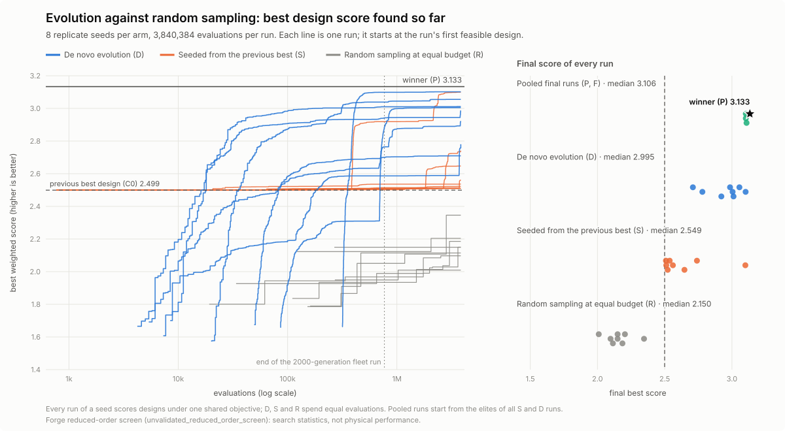
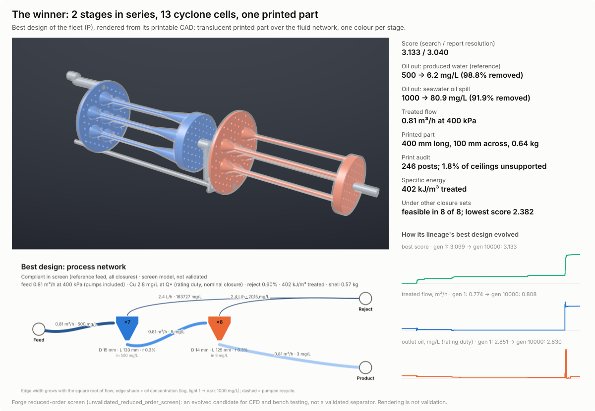

# joil

joil evolves 3D-printable deoiling cartridges: hydrocyclone networks that take oil out of produced water and out of seawater after a spill. Designs are bred in software, scored by reduced-order physics, held to a printer's build volume and exported as watertight CAD. A claims audit fails the build when a number in these documents does not trace to a committed receipt. Nothing has been printed or tested in water yet, so every performance number below is a screen result, not a measurement.

The repository holds two search lanes, and they give different answers:

- **[Forge lane](docs/forge/README.md)** (open-ended process-network genome, its own reduced-order screen). In a preregistered fleet run over `8` seeds, island evolution beat equal-budget random sampling of the same generator in every seed, at `768384` and again at `3840384` evaluations per run (one-sided sign test `p = 0.0039` each). Three final runs bred from all sixteen extended archives could not beat the fleet run's own pooled run continued to `10000` generations, which is the winner in Figure 2: two cyclone stages with `13` cells in one `400` mm printed part that, at report resolution, takes produced water from `500` to `6.2` mg/L and seawater-spill water from `1000` to `80.9` mg/L while treating `0.81` m³/h.
- **Original lane** (bounded liner genome, `F1` screen, OpenFOAM carrier CFD). On repaired code, evolution does not beat uniform random search on the screen's best score, and the CFD shells show no pressure-drop advantage over a `CT-35` baseline built by the same pipeline (Figure 3).

The [WHITEPAPER](docs/WHITEPAPER.md) gives the full account and [`docs/RESULTS.md`](docs/RESULTS.md) the tables.


*Figure 1 (Forge lane, screen only). Left: best weighted score found so far against evaluations (log scale) for every run of the `8` preregistered seeds, de novo evolution (`D`), evolution seeded from the previous best design (`S`) and random sampling of the same generator (`R`), each spending `3840384` evaluations; lines pass exactly through the points where a run's best changed, and the dotted line marks the end of the `2000`-generation fleet run. Right: the final score of every run, with the winner starred. Sources: [`docs/results/forge-v2-fleet-ext-summary-v1.json`](docs/results/forge-v2-fleet-ext-summary-v1.json), [`docs/results/forge-v2-fleet-ext-continuation-v1.json`](docs/results/forge-v2-fleet-ext-continuation-v1.json).*


*Figure 2 (Forge lane, screen only). The winner rendered from its printable CAD, its process network, its report-resolution numbers and how its lineage evolved. Its search score is `3.133`; at report resolution it scores `3.040`, below its `2000`-generation ancestor (`3.100`), and above that ancestor under each of eight further closure sets. Rendering is not validation. Source: [`docs/results/forge-v2-fleet-ext-winner-v1.json`](docs/results/forge-v2-fleet-ext-winner-v1.json).*


*Figure 3 (original lane, `F1` screen, sandbox). Best screen `KPI_score` per generation across `10` seeds on repaired operators: uniform random search (`B1`) ends with the higher best score, and evolution (`B3`) leads only on population median. Panel C is a gene-label schematic, not compiled geometry; Panel D repeats archived carrier CFD of earlier designs, which shows no difference from the same-pipeline `CT-35` control (WHITEPAPER §4.6). Source: [`docs/results/wave4-evolution-proof-v1.json`](docs/results/wave4-evolution-proof-v1.json).*

## Status

**Claim status** (generated from [`docs/STATUS.json`](docs/STATUS.json), which `tools/gen_status.py` derives from the evidence registry; the claims audit fails if this table is stale):

<!-- BEGIN GENERATED STATUS: python3 tools/claims_audit.py --write-readme-status (source docs/STATUS.json) -->
Phase: `software_truth_repair_scientific_claim_inventory_incomplete`.

| Claim | State | Missing evidence |
|---|---|---|
| Campaign admission | `sandbox_only` | unresolved pressure/energy/absolute-pressure limits and continuous duty band; unqualified oil transport and independent validation; unresolved installation and material/process requirements; current tail samples insufficient for physical p95 claims |
| `qualified_baseline` | `incomplete` (flag `false`) | `baseline-numerics`, `baseline-oil-grade`, `baseline-validation` |
| `structural_qualification` | `incomplete` (flag `false`) | `solid-fea`, `load-transfer`, `material-process-validation` |
| `physical_validation` | `incomplete` (flag `false`) | `as-built-metrology`, `paired-independent-physical-comparator` |
| `oil_grade_evaluated` | `incomplete` (flag `false`) | `full-residence-oil-inventory`, `size-resolved-grade` |
| `qualified_fitness` | `null` (no qualified value) | - |
| `qualified_capacity_gain` | `null` (no qualified value) | - |
| `evidence_identity_observation_and_claim_kernel` | `software_contract_verified` | - |
| `sandbox_campaign_contract_and_generated_status` | `software_contract_verified` | - |
| `rust_python_observation_schema_parity` | `software_contract_verified` | - |
| `surrogate_abstention_and_independent_admission_software` | `software_contract_verified` | - |
<!-- END GENERATED STATUS -->

## Install

Rust (stable, with `cargo`), Python 3 with `numpy` and `matplotlib` for the audit and figure tools, and Node.js `>=22.12.0` for the explorer app (`apps/explorer`). From the repository root:

```bash
python3 -m venv .private/venv && . .private/venv/bin/activate
python3 -m pip install numpy matplotlib
```

Exact CAD export (STEP, STL and glTF of the original lane) additionally needs Python 3.12 and [`requirements-cad.txt`](requirements-cad.txt); run it with `python3 tools/check.py --cad`.

## Quick start

Every command writes only to ignored paths (`runs/`, `artifacts/`, `.private/`).

```bash
cargo test --workspace --locked      # Rust tests
python3 tools/claims_audit.py        # every number in these documents traces to a receipt
just required                        # the full local gate that CI runs

# Forge lane: evolve, continue exactly where it stopped, then the report and CAD
just forge-evolve runs/forge/demo 300
just forge-resume runs/forge/demo 600
just forge-report runs/forge/demo
```

The Forge commands, the fleet run and how to reproduce it are in the [Forge README](docs/forge/README.md); local check commands and their time budgets are in [`docs/testing.md`](docs/testing.md).

## Read more

- [Forge lane](docs/forge/README.md) and its [physics](docs/forge/SCIENCE.md): the process-network genome, scoring, printable CAD, the fleet run and its extension
- [WHITEPAPER](docs/WHITEPAPER.md): methods, results, corrections and limitations of both lanes
- [Results](docs/RESULTS.md): result tables, figure plates and evidence tiers
- [Design language](docs/GENOME.md) · [Physics and validation contract](docs/SCIENCE.md) · [Evidence kernel](docs/EVIDENCE.md) · [Process networks](docs/design/PROCESS_NETWORKS.md)
- [Review synthesis](docs/reviews/2026-10-15-SYNTHESIS.md) · [Master plan](docs/MASTER_PLAN.md)

No project software license has been selected yet; dependency licenses remain their own. Supplied raw material and installation details stay in ignored private storage.
