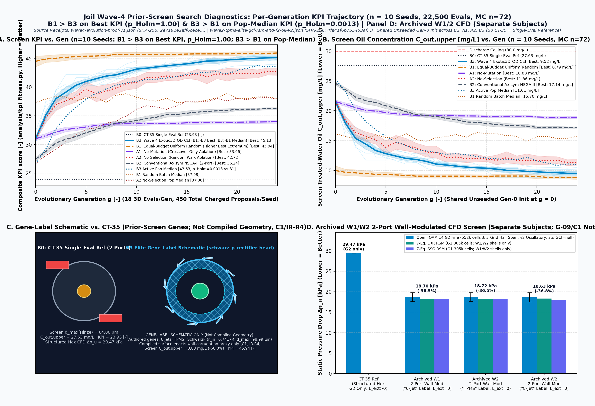

# joil

Evidence-driven evolutionary design of deoiling hydrocyclone cartridges.

joil searches for 3D-printable internal geometries for deoiling hydrocyclone liners. The goal is more compliant treated water per liner at a fixed pressure budget and reject fraction than `CT-35`, a research baseline reconstructed from the Colman–Thew patent example, without rewarding simulation errors. The pipeline combines a bounded design genome, a reduced-order screen, an evolutionary search, OpenFOAM carrier CFD on compiled surfaces, and a claims audit that fails when a number in these documents does not trace to a committed receipt. So far the answer is negative, and the documents say so: on the repaired code, evolution does not beat uniform random search on the screen's best score; the CFD shells show no pressure-drop advantage over `CT-35` built by the same pipeline; and nothing has been tested physically. The [WHITEPAPER](docs/WHITEPAPER.md) gives the full account, and [`docs/RESULTS.md`](docs/RESULTS.md) holds the result tables, figure plates and evidence tiers.


*Figure 0 (Wave-4, `F1` screen, sandbox): per-generation screen `KPI_score` across `10` seeds on repaired operators, with `72` Monte Carlo samples per candidate. Panels A and B: uniform random search (`B1`) ends with the higher best score, and `B3` leads only on population median. Panel C is a gene-label schematic, not compiled geometry; its labels are read from the receipt (`CT-35` Hinze diameter `64.0 µm`). Panel D repeats archived Wave-1/2 carrier CFD of different subjects ([`docs/results/wave2-tpms-elite-gci-rsm-and-f2-oil-v2.json`](docs/results/wave2-tpms-elite-gci-rsm-and-f2-oil-v2.json)), not Wave-4 designs, and its percentages compare with the different-pipeline `CT-35` case; against the same-pipeline control there is no detectable difference (WHITEPAPER §4.6). Source: [`docs/results/wave4-evolution-proof-v1.json`](docs/results/wave4-evolution-proof-v1.json); figure `SHA-256: fab2f5f59ab5dc75cb90416dc24aaa2beafab4dee1a97888c6b783bdeb9602b0`. The pre-repair Wave-3 hero is listed with the figure plates in [`docs/RESULTS.md`](docs/RESULTS.md). Only `A1`, `A2` and `B3` start from the same generation 0; `B2` starts from conventionalized copies of those programs and `B1` from random samples. The dashed line in Panel B is an authored research-screen threshold, not a permit limit.*

## Status

**Claim status** (generated from [`docs/STATUS.json`](docs/STATUS.json), which `tools/gen_status.py` derives from the evidence registry; the claims audit fails if this table is stale):

<!-- BEGIN GENERATED STATUS: python3 tools/claims_audit.py --write-readme-status (source docs/STATUS.json) -->
Phase: `software_truth_repair_scientific_claim_inventory_incomplete`.

| Claim | State | Missing evidence |
|---|---|---|
| Campaign admission | `sandbox_only` | unresolved pressure/energy/absolute-pressure limits and continuous duty band; unqualified oil transport and independent validation; unresolved installation and material/process requirements; current tail samples insufficient for physical p95 claims |
| `qualified_baseline` | `incomplete` (flag `false`) | `baseline-numerics`, `baseline-oil-grade`, `baseline-validation` |
| `structural_qualification` | `incomplete` (flag `false`) | `solid-fea`, `load-transfer`, `material-process-validation` |
| `physical_validation` | `incomplete` (flag `false`) | `as-built-metrology`, `paired-independent-physical-comparator` |
| `oil_grade_evaluated` | `incomplete` (flag `false`) | `full-residence-oil-inventory`, `size-resolved-grade` |
| `qualified_fitness` | `null` (no qualified value) | - |
| `qualified_capacity_gain` | `null` (no qualified value) | - |
| `evidence_identity_observation_and_claim_kernel` | `software_contract_verified` | - |
| `sandbox_campaign_contract_and_generated_status` | `software_contract_verified` | - |
| `rust_python_observation_schema_parity` | `software_contract_verified` | - |
| `surrogate_abstention_and_independent_admission_software` | `software_contract_verified` | - |
<!-- END GENERATED STATUS -->

## Install

Requirements: Rust (stable, `cargo`), Python 3 with `numpy` and `matplotlib`, and Node.js `>=22.12.0` for the explorer (`apps/explorer/package.json`). Omit `rtk` / `rtk proxy` if `rtk` is not installed.

From the repository root, install the Python requirements in an isolated environment (use Python 3.12 if you also want exact CAD):

```bash
python3 -m venv .private/quickstart-python
. .private/quickstart-python/bin/activate
python3 -m pip install numpy matplotlib
```

Optional exact CAD, inside a project environment with **Python 3.12** (on macOS, `uv venv --python 3.12 .venv` can create it):

```bash
rtk proxy python3 -m venv .venv
rtk proxy .venv/bin/pip install -r requirements-cad.txt
rtk proxy python3 tools/check.py --cad
```

CAD outputs include canonical mm STEP, mm and metre STL previews, metre glTF, terminal patch definitions and an audit report. Each check run uses a fresh output directory. Labelled conformal CFD tessellation is a later acceptance gate. See the report before using geometry downstream; scaling STEP coordinates without changing declared units is not a unit conversion.

## Quick start

**1. Check the repository.** Every command below writes only to ignored paths. Runtime varies with available cores; individual checks can take over a minute, and `cargo test --workspace` and `tools/check.py` take several minutes on a fresh clone. Workplan item DOC-05 runs this list from a clean checkout; the log is kept in ignored `.private/checks/`.

```bash
rtk cargo test --workspace --locked
rtk proxy cargo test -p joil-core --test regression closed_catalog_validity_11family_sampling -- --nocapture --exact
rtk proxy cargo test -p joil-core --test regression operator_chain_validity_20step_11family -- --nocapture --exact
rtk cargo run --locked -p joil-cli -- baseline
rtk proxy python3 analysis/kpi_fitness.py --wave3-results docs/results/wave3-evolution-proof-v1.json
rtk proxy python3 tools/run_elite_3grid_gci_and_rsm.py --interpret-existing
rtk proxy python3 -m unittest discover -s tests -v
rtk proxy python3 tools/check_public.py
rtk proxy python3 tools/claims_audit.py
rtk proxy sh -c 'cd apps/explorer && npm ci && npm run build'
rtk proxy python3 tools/check.py
```

`tools/run_elite_3grid_gci_and_rsm.py --interpret-existing` prints each committed elite GCI dossier's recorded historical gate value next to its corrected admission. The gate now reads only the frozen preregistration block, applies no improvement threshold, and admits only a resolved difference from a same-pipeline `CT-35` control with bound pipeline, grid-ladder, subject and solver identities. No committed dossier records those identities, so every one is `not_admitted` and `--verify-existing` exits nonzero. The historical `PASS ... certified` line came from a single-point analysis against the different-pipeline `CT-35` case. It is not a current claim: see WHITEPAPER correction C2 and §4.6.

**2. Re-run a screen study (optional, slow).** Pass `--out` into the ignored `artifacts/` directory, or omit it: CLI output defaults are unique paths under the ignored `runs/` directory, and every command refuses an existing output path, so the committed, hash-bound receipts in `docs/results/` are never overwritten. On repaired code the regenerated numbers differ from those historical receipts. Pass `--mc 72`: the p05/p95 objectives need `72` Monte Carlo samples for a distribution-free bound, and at the default of `12` they are reported insufficient, so no candidate is ranked and every hypervolume is zero ([TR fresh-clone check](docs/reviews/2026-10-16-TR-readme-freshclone.md)).

```bash
RAYON_NUM_THREADS=4 rtk cargo run --release --locked -p joil-cli -- wave2-benchmark --seeds 20261101,20261102,20261103,20261104,20261105 --mc 72 --out artifacts/wave2-rerun.json
```

Known limitations of re-runs on the current code:

- `wave3-proof` runs on the current code and wrote the Wave-4 receipt. Its default output is a unique path under `runs/`; it never replaces the historical Wave-3 receipt.
- `export-3d-preview` reads ignored campaign files under `runs/`, so it cannot run from a fresh checkout.
- `tools/generate_wave3_proof_figures.py` rewrites the committed, hash-bound figures, so run it only when regenerating figures together with a new receipt.

## Read more

- [Forge lane](docs/forge/README.md): a separate, self-contained search lane whose genome is an open-ended process network (series stages, numbered-up cells, reject scavengers, pumped recycles, coalescer beds and free-form walls) scored by genome-blind reduced-order physics, with exact resume, seeding from the last best design, watertight STL and GLB output and a rendered run report; its numbers are unvalidated screen outputs ([forge science](docs/forge/SCIENCE.md))
- [Chemical engineering process networks](docs/design/PROCESS_NETWORKS.md): executable synthetic series, parallel and recycle accounting, genuine swept-channel geometry, and the remaining integration steps
- [WHITEPAPER](docs/WHITEPAPER.md): methods, results, corrections and limitations
- [Results and evidence detail](docs/RESULTS.md): Wave-4 and Wave-3 tables, figure plates, evidence tiers
- [Design language](docs/GENOME.md) · [Physics and validation contract](docs/SCIENCE.md) · [Evidence kernel](docs/EVIDENCE.md)
- [Review synthesis](docs/reviews/2026-10-15-SYNTHESIS.md) · [Final PR review](docs/reviews/2026-10-16-PR3-FINAL-REVIEW.md) · [Workplan](docs/WORKPLAN-2026-10-15.md) · [Master plan](docs/MASTER_PLAN.md)

No jarambit code or shared environment is modified or required at runtime. Raw supplied material and installation details stay in ignored private storage. No project software license has been selected yet; dependency licenses remain their own.
