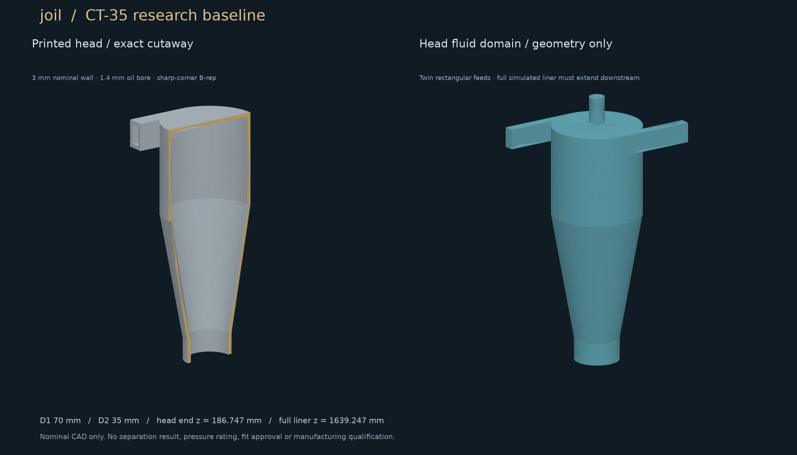

# joil

Evidence-driven evolutionary design of deoiling hydrocyclone cartridges.

Goal: more compliant treated water per liner at a fixed pressure budget and reject fraction, with performance established through numerical verification and paired physical tests. Explore unconventional internal geometry without rewarding simulation errors.

**Current status: planning and executable foundation. No CFD result, separation gain, pressure rating, sour-service qualification or manufactured winner is claimed.**

- [Master implementation plan](docs/MASTER_PLAN.md)
- [Physics, scoring and validation contract](docs/SCIENCE.md)
- [Representation and CAD contract](docs/GENOME.md)
- [Source review and corrections](docs/SOURCE_REVIEW.md)
- [Primary references](docs/REFERENCES.md)
- [Work packets](docs/WORK_PACKETS.json) · [Status](docs/STATUS.json)
- [Compute and installation runbook](docs/COMPUTE.md)



The research baseline is CT-35: the Colman–Thew patent example scaled to D2 = 35 mm, with explicit reconstruction assumptions. It is not an exact commercial liner or a validated experimental apparatus. Geometry dimensions are in mm; solver adapters must convert to SI explicitly.

```bash
rtk cargo test --workspace --locked
rtk cargo run -p joil-cli -- baseline
rtk proxy python3 -m unittest discover -s tests -v
rtk proxy python3 tools/check_public.py
rtk proxy sh -c 'cd apps/explorer && npm ci && npm run build'
```

Optional exact CAD, inside a project environment with **Python 3.12** (on macOS, `uv venv --python 3.12 .venv` can create it):

```bash
rtk proxy python3 -m venv .venv
rtk proxy .venv/bin/pip install -r requirements-cad.txt
rtk proxy python3 tools/check.py --cad
```

CAD outputs include canonical mm STEP, mm and metre STL previews, metre glTF, terminal patch definitions and an audit report. Each check run uses a fresh output directory. Labelled conformal CFD tessellation is a later acceptance gate. See the report before using geometry downstream; scaling STEP coordinates without changing declared units is not a unit conversion.

Stack: Rust numerical contracts and future search/control; Python/Open CASCADE CAD and scientific tools; OpenFOAM CPU/MPI reference planned; Vite/TypeScript/React explorer. Blender assets will carry geometry and field provenance separately.

No jarambit code or shared environment is modified or required at runtime. Raw supplied material and installation details stay in ignored private storage. No project software license has been selected yet; dependency licenses remain their own.
