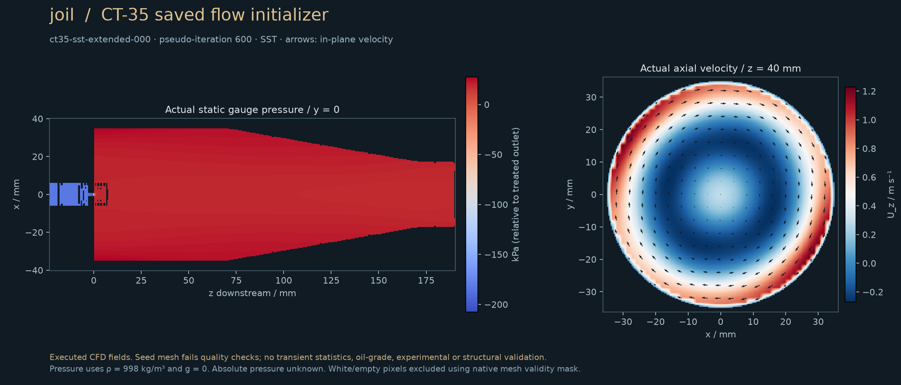
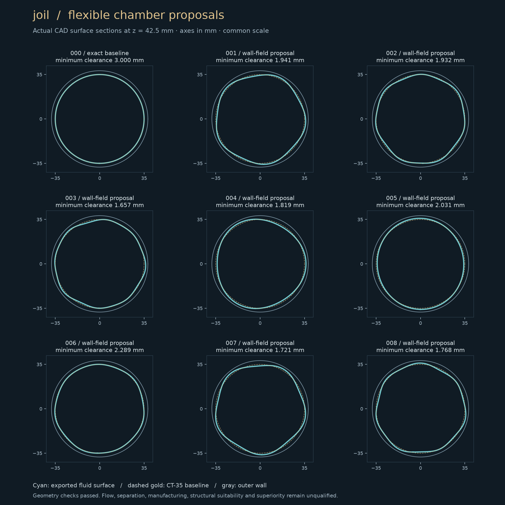

# First executed baseline hydraulics

The first CT-35 full-liner **F1 steady SST initializer** has run. This is useful diagnostic evidence, not a qualified separator baseline. The immutable public observation summary is [baseline-hydraulics-v1.json](results/baseline-hydraulics-v1.json); its raw fields, streams, solver logs and exact input manifests remain in ignored project storage on xbabe2.

At `runs/ct35-sst-extended-000`, saved pseudo-iteration 600:

| Measured quantity | Value |
|---|---:|
| Feed | 4.000 m³/h |
| Treated outlet | 3.91993 m³/h |
| Reject fraction | 1.98596% |
| Target reject | 2.000 ± 0.020% |
| Inlet-to-treated static pressure drop | 29.468 kPa |
| PDR, using the numerical outlet taps | 7.1083 |
| Device mechanical loss | 36.705 W / 33.710 kJ per treated m³ |
| Full numerical-domain mechanical loss | 37.026 W / 34.004 kJ per treated m³ |
| Water flux closure error | 0.015843% of feed |
| External outlet reverse flow | 0 at both outlets in this saved state |
| Oil capture / treated oil concentration | **Unknown** |
| Qualified fitness / capacity gain | **Undefined** |

The numerical reject pressure is −180 kPa relative to the treated outlet. Absolute pressure is unknown. The result does not establish that the actual pressure environment avoids cavitation. PDR exceeds the frozen **draft** 1.4–2.5 range; do not change the requirement or substitute an invented pressure curve to make this result pass.

The first two short-domain runs had substantial external reject backflow, despite closing net water flow. They cannot support a naive two-inlet oil-capture interpretation. A declared 120 mm numerical pipe extension moved that external boundary downstream without changing the baseline genotype or any original mesh point. The original 180 outlet polygons were recovered exactly as an internal measurement set. Recirculation still crosses this internal plane; particles crossing it must not be prematurely counted as permanently captured. Device and full-domain mechanical integrals are reported separately. Extension-length independence has **not** been demonstrated. The three public points use different backpressures and initialization histories; their differences cannot isolate an extension effect quantitatively.

## Evidence and limitations

The pinned CPU image runs OpenFOAM Foundation 14 build `14-a4867fc914c1`, double precision. The successful extended solve took 621.45 s on four allocated cores, including container/MPI overhead. It is 600 **pseudo-iterations**, not 600 seconds of physical flow. No transient confidence interval, mesh-convergence estimate or validated oil-grade curve exists.

The 302,460-cell seed mesh has positive volumes and adequate pilot port/volume checks, but fails the all-geometry check with 2,139 face-plane concave cells. Its sampled bore area is 1.90475% below the analytic 1.4 mm bore. The extended mesh has 313,260 cells and inherits those limitations. Exact-STEP tetrahedral alternatives were also rejected; the latest 489,196-cell Delaunay/inlet-refinement challenge fails determinant, interpolation-weight and volume-ratio checks. No mesh thresholds were relaxed. There are no accepted boundary-layer/y+ or grid-family results.

The attempted SSG initializer diverged and terminated with an MPI floating-point exception. Its failed evidence is retained and excluded from every oil run and score. SST supplies a finite initializer, not a replacement qualification for the planned transient Reynolds-stress carrier.

Native elementary tests passed for pressure-driven channel flow at 32 and 64 cross-channel cells (relative velocity L2 errors 0.13372% and 0.03343%), and 10 µm light-drop rise/added-mass response at two timesteps. These tests establish those elementary cases only. Rotation, turbulent dispersion, breakup/coalescence, actual fluid/DSD inputs, independent water/oil experiments, manufacturing and structural suitability remain open. See [the native receipts](receipts/native-elementary-20261015.json).

## Fitness and design exploration

The fixed-duty exploratory vector is `[adverse treated-oil concentration, mechanical loss per treated volume]`; it stays `null` when oil evidence is absent. The qualified comparator remains constrained Pareto optimization of common compliant treated capacity, energy and robustness under the frozen requirements. A single operating point cannot establish compliant capacity, and an infeasible or unknown baseline cannot supply a gain denominator.

Eight asymmetric/twisted chamber-wall proposals plus the exact zero-mutation baseline compiled successfully. Each has exact B-rep/STEP and outward closed metre STL/GLB exports, a minimum-clearance check, and a frozen collar/tail comparison. These are geometry proposals, with no performance ranking. The source archive is [proposals-v1.json](../experiments/search/proposals-v1.json); actual CAD sections are shown below. The amplitudes deliberately stay within the first family’s 1.8 mm radial budget. More radical inlet/cone/skimmer families are being reviewed separately; their availability does not confer physics qualification.

## Bounded particle capability probes

Gemini ran two 0.01 s frozen-field probes at timesteps of 50 µs and 25 µs. In each size class, 32 particles were placed in the chamber and near the two outlet pipes; 8 escaped through the treated terminal and 24 remained. Revised extraction closes the number inventory exactly. The first extractor missed the ordinary OpenFOAM `labelField` syntax and reported 24 missing particles; that failed result is preserved. These are mixed-placement software/mechanics probes, **not inlet oil-grade cohorts**, so no concentration or separator fitness follows. The 1 µm neutral-density reference is not an exact zero-inertia tracer. Measured solver times were 29.94 s and 50.37 s; linear throughput extrapolation is not a qualified baseline-run ETA. See [the reviewed handoff and limitations](receipts/capability-probes-20261015.json).

## Next dependency

Finish a geometry-faithful, acceptable mesh family; demonstrate outlet-domain sensitivity at matched conditions; stabilize and verify transient carrier statistics; verify native tracer and light-drop mechanics; then run source-bound full-liner cohorts with complete terminal/wall/remaining/lost accounting and size/timestep/parcel sensitivity. Gemini owns the separate oil/rotation and exotic-program files under the live `COORD.md` agreement. Until those results are reviewed, no oil-quality fitness or performance-selected evolutionary campaign is admitted.

This milestone requires no sudo packages or GPU allocation. The measured F1 timing cannot predict F2/LES/particle throughput; obtain a bounded transport pilot and physical-time carrier benchmark before quoting those ETAs.
