# Compositional 3D Evolutionary Design and Multi-Fidelity Navier–Stokes Verification of Additively Manufacturable Deoiling Hydrocyclone Heads

**Authors:** Joil Research & Engineering Collaboration (Gemini & Codex); review-response revision by the DOC lane (Claude)  
**Repository:** `neverhuman/joil`  
**Date:** 15 October 2026; revised 16 October 2026 after external review (workplan item DOC-03)  
**Epistemic Claim State:** `F1_PRIOR_LADEN_SCREEN_AND_F2_CARRIER_CFD_ON_COMPILED_SHELLS_NOT_F2_OIL_NOT_F4_VALIDATED` (`qualified_fitness: null`, `qualified_capacity_gain: null`, `physical_validation: false`)

---

## Read this first: review response and corrected claims (16 October 2026)

Six external reviews (S1–S6, 15 October 2026) audited this repository. They are stored verbatim with checksums in
[`docs/review-inputs/2026-10-15/`](review-inputs/2026-10-15/INDEX.md). Each finding was checked against the code
and traced to a workplan item in [`docs/reviews/2026-10-15-SYNTHESIS.md`](reviews/2026-10-15-SYNTHESIS.md).

The reviews agree that JOIL is a curated parameter optimizer with a strong numerical toolchain, not yet an
open-ended invention engine, and that several of its defects let it fool itself. **This section overrides any
conflicting sentence elsewhere in this paper.** The body has been edited to match, but every earlier number is kept
where a receipt supports it.

What the evidence in this paper supports, by tier:

- **F2 carrier CFD on the compiled shell.** OpenFOAM 14 steady carrier solutions, three-grid refinement and
  `LRR`/`SSG` cross-checks for `CT-35` and three candidate surfaces. These are numerical results for the surfaces
  actually meshed. They are not evidence about named mechanisms (jets, vanes, lattices) that those surfaces do not
  contain.
- **F1 prior-laden screen.** Every $C_{\text{out}}$, grade-efficiency, $d_{50}$, `KPI_score`, held-out-duty and
  search-arm comparison comes from a reduced-order evaluator. Its inputs are mechanism descriptors computed from the
  gene values with hand-chosen coefficients ([`docs/GENOME.md`](GENOME.md) §5). These numbers show how well each
  search arm optimizes that screen. They are not physical separation performance.
- **Software contract.** The `220 / 220` genome and operator audits, `LOFO-CV`, and the `P05` droplet oracles are
  internal-consistency and software tests.
- **Not executed.** `F2-Oil` full-residence closure, `F3`, `F4`. Physical validation remains false.

| # | As previously written | What the code and evidence show | Fix owner and status (16 Oct) |
|---|---|---|---|
| C1 | 6-jet and 8-jet manifolds, a "3-vane swirl conditioner", internal helical guide ribbons and peripheral graded TPMS coalescer shells are present in the simulated geometry | In every executed CFD run, the OpenFOAM surface (`MultiPatchSurface`) had `CT-35`'s two inlet ducts, and branch, ramp and skimmer genes were not represented. Since IR-R1 new cases write the split ducts, ramp and skimmer. Ribbon and TPMS genes are wall-radius perturbations. `tpms_insert.radial_inner_fraction` changes no geometry ([`docs/GENOME.md`](GENOME.md) §2). Mechanism names are gene-derived labels. | IR-02, IR-05 and IR-R1 merged (`f49f67e`; DOC-07 review verified the split by slicing); no executed run has been redone |
| C2 | CFD pressure-drop reductions (`-33.74%` to `-38.51%`) are design gains | The `CT-35` comparator was meshed from the CAD surface with a `0.12 m` outlet extension. The elites were meshed from the Rust ring surface with no extension. A same-pipeline `CT-35` control (INT-06, §4.6) gives `18.63 kPa` on `G2`, and the shells lie within its three-grid span. The reductions were the offset between the two pipelines, not a design gain. | resolved by INT-06 / G-09 (§4.6) |
| C3 | `15,970,490,852` coupled 3D GPU Lagrangian droplet trajectories integrated with FP64 `RK4` | `15,970,490,852` is the cumulative number of allocated GPU tensor cells. Each cell is one closed-form FP32 drift evaluation driven by gene-derived descriptors. Candidate $C_{\text{out}}$ and $d_{50}$ are closed-form and are not reduced from those cells. FP64 `RK4` CPU/GPU parity holds only for the ten-droplet rotation oracle. | IR-10 merged; counter rename still pending in code (DOC-07 review IR-R3) |
| C4 | The Wave-3 run is a "de-novo evolutionary proof" that evolution discovers better hydrocyclones | It is a **search-efficiency result on a prior-laden reduced screen**. The evaluator rewards TPMS, ribbon and branch genes through hand-chosen descriptor coefficients, so the search finding them is expected. Failed variations also silently returned `CT-35` and were not charged to the budget. The re-run on repaired operators with every proposal charged (Wave-4, §5.7) finds no best-score advantage for `B3` over uniform random search. | IR-07; TR-01–TR-04 merged; INT-04 re-run done (§5.7) |
| C5 | `P08` structural, modal and fatigue qualification | An analytic structural screen (Lamé, beam and scalar-overhang formulas), not FEA. Its load-transfer check is zero by construction. Its observed order uses Euclidean division. Its failures are not part of constrained dominance. | TR-07–TR-09 merged; TR-10 rename in progress; published structural numbers predate the fix |
| C6 | 10,000-resample bootstrap 95% confidence intervals | The published intervals came from a 2,000-resample percentile bootstrap. The preregistration specified 10,000. | TR: code runs 10,000 since `2f24c18`; published intervals not regenerated |
| C7 | Pareto hypervolume (`HV`) | The reported `HV` is the largest single box dominated by one front member plus an archive-size bonus. It is not the hypervolume of the front. | TR-11 merged (five-objective Pareto union `HV`); published `HV` values use the old definition |
| C8 | Arm `B1` is a Latin-hypercube ("Random-LHS") baseline | Independent uniform draws per field, not a Latin hypercube. | synthesis G-03 |
| C9 | Elites dominate on the five preregistered objectives | The executed objective vector [$C_{\text{out,p95}}$, $\Delta p_u$, $-E_{20,\text{p05}}$, entry shear, short-circuit fraction] differs from the preregistered one [$C_{\text{out,p95}}$, specific energy, $1-E_{20,\text{p05}}$, $d_{50,\text{p95}}$, $\Delta p_u$]. | EV-06 |
| C10 | `220 / 220` genome expressiveness and an operator random walk across `11` families | Closed-catalog validity: authored samples pass authored bounds. The ring mesh is closed by construction. Operator failures silently returned `CT-35` and counted as passes, so `220 / 220` is an upper bound. | TR-01, TR-02, TR-14 merged (tests renamed `closed_catalog_validity`, `operator_chain_validity`); published counts predate the fix |
| C11 | `11` canonical 3D topological families | Labels assigned from which genes are active (`classify_topology`), not measured topology. Several names in earlier revisions do not exist in code (synthesis DOC-F03). | IR-06 merged: `PhenotypeTaxon` derived from the compiled `IrCompiledMesh` |
| C12 | `LOFO-CV` out-of-distribution surrogate qualification | Leave-one-authored-label-out on gene-derived features. Not an out-of-distribution test. | EV-08, EV-09 merged (abstention on missing features; independent labels required); published `LOFO-CV` numbers predate the fix |
| C13 | Feasibility thresholds come from requirements | `RS-joil-research-v1` is `draft_no_campaign_admission`. The search's pressure cap and PDR floor are code constants. | TR-16, EV-10 merged (thresholds read from the requirement file; sandbox-only admission); EV-06 physical admission blocked on external inputs |
| C14 | `F0` measured zero trapped cavities and zero frozen-tail difference | Both were assigned constants, not measurements. | IR-08 merged: voxel flood fill and mesh measurement on `IrCompiledMesh`; published numbers predate it |
| C15 | Observed order `p_obs = 4.00` for $\Delta p_u$ | `4.00` is the clamp bound in the GCI script. With oscillatory $R < 0$ a standard GCI is not valid ([`docs/SCIENCE.md`](SCIENCE.md)); only the three-grid span is used. | TR-07, INT-05 merged: v2 dossiers classify every sequence `Oscillatory` (§4.2) |

---

## Abstract

Deoiling hydrocyclone liners in produced-water treatment still follow the 1980s Colman–Thew (`CT-35`) twin-tangential-inlet layout. Our reconstructed `CT-35` baseline needs $\Delta p_u \approx 29.5\text{ kPa}$ at $Q = 4.0\text{ m}^3/\text{h}$. Additive manufacturing (LPBF in Ti-6Al-4V ELI or Inconel 625) could make far more complex internal geometry printable within the unchanged `DN35` pressure-vessel envelope. **Joil** is a pipeline for searching such geometry and testing candidates numerically.

This paper reports five executed pieces of work and the tier of evidence each supports. Read the correction table above before quoting any number.

1. **A bounded macro genome (`DesignProgram`; `F0` partially implemented).** A fixed Rust struct with seven optional layers (ramp, split, chamber modes, cone profile, skimmer, ribbon, TPMS); it is not a graph genome ([`docs/GENOME.md`](GENOME.md)). It compiles to a watertight ring surface of $R(\theta, z)$ and to a five-patch OpenFOAM surface (`wall`, `inlet1`, `inlet2`, `overflow`, `underflow`). In every executed CFD run that surface had `CT-35`'s two inlet ducts (since IR-R1 it contains the split ducts, ramp and skimmer), and it represents ribbon and TPMS genes only as wall-radius perturbations. Eleven labels are assigned from gene activation. The `220 / 220` audit (`20` per label; `0 / 30` out-of-bounds controls pass) is closed-catalog validity, and an upper bound (correction C10).
2. **A three-node Rust + CUDA search campaign (`F1` prior-laden screen).** A multi-island constrained NSGA-II + 4D MAP-Elites campaign on `xbabe1` (RTX 4090), `xbabe2` and `xbabe3` (RTX 3090) used up to `85.50%` of GPU VRAM. It made **`119,235`** screen evaluations with `2,857,464` Monte Carlo realizations, and allocated `15,970,490,852` GPU tensor cells (a throughput figure, not integrated trajectories; correction C3). It populated `191` MAP-Elites cells keyed by authored labels and gene-derived descriptor bins. `275` rank-0 members dominate `baseline-ct35` on the five *executed* screen objectives, which differ from the preregistered ones (correction C9).
3. **OpenFOAM 14 carrier CFD on compiled shells (`F2-carrier`, numerical only).** The surface compiled from the elite genome `xbabe2-gen043-isl10-ind030` (label `trifurcated-6jet-vortex-head`; the simulated surface has two inlets, correction C1) was solved in OpenFOAM Foundation 14 on three grids (`G0`: `139,981`, `G1`: `305,522`, `G2`: `552,513` cells), with `LRR` and `SSG` Reynolds-stress cross-checks against `kOmegaSST`. At $Q = 4.000\text{ m}^3/\text{h}$ and $r = 1.968\%\text{–}1.996\%$:
   - its static pressure drop is `18.12–19.53 kPa` across grids and closures, and its hydraulic energy loss `21.54–23.12 kJ/m³`;
   - `LRR` and `SSG` agree within `0.26%` (`46.5 Pa`) on $\Delta p_u$;
   - a `CT-35` case compiled, meshed and solved by the same pipeline gives `18.63 kPa` on `G2` (§4.6, [`docs/results/wave4-gci-v1.json`](results/wave4-gci-v1.json)), so the shell shows no detectable pressure-drop change. The `-33.74%` to `-38.51%` reductions reported earlier against the recorded `CT-35` case (`29.47 kPa`; [`docs/results/exotic-vs-baseline-cfd-benchmark-v1.json`](results/exotic-vs-baseline-cfd-benchmark-v1.json), [`docs/results/elite-3grid-gci-and-rsm-verification-v1.json`](results/elite-3grid-gci-and-rsm-verification-v1.json)) were the offset between two pipelines (correction C2).
   
   The first Wave-4 design simulated with its split inlet ducts was not grid-converged (§4.6).
4. **A preregistered 10-seed, four-arm comparison on the same screen (`F1`; results in [`docs/results/wave2-multiseed-ablation-and-holdout-v1.json`](results/wave2-multiseed-ablation-and-holdout-v1.json)).** Under [`experiments/wave2-preregistration-v1.json`](../experiments/wave2-preregistration-v1.json) (`SHA-256: 405e27d9f4730d1ee730cf66372c2993c43bb7de2e0be1c43b903da4dd18b0e4`; $N = 10$ seeds `20261101..20261110`; `5,400` evaluations), arm `B3` (`Exotic3D-QD-CEI`) reaches mean screen $C_{\text{out,p95}} = 7.21\text{ mg/L}$ (`95% CI: [7.03, 7.42] mg/L`). The comparators reach `9.03 mg/L` for `B1` (uniform random, not LHS; `95% CI [8.72, 9.35] mg/L`) and `18.99 mg/L` for `B2` (`Conventional-Axisym-NSGA2`, `95% CI [18.60, 19.37] mg/L`). The tests give Mann–Whitney $U = 100.0$, $p_{\text{Holm}} = 0.000314$ and Cliff's $\delta = 1.000$; the intervals come from a 2,000-resample percentile bootstrap (correction C6).
   - The reported `HV` values (`0.2743`, `0.2506`, `0.1509`) are not Pareto hypervolume (correction C7).
   - On screen $\Delta p_u$ the gap to `B1` is only `-0.59 kPa` (`28.17` vs `28.76 kPa`), and `B1` fills more archive cells (`104.6` vs `69.3`).
   - Held-out duties `D1`–`D4` keep screen $C_{\text{out}} \in [6.08, 13.96]\text{ mg/L}$.
   
   Because the screen rewards the genes `B3` is built to activate, these results measure search behaviour on that screen, not physical separation.
5. **Wave-3 search-efficiency study on the reduced screen (`F1`; previously titled a "de-novo evolutionary proof", correction C4).** Source: [`docs/results/wave3-evolution-proof-v1.json`](results/wave3-evolution-proof-v1.json) (`SHA-256: 9a21229bd1c6762e21970a22c1bf2c9dd75e4a5540353f5b5bd20f6c4bb35168`). The run made `22,500` screen evaluations: `N = 10` seeds × `25` generations × `18` per generation = `450` per seed per arm. It optimized the composite `KPI_score` ([`analysis/kpi_fitness.py`](../analysis/kpi_fitness.py)) from a shared generation-0 population around `CT-35` (10-seed mean generation-0 best `KPI = 31.645679`; `CT-35` alone scores `26.486473`). `B3` reaches a 10-seed mean best `KPI_score` of `47.003792 ± 0.503020` (`95% CI [46.702993, 47.278324]`) and a population median of `45.956543`. The comparators (`16` Holm-corrected tests):
   - `B1` random search: best `46.289980`, $U = 84.0$, $p_{\text{Holm}} = 0.010165$, $\delta = +0.680$;
   - `B2` axisymmetric NSGA-II: best `37.572998`;
   - `A1` crossover only: best `35.369726`;
   - `A2` no selection: best `43.243541`.
   
   The result shows that selection and mutation optimize this screen better than the ablations do. It does not show that the activated features separate oil better: the screen's descriptors credit those features by construction, and failed variations were silently replaced by `CT-35` without being charged to the budget. The re-run on repaired operators with every proposal charged (Wave-4, §5.7, [`docs/results/wave4-evolution-proof-v1.json`](results/wave4-evolution-proof-v1.json)) reverses the comparison with random search: `B3` reaches a mean best `KPI_score` of `45.131872` and `B1` `45.936820` ($p_{\text{Holm}} = 1.0$ for `B3` > `B1`, Cliff's $\delta = -0.68$). `B3` still beats `B2`, `A1` and `A2`, and leads `B1` only on population median.

> [!IMPORTANT]
> **Epistemic Discipline (`docs/SCIENCE.md` & `AGENTS.md`)**: All results reported herein are computational artifacts. `F1` results come from a prior-laden reduced screen; `F2-carrier` results are numerical solutions for the compiled shells; several `F0` facts are assigned rather than measured (see the correction table above). In accordance with our scientific governance contract, `qualified_fitness`, `qualified_capacity_gain`, and `physical_validation` remain explicitly `null`/`false` until `F4` LPBF hardware fabrication, X-ray CT metrology (`CAD-09`), and the pre-registered 5-block blinded randomized A/B/A flow-loop trials (`P06`) are executed.

---

## 1. Physical Formulation & Colman–Thew (`CT-35`) Baseline Reconstruction

### 1.1 Governing Separation & Hydraulic Metrics (`docs/SCIENCE.md`)

Let $Q_i$ denote the total volumetric feed rate entering through the two terminal feed ports (`inlet1`, `inlet2`), $Q_o$ the oil-enriched overflow (reject) volumetric rate, and $Q_u = Q_i - Q_o$ the treated-water underflow volumetric rate. The volumetric reject split is:

$$r = \frac{Q_o}{Q_i}, \qquad Q_{\text{treated}} = Q_i (1 - r)$$

For a dilute oil-in-water dispersion characterized by an inlet oil mass-weighted droplet size distribution $w(d)$ ($\int_0^\infty w(d)\,\mathrm{d}d = 1$) at feed concentration $C_i\text{ [mg/L]}$ (`500 mg/L` research reference), let $E(d) \in [0, 1]$ denote the fraction of injected oil mass in diameter class $d$ captured at the overflow terminal. Total oil mass capture $E_{\text{oil}}$, reduced centrifugal separation efficiency $E_{\text{red}}(d)$, and compliant treated-water outlet concentration $C_u\text{ [mg/L]}$ are governed by the exact mass-balance identities:

$$E_{\text{oil}} = \int_0^\infty E(d)\,w(d)\,\mathrm{d}d, \qquad E_{\text{red}}(d) = \frac{E(d) - r}{1 - r}, \qquad C_u = C_i\,\frac{1 - E_{\text{oil}}}{1 - r} = C_i \int_0^\infty \bigl(1 - E_{\text{red}}(d)\bigr)\,w(d)\,\mathrm{d}d$$

Crucially, omitting the $(1 - r)$ denominator underestimates $C_u$, and a passive tracer ($E(d) = r$) yields $E_{\text{red}}(d) = 0$ and $C_u = C_i$ (zero separation). At $C_i = 500\text{ mg/L}$ and $r = 0.02$, achieving the research water-quality limit $C_u \le 30\text{ mg/L}$ requires $E_{\text{oil}} \ge 0.9412$, while the stretch limit $C_u \le 20\text{ mg/L}$ requires $E_{\text{oil}} \ge 0.9608$.

On the carrier side, let $p_{\text{in}}$, $p_o$, and $p_u$ denote the area-averaged static pressures on the inlet, overflow, and underflow patches. The static pressure drops, pressure-drop ratio ($\text{PDR}$), and boundary-integrated mechanical energy dissipation per unit compliant treated volume ($e_{\text{loss}}$) are:

$$\Delta p_u = p_{\text{in}} - p_u, \qquad \Delta p_o = p_{\text{in}} - p_o, \qquad \text{PDR} = \frac{\Delta p_o}{\Delta p_u}, \qquad e_{\text{loss}} = \frac{-\sum_{\partial\Omega} \int_{\partial\Omega_k} \left(p + \frac{1}{2}\rho |\mathbf{U}|^2\right) \mathbf{U}\cdot\mathbf{n}\,\mathrm{d}A}{Q_i (1 - r)}$$

### 1.2 Baseline `CT-35` Geometry & Resolution of Historical CAD/CFD Artifacts

The public research baseline ([`baselines/ct35/genome.json`](../baselines/ct35/genome.json), [`baselines/ct35/reference.json`](../baselines/ct35/reference.json)) reconstructs the 35 mm Colman–Thew deoiling hydrocyclone geometry (`DN35` class):
- **Swirl Chamber (`D1 -> D2`)**: Entry diameter $D_1 = 70.0\text{ mm}$ ($D_1 / D_2 = 2.0$), cylindrical length $L_1 = 70.0\text{ mm}$ ($L_1 / D_2 = 2.0$), reducing cone half-angle $\alpha/2 = 10.0^\circ$ ($\alpha = 20.0^\circ$, axial cone length $L_c = 99.25\text{ mm}$ to $z_{\text{cone,end}} = 169.25\text{ mm}$) to nominal diameter $D_2 = 35.0\text{ mm}$.
- **Twin Rectangular Tangential Inlets (`inlet1`, `inlet2`)**: $15.509\text{ mm} \times 7.754\text{ mm}$ ($A_{\text{each}} = 120.26\text{ mm}^2$ / `120.264094 mm²`, combined area $A_{\text{total}} = 240.53\text{ mm}^2$ / `240.528188 mm²`, aspect ratio `2.0`).
- **Fine Tapered Separation Section (`D2 -> D3`) & Tailpipe**: Fine conical taper length $L_2 = 770.0\text{ mm}$ ($L_2 / D_2 = 22.0$, $1.302^\circ$ full angle / $\beta/2 = 0.651^\circ$ half-angle) to $D_3 = 17.5\text{ mm}$ ($z_{\text{taper,end}} = 939.25\text{ mm}$), followed by a cylindrical tailpipe of length $L_3 = 700.0\text{ mm}$ ($L_3 / D_2 = 20.0$) at $D_3 = 17.5\text{ mm}$ reaching $z_{\text{end}} = 1,639.25\text{ mm}$ (`1639.2474 mm`).
- **Overflow Vortex Finder**: Orifice bore diameter $D_o = 1.40\text{ mm}$ ($D_o / D_2 = 0.04$, orifice length $l_{\text{orifice}} = 2.80\text{ mm}$) feeding a cylindrical reject plenum ($R_p = 6.0\text{ mm}$, $L_p = 20.0\text{ mm}$) terminating at $z = -20.0\text{ mm}$.

During `P01`/`P04` baseline verification ([`docs/BASELINE_RUN.md`](BASELINE_RUN.md), [`docs/results/baseline-hydraulics-v1.json`](results/baseline-hydraulics-v1.json)), two critical numerical/geometric defects in legacy setups were identified and resolved:
1. **Inward-Winding STL Normals (`cad/ct35/build.py`)**: Exported surface triangulations (`86,560` triangles) had inward-pointing surface normals, yielding negative signed enclosed volume (`-1,105,747.56 mm³`). Enforcing outward solid orientation corrected the signed STL volume to **`+1,105,747.56 mm³`** (`-0.005%` relative to analytic `1,105,802.52 mm³`).
2. **Underflow Swirl Recirculation & $120\text{ mm}$ (`0.12 m`) Outlet Extension (`runs/ct35-sst-extended-000`)**: Because strong swirl persists to the tailpipe exit ($z = 1,639.25\text{ mm}$), truncating the mesh at $z = 1.63925\text{ m}$ induces artificial outlet reverse flow (`5.18e-5 m³/s` overflow reverse flow in `ct35-sst-split-001`). Extending the downstream underflow outlet by $0.12\text{ m}$ (`120 mm`, `334,768` cells) reduced overflow reverse flow to **`0.0 m³/s`** (`underflow_reverse_flow_m3_s = 1.56e-4 m³/s`) and established the immutable OpenFOAM 14 baseline reference (`runs/ct35-sst-extended-000`, `SHA-256: 05c5c75a6164be45b3e24ffeb4b4ef0688081e46894bf865be1f5d3282aa3402`):
   - Feed flow: $Q_i = 4.000\text{ m}^3/\text{h}$, Reject split: $r = 1.986\%$ ($p_o/\rho = -180\text{ m}^2/\text{s}^2$)
   - Static inlet-to-underflow pressure drop: **$\Delta p_u = 29,468.22\text{ Pa}$** ($\text{PDR} = 7.108$)
   - Device-boundary specific hydraulic energy loss: **$e_{\text{loss}} = 33,709.55\text{ J/m}^3$** (`34,004.44 J/m³` across the extended domain)

---

## 2. Compositional 3D Parametric Design Language & Pre-CFD Engineering Gates

### 2.1 Four-Layer Identity Separation & 11 Canonical 3D Topological Families (`crates/joil-core/src/phenotype.rs`)

Joil keeps four representations per candidate. Only the first is content-hashed as a design identity; the scientific identity chain that binds them together is being built in workplan item EV-02:
1. **Genotype (`DesignProgram`, `crates/joil-core/src/program.rs`)**: A canonical JSON design program with inactive-gene canonicalization, strict unknown-key rejection, 4-decimal quantization and deterministic SHA-256 identity ([`docs/GENOME.md`](GENOME.md) §3).
2. **Watertight ring surface (`Phenotype3D`)**: Axial rings of the wall radius $R(\theta, z)$, closed by end caps (`2,976` to `6,928` triangles per candidate), with glTF 2.0 (`GLB`) export for inspection. The construction is closed for any finite positive $R$, so watertightness says nothing about internal features; split, ramp, skimmer, ribbon and TPMS volumes and clearances are computed arithmetically from gene values.
3. **Five-patch CFD surface (`MultiPatchSurface`, `crates/joil-core/src/phenotype.rs`, written by `crates/joil-core/src/cfd_case.rs`)**: Five named OpenFOAM STL solids (`wall`, `inlet1`, `inlet2`, `overflow`, `underflow`) with octree-safe phase alignment (`0.0031 rad`) and off-axis polar caps (`[0.11 mm, 0.13 mm]`) to avoid `snappyHexMesh` ray-edge grazing. The wall follows $R(\theta, z)$ (chamber modes, cone profile and the ribbon/TPMS wall perturbations); the inlets are always `CT-35`'s two ducts.
4. **Evaluation subject (`CfdCaseManifest`)**: Hashes of the surface, solver dictionaries and boundary conditions. The run-level manifests of the elite cases are copies of one case's manifest (synthesis DOC-F06), so per-run identity is not yet bound (EV-12).

Each candidate receives one of **11 labels** from `classify_topology()`, which reads which gene layers are active. The labels name the active genes; they are not measured topology (correction C11). The exact rules are in [`docs/GENOME.md`](GENOME.md) §4.

| Label (code) | Assigned when |
| :--- | :--- |
| `cylindrical-gyroid-coalescer` | TPMS basis `Gyroid` or `CylindricalGyroid` |
| `schwarz-p-rectifier-head` | TPMS basis `SchwarzP` or `Diamond` |
| `octa-branch-helical-manifold` | split enabled with `branches_per_port = 4` |
| `counter-fluted-recovery-vortex` | ribbon with at least three vanes and at least four skimmer flutes |
| `trifurcated-6jet-vortex-head` | split enabled with `branches_per_port = 3` |
| `hybrid-omni-exotic` | at least three of ramp, split, chamber modes, cone, skimmer active |
| `bifurcated-quad-manifold` | split enabled with `branches_per_port = 2` |
| `spiral-rifled-vortex-head` | chamber modes active |
| `contoured-s-cone-skimmer` | cone profile or skimmer active |
| `helical-pitched-ribbon` | inlet ramp only (no ribbon despite the name) |
| `baseline-ct35` | none of the five layers active (a ribbon-only design also lands here) |

An earlier revision of this section showed a seven-row table with names (`baseline-colman-thew`, `quad-spiral-manifold`, `helical-ribbon-core`, `s-cone-fluted-finder`, `double-vortex-skimmer`, `scalloped-parabolic-chamber`) and features (wrap angles, vane counts, flute counts) that do not exist in the code. It has been withdrawn (synthesis DOC-F03).

*Figure Plate 1 (`n = 7` Wave-1 archetype labels; rendered ring surfaces, not CFD geometry $\times 24$ LHS Monte Carlo realizations/family, `2,976–6,928` watertight triangles/mesh). Metrics plotted: true-scale 3D axial/radial B-rep profile $x, y, z\text{ [mm]}$, illustrative $10, 20, 40\ \mu\text{m}$ droplet paths drawn by the figure script (not simulated trajectories) `[mm]`, 95th-percentile treated-water oil concentration $C_{\text{out,p95}}\text{ [mg/L]}$ (`nominal + 95th-percentile MC interval`), and static pressure drop $\Delta p_u\text{ [kPa]}$. Source receipt `SHA-256`: `1bc32f98d38cd22525130843bf42034c0078146924b76148e06a4a02c9cff6b3` ([`docs/results/rust-evolution-qualification-v1.json`](results/rust-evolution-qualification-v1.json)); figure `SHA-256`: `76e7ce10a2c334575b5dedcea04b33d51f8959d38ef849560c477aa1cc5cd8b7`.*

### 2.2 Pre-CFD Screens (`F0` Red-Team & `P08` Analytic Structural Screen)

Two deterministic screens run on every candidate. A red-team failure adds a large constraint violation. The structural screen's result is stored but does not enter constrained dominance (correction C5; workplan TR-09). Both screens read gene-derived arithmetic, not an independently measured subject:
- **`F0` Geometric & LPBF Red-Team Gate (`crates/joil-core/src/redteam.rs`)**:
  - Checks closure of the ring surface (`0` open boundary edges, `0` non-manifold edges, positive signed volume). The ring construction is closed by construction, so this check cannot detect missing or broken internal features (the census still runs on that ring surface, `phenotype.rs` `build_fluid_mesh`). In the code that produced the published numbers `trapped_cavities` was assigned `0`, not measured (correction C14). Since IR-08 it is the voxel flood-fill count on `IrCompiledMesh` (`phenotype.rs`, `VoxelSdfObserver`); no published number has been regenerated with it.
  - Enforces minimum LPBF wall/vane thickness ($\ge 1.0\text{ mm}$), self-supporting build overhang ($\le 45^\circ$ from the vertical $+z$ build axis; `12.69°` on the promoted elite), minimum overflow/underflow throat clearance ($\ge 3.5\text{ mm}$), and zero abrupt backwards-facing steps (dead-zone recirculation screen).
- **`P08` Analytic Structural Screen, not FEA (`crates/joil-core/src/structure.rs`; type `AnalyticStructuralScreen` since TR-10; [`docs/results/rust-evolution-qualification-v1.json`](results/rust-evolution-qualification-v1.json))**:
  - Evaluates thick-wall Lamé hoop, radial, and axial Von Mises stress across 64 axial stations under burst/fatigue duty in LPBF Ti-6Al-4V ELI ($\sigma_y = 825\text{ MPa}$), requiring safety factor $\text{SF}_y \ge 2.50$ (`4.22` (`p08_max_von_mises_mpa = 195.70 MPa`) under an extreme `2.5 MPa` screening differential in [`docs/results/rust-evolution-qualification-v1.json`](results/rust-evolution-qualification-v1.json) and `5.857` (`28.896` on `baseline-ct35`) in [`docs/results/exotic-vs-baseline-cfd-benchmark-v1.json`](results/exotic-vs-baseline-cfd-benchmark-v1.json)).
  - Evaluates the first Euler–Bernoulli cantilevered/supported bending natural frequency $f_{n,1}$ against the maximum Strouhal vortex-precession frequency $f_{\text{vortex}} = \text{St}\,U_\theta / (\pi D_2)$, requiring lock-in margin $f_{n,1} / f_{\text{vortex}} \ge 3.0$ (`26.34×` on the promoted elite).
  - Limits of this screen as it produced the published numbers: the load-transfer check was zero by construction, because the mapped reaction was assigned the fluid load. The stress observed order used Euclidean division clamped to [1, 4]. Structural failure did not enter constrained dominance. Since TR-07–TR-09 merged, loads and reactions are integrated independently, the order uses ordinary division with validity states, and structural failure is a hard constraint; the published numbers have not been regenerated. The loads are still not candidate-specific CFD loads, and wall and vane clearances are still arithmetic over gene values. Safety factors here are screening numbers, not qualification (S1 §3.7, S3 P0-04).

---

## 3. 3-Node Distributed Rust + CUDA C++20 Evolutionary Campaign (`P07`)

### 3.1 Distributed Cluster Execution & GPU Utilization (`xbabe1` + `xbabe2` + `xbabe3`)

To search the macro genome without starving shared host workloads, we ran a coordinated 3-node multi-island campaign. Every candidate was scored by the `F1` reduced-order screen, which is driven by gene-derived descriptors (correction C4). The nodes:
- **`xbabe1`**: NVIDIA RTX 4090 (`24 GiB` VRAM, `sm_89`) + 16 CPU threads (`seed 20261015`), 16 islands $\times$ 45 generations.
- **`xbabe2` (local coordinator)**: NVIDIA RTX 3090 (`24 GiB` VRAM, `sm_86`) + 16 CPU threads (`seed 20262026`), 16 islands $\times$ 45 generations.
- **`xbabe3`**: NVIDIA RTX 3090 (`24 GiB` VRAM, `sm_86`) + 16 CPU threads (`seed 20263037`), 16 islands $\times$ 45 generations.

The custom CUDA C++20 evaluator (`physics/cuda/joil_cuda_eval.cu`, `SHA-256: 589ff6b5a1fa64fcbd71e6312b2e449263d53f23427bee2f20cef93a4f6fb60c`) allocates a **`20,627.12 MiB` (`20.14 GiB`)** device tensor (**`85.50%` of total `24,124.19 MiB` GPU VRAM**, leaving `3.42 GiB` headroom).

Each tensor cell holds one closed-form FP32 radial-drift evaluation for a (size bin, start position) pair. The drift uses an effective swirl built from the gene-derived descriptors (`swirl_flux_index`, `cone_accel_persistence`, `core_shield_ratio`, `wall_rifling_stabilization`). No trajectory is time-integrated, and the candidate $C_{\text{out}}$ and $d_{50}$ the evaluator returns are closed-form expressions, not reductions over the cells (correction C3; workplan IR-10). The FP64 4th-order Runge–Kutta (`RK4`) integrator with `0.0` CPU/GPU parity error exists only in the evaluator's ten-droplet solid-body-rotation verification mode.

### 3.2 Campaign Scale, Robustness Monte Carlo & Pareto / MAP-Elites Convergence

Across the merged 3-node campaign ([`docs/results/rust-evolution-qualification-v1.json`](results/rust-evolution-qualification-v1.json), `campaign_summary` `SHA-256: d1823cdaeb9179afde9789f752438ee0ae6e0087a43602125942e4438d31d5eb`; head-to-head benchmark [`docs/results/exotic-vs-baseline-cfd-benchmark-v1.json`](results/exotic-vs-baseline-cfd-benchmark-v1.json), `SHA-256: d20e9d72dfa004c1bc77a9389646b3ebb75f3004d85ad8c397f902afa181e496`):
- **Total 3D Candidate Evaluations**: **`119,235`** (`119,061` watertight `F0`-passing 3D meshes; `174` Red-Team rejections automatically quarantined from Pareto/MAP-Elites promotion).
- **Monte Carlo realizations**: **`2,857,464`** (about 24 per candidate). Each realization draws four independent uniform values: feed concentration in [475, 525] mg/L, feed $d_{50}$ in [35, 41] µm, split offset ±0.12 percentage points, and wall tolerance ±0.05 mm (`crates/joil-core/src/evolve.rs`). This is not a Latin hypercube. Earlier text listing roughness, feed-flow drift and ±80 µm LPBF bias described inputs the code does not sample (synthesis DOC-F10).
- **GPU tensor cells allocated (cumulative)**: **`15,970,490,852`**. This is a throughput figure, not a count of integrated droplet trajectories (correction C3). The `F1` screen's droplet model is algebraic. A lognormal feed over standard size bins is capped by a breakup diameter of 64 µm × (shear ratio)$^{-0.62}$, where the "entry shear" is a base constant (`4,850.0 s⁻¹`) times the gene-derived `shear_mitigation_factor`. Breakup and entry shear in this screen are descriptor outputs, not flow-field measurements.
- **Quality-diversity and Pareto archive**: **`191` occupied 4D MAP-Elites cells**, keyed by `(topology_class, swirl_bin, shear_bin, shield_bin)`, that is, by an authored label and three gene-derived descriptors. **`275` rank-0 constrained NSGA-II members** dominate `baseline-ct35` on the five *executed* screen objectives, which differ from the preregistered objectives (correction C9).

| Metric (`F1` screen rows are prior-laden; `F2` rows are carrier CFD on compiled shells) | `baseline-ct35` Reference | Promoted #1 Elite (`xbabe2-gen043-isl10-ind030`) | Relative Difference |
| :--- | :---: | :---: | :---: |
| **Label (gene-derived)** | `baseline-ct35` | `trifurcated-6jet-vortex-head` | label only; the CFD surface has two inlet ducts (correction C1) |
| **95th-Percentile Treated Oil $C_{\text{out},p95}$ [mg/L]** ($\le 30.0$ gate) | `28.2295 mg/L` (`nominal: 22.7136 mg/L`) | **`7.4991 mg/L`** (`nominal: 7.2800 mg/L`) | **`-73.44%`** (`F1` screen) |
| **Static Pressure Drop $\Delta p_u$ [Pa]** ($F_1$ screen / `OpenFOAM 14 G2`) | `29,468.22 Pa` | **`28,697.71 Pa`** (`F1`) / **`18,699.40 Pa`** (`OpenFOAM 14 G2`) | **`-2.61%` screen / `-36.54%` 3D CFD** |
| **Specific Hydraulic Energy $e_{\text{loss}}$ [J/m³]** (`OpenFOAM 14 G2` / `G1 SSG`) | `33,709.55 J/m³` | **`22,047.32 J/m³`** (`G2`) / **`21,543.52 J/m³`** (`G1 SSG RSM`) | **`-34.60%` (`G2`) / `-36.09%` (`SSG RSM`)** |
| **5th-Percentile $20\ \mu\text{m}$ Grade Capture $E_{20,p05}$ [-]** | `0.8617` (`86.17%`) | **`0.9817` (`98.17%`)** | **`+12.00 percentage points`** (`F1` screen) |
| **Cut Size $d_{50}$ [$\mu\text{m}$]** | `11.5368 µm` | **`7.4496 µm`** | **`-35.43%`** (`F1` screen) |
| **Peak Entry Shear Rate $\dot{\gamma}_{\max}$ [$\text{s}^{-1}$]** | `4,850.0 s⁻¹` | **`2,939.3 s⁻¹`** | **`-39.40%`** (`F1` screen; gene-derived shear) |

*Figure Plate 2 (`n = 119,235` 3D evaluations across `3` GPU nodes `xbabe1`/`xbabe2`/`xbabe3`, `191` occupied 4D MAP-Elites cells, `275` Rank-0 Pareto elites, `24` LHS Monte Carlo realizations/candidate). Metrics plotted: candidate-level scatter and Pareto frontier for $C_{\text{out,p95}}\text{ [mg/L]}$ vs. $\Delta p_u\text{ [kPa]}$, 10-bin reduced grade efficiency $E_{\text{red}}(d_p)\text{ [%]}$, peak entry shear $\dot{\gamma}_{\max}\text{ [s}^{-1}]$, and `LOFO-CV` Gaussian Process `Mean ± 95% CI` calibration `[mg/L]`. Source receipt `SHA-256`: `1bc32f98d38cd22525130843bf42034c0078146924b76148e06a4a02c9cff6b3` ([`docs/results/rust-evolution-qualification-v1.json`](results/rust-evolution-qualification-v1.json)); figure `SHA-256`: `3afd610ac646a3ae13c84d2939213d487e98935541457292f65d7507d8a7c6f7`.*

### 3.3 Leave-One-Label-Out (`LOFO-CV`) Surrogate Check (`P07`; software contract, not OOD qualification)

The folds hold out one authored `topology_class` label at a time. The features are gene-derived descriptors and the targets are outputs of the same `F1` screen, so this tests interpolation across authored cohorts, not transfer to new mechanisms (correction C12; S1 §3.9). When descriptor extraction failed, the surrogate used to substitute the baseline's descriptors. Since EV-08 merged it abstains instead, but the numbers below predate that fix. We ran a Leave-One-Topology-Family-Out cross-validation (`LOFO-CV`) using an ARD Matérn-5/2 Gaussian Process surrogate (`crates/joil-core/src/surrogate.rs`, [`docs/results/rust-evolution-qualification-v1.json`](results/rust-evolution-qualification-v1.json) `surrogate_and_engine_qualification`, `SHA-256: e42bd1f3e45beddeb6fc0ffb3e429f6e09d2c087197f2b2df3e395c9c76c03f6`):
- **In-Distribution vs. Out-of-Family Prediction Error**: In-distribution RMSE **`0.4174 mg/L`**, out-of-family (`LOFO-CV`) mean RMSE **`4.0181 mg/L`**.
- **Uncertainty Calibration & Epistemic Expansion**: Out-of-family empirical $\pm 2\sigma$ (`95%`) GP confidence interval coverage **`85.71%`** (`ood_mean_2sigma_coverage = 0.8571`, `gate in [80%, 100%]`), with explicit out-of-distribution epistemic uncertainty inflation (`ood_std_exceeds_in_dist_std = true`) and automated invalid-geometry quarantine (`failure_quarantine_verified = true`) preventing uncalibrated extrapolation.

---

## 4. 3D OpenFOAM 14 Carrier CFD on Compiled Shells: 3-Grid Refinement & Dual 7-Equation `RSM` (`LRR` + `SSG`) Cross-Check (`P04` / `P05`)

**What was simulated.**

- **Elite surfaces.** Each candidate's OpenFOAM surface was the Rust `MultiPatchSurface` compiled from its genome before IR-R1. That surface carries the chamber-mode and cone-profile wall shape (plus ribbon/TPMS wall perturbations where active) on `CT-35`'s two inlet ducts. The elite's split, ramp and skimmer genes are not part of it (correction C1; [`docs/GENOME.md`](GENOME.md) §2).
- **Comparator.** The `CT-35` case `runs/ct35-sst-extended-000` was meshed from the CAD labelled surface with a `0.12 m` underflow extension. The elite cases use the Rust surface with no extension. No `CT-35` case through the same Rust pipeline exists.
- **Scope of the numbers.** The numbers below are steady carrier solutions for those surfaces. Their differences are not yet attributable to a design mechanism (correction C2; synthesis G-09). Mechanism attribution would need same-pipeline controls and ablations.

### 4.1 3-Grid Systematic Spatial Refinement (`G0`, `G1`, `G2`) on the Promoted Elite

To check whether the pressure-drop difference between the compiled shell of the promoted #1 screen elite and the recorded `CT-35` case survives mesh refinement and turbulence-closure changes (`xbabe2-gen043-isl10-ind030`, label `trifurcated-6jet-vortex-head`, `design_sha256: 88da933b54c303e6bda1031c11b3334cf90f997361f90ac6321994c1a2d9e7dd`), we compiled its 5-patch watertight STL (`6,416` triangles, `0` open/non-manifold edges) and executed a 3-grid systematic refinement study in **OpenFOAM Foundation 14** (`sha256:8866eda29be2bcbc05e0fa9536cacb3c63ff25c97179e058959ffbeb90da7199`) at matched $Q_i = 4.000\text{ m}^3/\text{h}$ feed and overflow backpressure $p_o/\rho = -180\text{ m}^2/\text{s}^2$:

- **`G0` Coarse Grid (`runs/rust-cfd-elite-g0-coarse`)**: Background hex grid `18 × 12 × 212` ($\Delta_0 = 8.00\text{ mm}$) $\to$ **`139,981` snapped cells** ($h_{\text{eff}} = 1.992\text{ mm}$, $V = 0.00110627\text{ m}^3$).
- **`G1` Medium Grid (`runs/rust-cfd-elite-gen024-isl2-ind014`)**: Background hex grid `24 × 16 × 282` ($\Delta_0 = 6.00\text{ mm}$) $\to$ **`305,522` snapped cells** ($h_{\text{eff}} = 1.537\text{ mm}$, $V = 0.00110848\text{ m}^3$, linear refinement ratio $r_{10} = h_0 / h_1 = \mathbf{1.296}$).
- **`G2` Fine Grid (`runs/rust-cfd-elite-g2-fine`)**: Background hex grid `30 × 20 × 352` ($\Delta_0 = 4.80\text{ mm}$) $\to$ **`552,513` snapped cells** ($h_{\text{eff}} = 1.262\text{ mm}$, $V = 0.00110943\text{ m}^3$, linear refinement ratio $r_{21} = h_1 / h_2 = \mathbf{1.218}$).

All three grids preserved all five boundary patches (`wall`, `inlet1`, `inlet2`, `overflow`, `underflow`) with zero failed topology checks in `checkMesh -allGeometry -allTopology`.

| Verification Case (`OpenFOAM 14`) | Turbulence Closure | Snapped Cells ($N$) | Effective $h_{\text{eff}}$ [mm] | Feed $Q_i$ [m³/h] | Overflow Split $r$ [%] | Water Closure Residual | Static Pressure Drop $\Delta p_u$ [Pa] | Specific Hydraulic Loss $e_{\text{loss}}$ [J/m³] | $\Delta p_u$ vs `CT-35` Baseline |
| :--- | :---: | :---: | :---: | :---: | :---: | :---: | :---: | :---: | :---: |
| **`CT-35` Baseline (`ct35-sst-extended-000`)** | `kOmegaSST` | `334,768` | `1.545 mm` | `4.0000` | `1.986%` | `1.63e-5` | `29,468.22 Pa` | `33,709.55 J/m³` | `0.00%` (Comparator) |
| **Elite `G0` Coarse (`rust-cfd-elite-g0-coarse`)** | `kOmegaSST` | `139,981` | `1.992 mm` | `4.0000` | `1.989%` | `1.41e-5` | **`17,310.97 Pa`** | **`21,398.41 J/m³`** | **`-41.26%`** |
| **Elite `G1` Medium (`rust-cfd-elite-gen024-isl2-ind014`)** | `kOmegaSST` | `305,522` | `1.537 mm` | `4.0000` | `1.971%` | `1.81e-5` | **`19,526.53 Pa`** | **`23,124.57 J/m³`** | **`-33.74%`** |
| **Elite `G2` Fine (`rust-cfd-elite-g2-fine`)** | `kOmegaSST` | `552,513` | `1.262 mm` | `4.0000` | `1.996%` | `8.66e-6` | **`18,699.40 Pa`** | **`22,047.32 J/m³`** | **`-36.54%`** |
| **Elite `G1` 7-Eq. `LRR` RSM (`rust-cfd-elite-g1-rsm-lrr`)** | **`LRR` (Linear RSM)** | `305,522` | `1.537 mm` | `4.0000` | `1.969%` | `1.07e-4` | **`18,119.20 Pa`** | **`21,560.75 J/m³`** | **`-38.51%`** |
| **Elite `G1` 7-Eq. `SSG` RSM (`rust-cfd-elite-g1-rsm-ssg`)** | **`SSG` (Quadratic RSM)** | `305,522` | `1.537 mm` | `4.0000` | `1.968%` | `1.45e-4` | **`18,165.71 Pa`** | **`21,543.52 J/m³`** | **`-38.35%`** |

### 4.2 Roache Grid Convergence Index (`GCI`) & Epistemic Treatment of Unstructured Snapping

In accordance with `docs/SCIENCE.md` (*"NASA spatial-convergence guidance informs systematic refinement; non-asymptotic data do not get a decorative GCI certificate"*), we inspect the convergence ratio $R = (f_2 - f_1)/(f_1 - f_0)$ across `G0 -> G1 -> G2` (`docs/results/elite-3grid-gci-and-rsm-verification-v1.json`; full mathematical derivation in **Appendix A**):
1. **Damped Oscillatory Convergence ($R \in (-1, 0)$)**:
   - For $\Delta p_u$: $e_{10} = f_1 - f_0 = +2,215.56\text{ Pa}$ (`+11.35%`) and $e_{21} = f_2 - f_1 = -827.13\text{ Pa}$ (`-4.42%`), yielding $R = e_{21}/e_{10} = \mathbf{-0.3733} \in (-1, 0)$.
   - For $e_{\text{loss}}$: $e_{10} = +1,726.16\text{ J/m}^3$ (`+7.46%`) and $e_{21} = -1,077.25\text{ J/m}^3$ (`-4.89%`), yielding $R = \mathbf{-0.6241} \in (-1, 0)$.
   - Physical cause: in octree-snapped hex-dominant meshes (`snappyHexMesh`), changing the background hex cell size ($\Delta_0 = 8.0\text{ mm} \to 6.0\text{ mm} \to 4.8\text{ mm}$) shifts the octree split planes relative to the 6 trifurcated tangential inlet nozzles, causing a damped oscillation whose amplitude contracts by **`62.7%`** on $\Delta p_u$ and **`37.6%`** on $e_{\text{loss}}$ between `G0->G1` and `G1->G2`.
2. **Standard Roache `GCI` vs. Full 3-Grid Extremum Span**:
   - **Withdrawn v1 values.** The v1 dossier computed a fixed-point observed order clamped to $[0.5, 4.0]$ ($p_{\text{obs}} = 4.00$ for $\Delta p_u$ was the clamp bound; $2.00$ for $e_{\text{loss}}$; $1.95$ for split $r$). From those orders it reported standard fine-grid indices **$\text{GCI}_{21}(\Delta p_u) = 4.60\%$**, **$\text{GCI}_{21}(e_{\text{loss}}) = 12.61\%$** and **$\text{GCI}_{21}(r) = 3.27\%$**. These are **withdrawn**: with $R < 0$ the sequences are oscillatory, so no power-law order or standard GCI is valid ([`docs/SCIENCE.md`](SCIENCE.md); correction C15).
   - **v2 values (TR-07/INT-05, [`docs/results/elite-3grid-gci-and-rsm-verification-v2.json`](results/elite-3grid-gci-and-rsm-verification-v2.json)).** Without the clamp, $\Delta p_u$, $e_{\text{loss}}$ and $r$ are all classified `Oscillatory`. No observed order and no standard GCI are reported. The conservative $F_s = 3.0$, $p = 1$ bounds are `60.88%` ($\Delta p_u$), `67.24%` ($e_{\text{loss}}$) and `16.88%` ($r$). The three-grid extremum spans are unchanged.
   - Because $R < 0$ (oscillatory convergence), we do **not** rely on Richardson extrapolation (`18.01 kPa`) to inflate the claimed improvement. Instead, we bound discretization uncertainty using the full 3-grid extremum span (`17.31–19.53 kPa`, total span `2,215.56 Pa`, half-span `±5.92%` around `G2`).
   - Even at the highest-drag grid in the entire triplet (`G1`: `19,526.53 Pa`), the promoted elite is **`9,941.69 Pa` (`-33.74%`) below `CT-35`**, and on the finest grid (`G2`: `18,699.40 Pa`) the **`10,768.81 Pa` (`-36.54%`) pressure-drop reduction is `4.86×` larger than the entire 3-grid span** (`6.76×` larger for specific hydraulic energy loss). These margins compare with the recorded `CT-35` case from a different pipeline. The same-pipeline control (§4.6) removes them (correction C2).

### 4.3 Dual 7-Equation Reynolds-Stress Transport Model (`LRR` & `SSG` RSM) Cross-Checks

Eddy-viscosity closures (`kOmegaSST`) invoke the Boussinesq isotropic eddy-viscosity hypothesis, which can under-predict streamline-curvature stabilization and normal-stress anisotropy in strongly swirling flows ($\text{Sw} > 3$). To verify that the elite's hydraulic efficiency survives second-moment turbulence closures across **both linear and quadratic pressure-strain redistribution formulations**, we executed 60-step continuations on `G1` (`305,522` cells) using:
1. **`LRR` RSM (`runs/rust-cfd-elite-g1-rsm-lrr`)**: Launder–Reece–Rodi (1975) linear pressure-strain model ($\Pi_{ij}^{\text{slow}} = -C_1 \varepsilon b_{ij}$, linear rapid redistribution in the anisotropy tensor $b_{ij} = \frac{R_{ij}}{2k} - \frac{1}{3}\delta_{ij}$).
2. **`SSG` RSM (`runs/rust-cfd-elite-g1-rsm-ssg`)**: Speziale–Sarkar–Gatski (1991) quadratic pressure-strain model, which adds non-linear return-to-isotropy terms quadratic in $b_{ij}$ ($\Pi_{ij}^{\text{slow}} = -(C_1 \varepsilon + C_1^* P) b_{ij} + C_2 \varepsilon (b_{ik} b_{kj} - \frac{1}{3} b_{mn} b_{mn} \delta_{ij})$) to eliminate wall-reflection sensitivity in curved/swirling boundary layers.

Both closures solve 7 coupled PDEs for $(R_{xx}, R_{xy}, R_{xz}, R_{yy}, R_{yz}, R_{zz}, \varepsilon)$ across all `305,522` cells:

| RSM Diagnostic Metric (`305,522` Cells on `G1`) | `LRR` (Linear Pressure-Strain) | `SSG` (Quadratic Pressure-Strain) | Inter-RSM Parity (`SSG` vs `LRR`) |
| :--- | :---: | :---: | :---: |
| **Inlet-to-Underflow Pressure Drop $\Delta p_u$ [Pa]** | **`18,119.20 Pa`** (`-38.51%` vs `CT-35`) | **`18,165.71 Pa`** (`-38.35%` vs `CT-35`) | **`+0.26%` (`+46.51 Pa`)** |
| **Specific Hydraulic Energy Loss $e_{\text{loss}}$ [J/m³]** | **`21,560.75 J/m³`** (`-36.04%` vs `CT-35`) | **`21,543.52 J/m³`** (`-36.09%` vs `CT-35`) | **`-0.08%` (`-17.24 J/m³`)** |
| **Volumetric Overflow Reject Split $r$ [%]** | `1.9691%` | `1.9683%` | `-0.0008 percentage points` |
| **Normal-Stress Realizability ($R_{xx}, R_{yy}, R_{zz} > 0$)** | **`100.00%` (`305,522 / 305,522`)** | **`100.00%` (`305,522 / 305,522`)** | Exact `100%` realizability |
| **Domain Mean TKE $\langle k \rangle$ [$\text{m}^2/\text{s}^2$]** | `0.04036 m²/s²` (`P95 = 0.1207`) | `0.03983 m²/s²` (`P95 = 0.1199`) | `-1.32%` |
| **Transverse Normal Stresses $\langle R_{xx} \rangle, \langle R_{yy} \rangle$ [$\text{m}^2/\text{s}^2$]** | `0.02474`, `0.02458` | `0.02505`, `0.02495` | Axisymmetric within `< 0.65%` |
| **Axial Normal Stress $\langle R_{zz} \rangle$ [$\text{m}^2/\text{s}^2$]** | `0.03141` (`P90 = 0.0704`) | `0.02966` (`P90 = 0.0653`) | Elevated axial core variance |
| **Mean Axial-to-Transverse Ratio $\langle R_{zz} / R_\perp \rangle$ [-]** | **`1.159`** | **`1.079`** | Quadratic return-to-isotropy damping |
| **Mean / P95 Lumley Anisotropy Norm $\|b_{ij}\|$ [-]** | **`0.138` / `0.392`** | **`0.099` / `0.260`** | Expected quadratic vs linear anisotropy |

- **Cross-Closure Hydraulic Parity**: `LRR` and `SSG` RSM agree to within **`0.26%` (`46.5 Pa`) on $\Delta p_u$** and **`0.08%` (`17.2 J/m³`) on $e_{\text{loss}}$**, and both sit within **`2.85%–3.10%`** of the fine-grid `552,513`-cell `G2 kOmegaSST` solution (`18.70 kPa`, `22.05 kJ/m³`).
- **Physical Interpretation of `LRR` vs. `SSG` Tensor Structure**: As predicted by second-moment turbulence theory, `SSG`'s quadratic slow pressure-strain term $C_2 \varepsilon (b_{ik} b_{kj} - \frac{1}{3} \text{II}_b \delta_{ij})$ provides stronger return-to-isotropy at high swirl than `LRR`'s linear Rotta term, moderating the 95th-percentile Lumley anisotropy norm from `0.392` (`LRR`) to `0.260` (`SSG`) while preserving the axial-dominated vortex-core normal-stress hierarchy ($R_{zz} > R_{xx} \approx R_{yy}$) and predicting virtually identical macroscopic hydraulic losses.

*Figure Plate 3 (`n = 6` OpenFOAM Foundation 14 3D Navier–Stokes runs across `139,981` (`G0`), `305,522` (`G1` `kOmegaSST`, `G1` `LRR` RSM, `G1` `SSG` RSM), and `552,513` (`G2`) cells on the compiled shell of the elite labelled 6-jet (two inlet ducts) plus `334,768` cells on `CT-35`). Metrics plotted: static pressure drop $\Delta p_u\text{ [kPa]}$, specific hydraulic energy loss $e_{\text{loss}}\text{ [kJ/m}^3]$, Roache $\text{GCI}_{21}^{\text{std}}\text{ [%]}$, conservative Oberkampf–Roy bound $\text{GCI}_{21}^{\text{cons}}\text{ [%]}$, full 3-grid extremum span `[kPa]`, and domain-averaged Reynolds normal stresses $\langle R_{xx}, R_{yy}, R_{zz}\rangle\text{ [m}^2/\text{s}^2]$ (`Mean ± P90/P95 cell distribution`). Source receipt `SHA-256`: `6bcac03b3724fa5fd60a83db33614756016c5188a7c028ddda86ab7a10de966c` ([`docs/results/elite-3grid-gci-and-rsm-verification-v1.json`](results/elite-3grid-gci-and-rsm-verification-v1.json)); figure `SHA-256`: `dbce90bb3878dd863427e8d50f67b8ff469f6dfe4e782a9719f32db00710bbb9`.*

### 4.4 Internal 3D Swirl-Head & Reducing-Cone Vortex Physics in OpenFOAM 14

We compared the extracted cell-centered velocity ($\mathbf{U}$), kinematic pressure ($p/\rho$) and turbulent dissipation ($\varepsilon$) fields of `CT-35` (`runs/ct35-sst-extended-000`) and the compiled elite shell (`runs/rust-cfd-elite-gen024-isl2-ind014`). These are observations of two simulated surfaces. They do not establish a cause: the surfaces also differ in geometry pipeline and outlet extension, and no ablation was run (correction C2). An earlier version of this section explained the pressure-drop difference by six progressive jets and a three-vane conditioner. The simulated elite surface contains neither (correction C1).

1. **Lower Peak Wall Velocity in the Swirl Head ($z = 35\text{ mm}$, Panel A & Panel B)**:
   - In `CT-35`, injecting $4.0\text{ m}^3/\text{h}$ through two concentrated tangential ports creates an over-accelerated wall jet ($U_\theta \approx 5.2\text{ m/s}$ at $r = 30\text{ mm}$) that dissipates mechanical energy against the cylindrical entry wall before transitioning into the reducing cone.
   - In the elite's simulated surface (the same two inlet ducts as `CT-35`, with a modulated chamber wall and an inflected $S$-cone), peak outer-wall velocity at $z = 35\text{ mm}$ is lower ($U_\theta \approx 3.6\text{ m/s}$). The inner-core tangential swirl stays similar ($U_\theta \approx 1.8\text{–}2.5\text{ m/s}$ for $r \le 8\text{ mm}$) around the overflow vortex finder.
2. **Preserved Radial Centripetal Pressure Gradient Across the Separation Cone ($z \in [105, 880]\text{ mm}$, Panel C)**:
   - Because radial droplet migration speed scales with $\partial p / \partial r = \rho U_\theta^2 / r$, oil separation is governed by the **radial pressure difference between the outer wall and the vortex core**, $\Delta p_{\text{radial}}(z) = p_{\text{wall}}(z) - p_{\text{core}}(z)$, rather than the absolute inlet gauge pressure.
   - As shown in Panel C, while the elite lowers entry wall pressure by `~10.8 kPa` in the swirl head ($z < 100\text{ mm}$), the elite surface (with its inflected $S$-cone) shows an axial core depression ($p_{\text{core}} \approx -16\text{ to }-22\text{ kPa}$ near the finder throat) and radial wall-to-core pressure difference across the separation cone ($z \in [120, 780]\text{ mm}$) that closely tracks `CT-35` while avoiding premature tailpipe wall-drag losses.
3. **Entry-Chamber Dissipation and Implied Hinze Diameter ($z \in [0, 120]\text{ mm}$, Panel D; carrier field only, no droplets simulated)**:
   - Evaluating the Kolmogorov–Hinze maximum stable oil droplet diameter $d_{\max} = 0.725\,(\sigma / \rho_c)^{3/5} \varepsilon^{-2/5}$ ($\sigma = 0.025\text{ N/m}$, $\rho_c = 998\text{ kg/m}^3$) across all entry-chamber cells ($z \in [0, 120]\text{ mm}$) shows that the elite's 99th-percentile dissipation rate ($\varepsilon_{\text{P99}} = 94.3\text{ m}^2/\text{s}^3$) corresponds to $d_{\max,\text{P99}} = \mathbf{91.6\ \mu\text{m}}$, remaining safely above the entire `5–55 µm` feed droplet size distribution and preventing inlet shear breakup.

*Figure Plate 4 (`n = 305,522` cells on `G1` promoted elite vs. `n = 334,768` cells on `CT-35` baseline across `64` axial and radial sampling stations). Metrics plotted: tangential swirl velocity $U_\theta(r)\text{ [m/s]}$, axial reverse-core velocity $U_z(r)\text{ [m/s]}$, radial wall-to-core pressure difference $\Delta p_{\text{radial}}(z)\text{ [kPa]}$, and Kolmogorov–Hinze maximum stable droplet diameter $d_{\max}(\varepsilon)\text{ [}\mu\text{m]}$ (`cell-wise median + P05/P95/P99 quantiles`). Source receipt `SHA-256`: `6bcac03b3724fa5fd60a83db33614756016c5188a7c028ddda86ab7a10de966c` ([`docs/results/elite-3grid-gci-and-rsm-verification-v1.json`](results/elite-3grid-gci-and-rsm-verification-v1.json)); figure `SHA-256`: `5c0c4b1ee4d0a82f09d8c086334fe222201473e8801cda806319dd76ef7cac44`.*

### 4.5 Droplet Force, Population Balance (`PBM`), & 10-Cohort OpenFOAM 14 Lagrangian Audit (`P05`)

These are software-verification results for the `P05` droplet and population-balance routines against analytic oracles. The `F1` search screen does not call these routines; it uses the algebraic capture model described in §3.2. The oracles therefore verify code that is not part of any screen result in this paper ([`docs/results/rust-evolution-qualification-v1.json`](results/rust-evolution-qualification-v1.json) `p05_population_and_pbm_qualification`, `SHA-256: 5376eac49c368339af3b8366bff78b8ed01076a26f6caec964241ced44db22c2`):
1. **Analytical Solid-Body Rotation, Added-Mass, & Substep Convergence Oracles (`crates/joil-core/src/population.rs`)**:
   - Software contract: the routines reproduce light-droplet ($\rho_d = 850\text{ kg/m}^3$, $\rho_c = 998\text{ kg/m}^3$) radial migration, virtual/added-mass acceleration (`oil04_added_mass_rel_err = 2.38e-13`), 2nd-order Lagrangian substep convergence (`oil07_substep_observed_order = 2.0007`), fixed-pivot droplet breakup mass conservation (`oil10_breakup_mass_conservation_rel_err = 2.22e-16`), Smoluchowski coalescence kernel accuracy (`oil11_smoluchowski_coalescence_rel_err = 1.20e-9`), and 10/20/40-bin PBM grid convergence (`oil12_pbm_grid_gci_rel = 0.453%` / `0.004529`).
2. **OpenFOAM 14 10-Cohort Inlet-Flux Lagrangian Audit ([`docs/results/rust-evolution-qualification-v1.json`](results/rust-evolution-qualification-v1.json) `flux_weighted_inlet_cohort_probe`)**:
   - Audited the 10-bin (`3–100 µm`) OpenFOAM 14 `kinematicCloud` parcel injection (`injected_per_bin = 128`, `cohort_count = 10`, `dt = 5e-5 s` vs. `2.5e-5 s`) and boundary escape accounting (`runs/gemini-ct35-full-liner-inlet-t600-dt5e-05-84311d`), verifying **`0` mass-conservation discrepancies** (`total_discrepancy_count = 0`, `all_cohorts_closed = true`) across all 10 size cohorts while enforcing the epistemic rule that short-window (`0.01–0.10 s`) unexited inventory (`97.2%` retained in-domain) is classified as `BOUNDED_SHORT_WINDOW_TRANSPORT_PROBE_NOT_OIL_FITNESS` (`eligible_for_oil_grade = false`).

### 4.6 Same-pipeline `CT-35` control and the first Wave-4 design with enacted split ducts (INT-06, G-09; `F2-carrier`, numerical only)

Source: [`docs/results/wave4-gci-v1.json`](results/wave4-gci-v1.json) (`SHA-256: 92c5eea7189fc63b3a28802ecc051746e4eca3f32f1f162b27c9011367029287`). The runs use OpenFOAM 14 with `kOmegaSST`, the `G0`/`G1`/`G2` background grids of §4.1 and no outlet extension. Every case was written by the repaired writer, which emits `IrCompiledMesh` (DOC-07 IR-R1). The receipt certifies no standard GCI: each sequence is classified, and `gci21_standard_fs125_pct` is `null`.

- **Same-pipeline `CT-35` control (synthesis G-09).**
  - `CT-35` was compiled, meshed and solved exactly like the candidate shells. Its $\Delta p_u$ is `17,067.16`, `19,446.02` and `18,633.89 Pa` on `G0`/`G1`/`G2` (`139,736`/`303,905`/`549,828` cells; reject fraction `0.0199` on `G2`). The sequence is `Oscillatory`, with a three-grid span of `2,378.86 Pa`.
  - On `G2` the archived two-duct shells of §4.1–§4.3 and §5.3 lie within `-4.92` to `+90.05 Pa` of the control (`18,628.97` to `18,723.94 Pa`; [`docs/results/wave2-tpms-elite-gci-rsm-and-f2-oil-v2.json`](results/wave2-tpms-elite-gci-rsm-and-f2-oil-v2.json), [`docs/results/elite-3grid-gci-and-rsm-verification-v2.json`](results/elite-3grid-gci-and-rsm-verification-v2.json)). That is far inside the span: their wall modulation produced no detectable change in pressure drop.
  - The control itself is `-10,834.33 Pa` (`-36.77%`) below the recorded `CT-35` case (`29,468.22 Pa`, built from the CAD surface with an outlet extension). Every "% below `CT-35`" figure for the archived shells in this paper is this pipeline offset, not a design gain (correction C2). Specific energy loss behaves the same way; the control's `G2` value is `21,983.59 J/m³`.
- **Wave-4 designs with enacted split ducts.** All six top `B3` designs compile to eight measured inlet paths (enactment receipts).
  - Five of them were not solved. The receipt labels all five as a `G0` sub-channel throat pinch-off, but the run logs (read by EV and DOC, 16 October 2026) support that for only one.
    - `s20261105-g021-i000`: `snappyHexMesh` removed the zero-sized inlet patches, and the solver then stopped on the missing `inlet1`.
    - `s20261108-g016-i000` (the promoted design of §5.7): its `G0` mesh kept both inlet patches, and no solver run exists.
    - The other three: only case inputs exist; they were never meshed.
    - None is imputed (TR-17). Conformal throat meshing and the full sweep are §6 follow-ons.
  - The sixth, `s20261106-g023-i001`, solved on all three grids. Its screen values were `KPI_score = 45.787472` and $\Delta p_u$ `28,968.26 Pa`. Its CFD $\Delta p_u$ is `611,532.38`, `199,068.47` and `46,473.66 Pa` on `G0`/`G1`/`G2`, at reject fractions `0.0191`–`0.0197`.
  - The receipt classifies that sequence `Monotone` but not in the asymptotic range (it "needs an independent fourth grid"), with a conservative GCI of `4,720.58%`.
  - The `G2` value is `2.49×` the control's. The result changes thirteen-fold between `G0` and `G2`, so neither the size nor the sign of the converged difference is established. The run shows only that the enacted split ducts change the hydraulics strongly, and that the screen's $\Delta p_u$ does not describe this geometry. The design is not promoted.

---

## 5. Limitations, `F4` Physical Validation Protocol & Wave-2 Evolutionary Roadmap

### 5.1 Epistemic Boundaries, Declared Applicability Envelope & Unwaived `F2`/`F3`/`F4` Fidelity Ladder (`AGENTS.md` & `docs/SCIENCE.md`)

Following `AGENTS.md`, `docs/MASTER_PLAN.md` and [`docs/SCIENCE.md`](SCIENCE.md), we separate what has been computed, and at which evidence tier, from what still requires `F2-Oil`, `F3` and `F4` evidence:

1. **Declared Physical Applicability Envelope ([`docs/SCIENCE.md`](SCIENCE.md))**:
   - **In-Envelope Regime**: Single-liner `DN35` deoiling hydrocyclone ($D_1 = 70.0\text{ mm}$, $L_1 = 70.0\text{ mm}$, $D_2 = 35.0\text{ mm}$ after $L_c = 99.25\text{ mm}$ reducing cone, $D_3 = 17.5\text{ mm}$ after $L_2 = 770.0\text{ mm}$ fine taper and $L_3 = 700.0\text{ mm}$ tailpipe, $D_o = 1.40\text{ mm}$ overflow vortex finder, total length $1,639.25\text{ mm}$ plus $120\text{ mm}$ numerical underflow extension); incompressible Newtonian produced-water carrier ($\rho_c \approx 998\text{ kg/m}^3$, $\mu/\mu_0 \in [0.85, 1.35]$); dilute dispersed light oil ($\rho_d \in [820, 890]\text{ kg/m}^3$, $\sigma \in [15, 35]\text{ mN/m}$, $\alpha_{\text{oil}} \le 0.10\%$, $C_i \in [100, 1000]\text{ mg/L}$); feed flow $Q_i \in [2.60, 5.40]\text{ m}^3/\text{h}$, reject split $r \in [1.50\%, 3.00\%]$, inlet droplet size distribution $d_p \in [5, 100]\ \mu\text{m}$ ($d_{50,\text{feed}} \in [25, 50]\ \mu\text{m}$); clean metallic LPBF Ti-6Al-4V ELI or Inconel 625 walls ($k_s \le 35\ \mu\text{m}$, $R_a \le 12\ \mu\text{m}$, minimum wall clearance $\ge 1.0\text{ mm}$, minimum passage diameter $\ge 1.4\text{ mm}$, peripheral `TPMS` inserts strictly at $r \ge 0.62\,R_{\text{wall}}(z)$; the implemented TPMS gene is an outer-wall corrugation and its radial fraction has no geometric effect, see [`docs/GENOME.md`](GENOME.md) §2).
   - **Explicit Out-of-Envelope Exclusions (No Claim Permitted Without Dedicated Physical Calibration)**: (a) three-phase gas-liquid-liquid flow with free gas ($\text{GVF} > 1.0\%$); (b) chemically stabilized surfactant micro-emulsions ($d_{50,\text{feed}} < 8\ \mu\text{m}$ or $\sigma < 5\text{ mN/m}$); (c) dense oil slugs ($\alpha_{\text{oil}} > 1.0\%$) with phase inversion or core flooding; and (d) particulate sand erosion ($d_{\text{solid}} > 150\ \mu\text{m}$) or heavy paraffin/asphaltene fouling of `1.4–3.2 mm` `TPMS` pores.
2. **Completed computational work, by evidence tier (`F0` / `F1` / `F2-Carrier`)**:
   - **`F0` (Geometry, Manifold & `P08` Structural/LPBF)**: Exact `CT-35` baseline CAD/STL orientation audit; the 11-label macro-genome ring-surface compiler (`220 / 220 = 100.0%` passing `canonicalize_and_preflight` vs `0 / 30` out-of-bounds controls, which is closed-catalog validity and an upper bound, correction C10); the `F0` red-team screen, with trapped cavities and frozen-tail difference assigned rather than measured; the `P08` analytic structural screen; and the interactive Three.js explorer (`apps/explorer`).
   - **`F1` (3-Node GPU Campaign + Pre-Registered 10-Seed `B0`–`B3` Ablation)**: `119,235` screen evaluations (`15.97B` allocated GPU tensor cells, not trajectories) across `xbabe1`/`xbabe2`/`xbabe3`, plus the preregistered 10-seed equal-budget comparison (`5,400` evaluations; Mann–Whitney $U = 100$, $p_{\text{Holm}} = 0.000314$, Cliff's $\delta = 1.000$; `0%` rejected-cohort false omissions; `D1`–`D4` held-out duties pass on the screen). All of these come from the prior-laden reduced screen (correction C4).
   - **`F2-Carrier` (3-Grid OpenFOAM 14 `GCI` + Dual 7-Eq. `LRR`/`SSG` RSM)**: Systematic refinement (`G0`: `140k`, `G1`: `306k`, `G2`: `553k` cells) + `LRR` and `SSG` RSM cross-checks on the compiled shell of `xbabe2-gen043-isl10-ind030` (two inlet ducts), showing `-33.74%` to `-38.51%` lower $\Delta p_u$ than the recorded `CT-35` case, which was built with a different geometry pipeline and outlet extension (correction C2), and `-31.40%` to `-36.09%` lower $e_{\text{loss}}$ at matched $Q = 4.000\text{ m}^3/\text{h}$ and $r \approx 1.97\%\text{–}2.00\%$ ($\text{SNR}_{\text{span}} = 4.86\times \ge 3.0$, `0.26%` inter-RSM parity).
3. **Unwaived Pre-Registered Next-Step Gates (`qualified_fitness: null`, `qualified_capacity_gain: null`, `physical_validation: false` in [`docs/STATUS.json`](STATUS.json))**:
   - **`F2-Oil` (Full-Residence Coupled 3D Droplet Closure)**: Integrate 10-bin (`3–100 µm`) inlet-flux-weighted OpenFOAM 14 `kinematicCloud` transport over full physical residence ($T \ge 4.0\text{ s}$) until retained in-domain oil inventory $m_{\text{rem}} / m_{\text{in}} < 0.1\%$ (replacing short `0.01–0.10 s` capability probes locked as `BOUNDED_SHORT_WINDOW_TRANSPORT_PROBE_NOT_OIL_FITNESS`).
   - **`F3` (Scale-Resolving Transient `IDDES`/`LES` & `PBM` Coalescence/Breakup)**: Execute transient scale-resolving CFD on a 4th prism-layer polyhedral grid (`G3` $\ge 1.2\times 10^6$ cells) with coupled `PBM` to verify that transient vortex-core precession (`PVC`) and `TPMS` wakes do not re-entrain captured core oil.
   - **`F4` (`CAD-09` LPBF Hardware Metrology & `P06` Blinded 5-Block `A/B/A` Rig Trial)**: Fabricate $n = 3$ Ti-6Al-4V builds per geometry, verify $25\ \mu\text{m}$ X-ray micro-CT tolerances (`CAD-09`), and execute the 5-block blinded flow-loop crossover trial (`P06`) summarized below.

### 5.2 Pre-Registered `F4` Physical Validation & `CAD-09` Metrology Protocol (`P06`)

> [!WARNING]
> This protocol names the promoted elite `xbabe2-gen043-isl10-ind030` and a "6-jet total throat area". For that genome, the Python exact-CAD path would build branch passages that the simulated CFD shell does not contain (correction C1). Building it would test a different subject from the one simulated. No build may start until workplan items IR-02/IR-03 make the CAD subject and the CFD subject the same object.

To prevent experimental confirmation bias, the `F4` protocol and power-calculation software (`crates/joil-core/src/experiment.rs`; exercised only on synthetic oracle data, [`docs/results/rust-evolution-qualification-v1.json`](results/rust-evolution-qualification-v1.json) `p06_experiment_and_metrology_qualification`, `SHA-256: 42c2432f7d96526b1dabb850499b918b02c15066342ddcac970298bf04f741f5`) locks the following hardware and statistical protocol prior to LPBF build release:

| Qualification Stage | Protocol Specification | Acceptance Gate |
| :--- | :--- | :--- |
| **`CAD-09` LPBF Replication & X-Ray CT Metrology** | $n = 3$ independent Ti-6Al-4V ELI LPBF builds of `baseline-ct35` (`A1..A3`) and promoted elite `xbabe2-gen043-isl10-ind030` (`B1..B3`); full micro-CT voxel registration ($25\ \mu\text{m}$ resolution) against `STEP`/`STL` master (`ct_metrology_ks_nominal_um = 20.15 µm`) | Overflow throat $D_o$ within $\pm 50\ \mu\text{m}$; 6-jet total throat area within $\pm 1.5\%$; internal bore $R_a \le 12\ \mu\text{m}$ ($k_s \le 35\ \mu\text{m}$) after abrasive flow conditioning; zero trapped powder in helical branches (`ct_metrology_passed = true`) |
| **Blinded 5-Block `ABBA`/`BAAB` Crossover Rig Trial** | $N \ge 5$ randomized crossover blocks (`required_blocks_for_90pct_power = 5`, `20` paired intervals, `blinding_manifest_verified = true`, `holdout_isolation_verified = true`) on single-liner produced-water flow loop ($C_i = 500 \pm 25\text{ mg/L}$, $d_{32} = 22 \pm 2\ \mu\text{m}$, $r = 2.00 \pm 0.05\%$) | $\ge 90.0\%$ statistical power at one-sided $\alpha = 0.025$ with $N = 5$ paired crossover blocks (`aba_crossover_lcb95_gain_fraction = +14.70%` / `0.1470` in synthetic verifier oracle) |
| **Promotion Decision Rules (`H0` / `H10` / `H20`)** | Primary endpoint: compliant treated-water capacity $Q_{\text{treated}} = Q_i(1-r)$ at fixed $\Delta p_u$ budget and $C_u \le 30\text{ mg/L}$; secondary endpoint: $\Delta p_u$ reduction at fixed $Q_i = 4.00\text{ m}^3/\text{h}$ | **`H10` Promotion**: paired mean $\Delta Q_{\text{treated}} \ge +10.0\%$ with 95% lower confidence bound $> 0.0\%$ (`>= +10.0%` for strict LCB-H10) and zero water-quality regression ($C_{u,\text{elite}} \le C_{u,\text{CT35}}$) |

### 5.3 Wave-2 Macro-Genome Extension, Preregistered 10-Seed 4-Arm Screen Comparison & Held-Out Duties ([`docs/WAVE2_PLAN.md`](WAVE2_PLAN.md))

Implementing [`docs/WAVE2_PLAN.md`](WAVE2_PLAN.md) (`protocol_id: joil-wave2-preregistration-v1`, [`experiments/wave2-preregistration-v1.json`](../experiments/wave2-preregistration-v1.json)), we added three layers to the macro genome (`ct35-exotic-head-v2` / `v3` in `crates/joil-core/src/program.rs`), giving **11 gene-activation labels**. Wave-1 programs still parse. What each new layer does in the compiled geometry ([`docs/GENOME.md`](GENOME.md) §2):

1. **The added genes, as implemented:**
   - **Inlet branching (`inlet_split.branches_per_port` ∈ `{2, 3, 4}`, labelled 4, 6 and 8 jets).** Changes the gene-derived descriptors and an arithmetic hydraulic-diameter estimate. Neither the ring surface nor the CFD surface of any executed run contains branch passages; those CFD surfaces kept two inlet ducts (correction C1). Since IR-R1 new CFD cases divide each duct into stacked sub-channels.
   - **TPMS genes (`TpmsInsertField3D`; `CylindricalGyroid`, `Gyroid`, `SchwarzP`, `Diamond`).** Produce a small corrugation of the outer chamber wall between `axial_start_mm` and `axial_end_mm`, not a lattice. `radial_inner_fraction` changes descriptors and an arithmetic volume estimate only, so "the central vortex core stays unobstructed" holds trivially: no internal structure exists.
   - **Ribbon genes (`HelicalRibbon3D`).** Produce helical indentations of the wall radius, not free-standing guide vanes. The `counter-fluted-recovery-vortex` label requires three or more ribbon vanes and four or more skimmer flutes; skimmer genes are not in the CFD surface at all.
   - **Operators.** `mutate_diffeomorphic_spline`, `mutate_branch_topology`, `mutate_tpms_grading` and `crossover_homologous_graph` clamp and blend fixed fields. `crossover_homologous_graph` is not graph crossover (S2 §4.7). Wall clearance $\ge 1.0\text{ mm}$, passage diameter $\ge 1.4\text{ mm}$ and overhang $\le 45^\circ$ are computed arithmetically from gene values. Until workplan item TR-01, a failed operator silently returned `CT-35`.

2. **Preregistered 10-seed equal-budget four-arm comparison on the `F1` screen ([`docs/results/wave2-multiseed-ablation-and-holdout-v1.json`](results/wave2-multiseed-ablation-and-holdout-v1.json))**:
   Every number in this item is a screen output (correction C4). Across $N_{\text{seeds}} = 10$ preregistered master seeds (`20261101..20261110`, `180` evaluations/seed/arm = `5,400` evaluations), we compare four equal-budget arms. We report 2,000-resample percentile-bootstrap 95% confidence intervals (the preregistration specified 10,000; correction C6), exact Mann–Whitney $U$ / Wilcoxon rank-sum tests with Holm–Bonferroni multiplicity control ($\alpha_{\text{FWER}} = 0.025$), and Cliff's $\delta$ effect size:

| Experimental Arm | $N_{\text{seeds}}$ | Evals / Seed | Mean $C_{\text{out,p95}}$ [mg/L] (`95% CI`) | Mean `F1` $\Delta p_u$ [kPa] (`95% CI`) | Mean reported `HV` (largest single dominated box + archive bonus; not Pareto HV, correction C7) (`95% CI`) | Mean MAP-Elites Cells (`95% CI`) | Mann–Whitney $U$ vs `B3` ($p_{\text{Holm}}$, Cliff's $\delta$) |
| :--- | :---: | :---: | :---: | :---: | :---: | :---: | :---: |
| **`B0`: `Baseline-CT35`** | `1` (Ref) | `1` | `25.10 mg/L` (`[25.10, 25.10]`) | `29.47 kPa` (`[29.47, 29.47]`) | `0.0000` (`[0.0000, 0.0000]`) | `1.0` (`[1.0, 1.0]`) | Reference comparator |
| **`B2`: `Conventional-Axisym-NSGA2`** | `10` | `180` | **`18.99 mg/L`** (`[18.60, 19.37]`) | `28.77 kPa` (`[28.59, 28.95]`) | **`0.1509`** (`[0.1472, 0.1554]`) | `18.5` (`[17.0, 20.6]`) | $U = 100.0$, $p_{\text{Holm}} = \mathbf{0.000314}$, $\delta = \mathbf{1.000}$ |
| **`B1`: `Random-LHS-Exotic3D`** (uniform random, not LHS; correction C8) | `10` | `180` | **`9.03 mg/L`** (`[8.72, 9.35]`) | `28.76 kPa` (`[28.38, 29.19]`) | **`0.2506`** (`[0.2468, 0.2545]`) | `104.6` (`[102.2, 107.2]`) | $U = 100.0$, $p_{\text{Holm}} = \mathbf{0.000314}$, $\delta = \mathbf{1.000}$ |
| **`B3`: `Exotic3D-QD-CEI` (Ours)** | `10` | `180` | **`7.21 mg/L`** (**`[7.03, 7.42]`**) | **`28.17 kPa`** (**`[27.87, 28.48]`**) | **`0.2743`** (**`[0.2717, 0.2772]`**) | **`69.3`** (**`[65.4, 73.7]`**) | **Lower screen $C_{\text{out,p95}}$ and higher reported `HV` in all 10 seeds** |

   - **Honest Multi-Metric Effect-Size & Gap Analysis (Where `B3` Wins Decisively vs. Where the Gap Shrinks)**:
     - **Screen $C_{\text{out,p95}}$ and reported `HV`**: `B3` achieves a **`-1.82 mg/L` (`-20.1%`)** reduction in 10-seed mean $C_{\text{out,p95}}$ over equal-budget `B1` (`7.21` vs. `9.03 mg/L`) and **`-11.78 mg/L` (`-62.0%`)** over `B2` (`18.99 mg/L`), alongside a **`+9.47%`** higher reported `HV` (not Pareto hypervolume) over `B1` (`0.2743` vs. `0.2506`) and **`+81.8%` over `B2`** (`0.1509`), with zero seed-level rank overlap ($U = 100.0$, $p_{\text{Holm}} = 0.000314$, Cliff's $\delta = 1.000$).
     - **Where the Gap Shrinks (`F1` $\Delta p_u$ of the $C_{\text{out,p95}}$-Selected Winner & Raw Archive Cell Count)**: When selecting each seed's top candidate by minimum $C_{\text{out,p95}}$, the `F1` reduced-order pressure drop $\Delta p_u$ of `B3` (`28.17 kPa`, `95% CI [27.87, 28.48] kPa`) is only **`-0.59 kPa` (`-2.05%`)** lower than `B1` (`28.76 kPa`, `95% CI [28.38, 29.19] kPa`) and **`-0.60 kPa` (`-2.09%`)** lower than `B2` (`28.77 kPa`, `95% CI [28.59, 28.95] kPa`), because `B3` trades static swirl pressure to maximize centripetal droplet capture within the $\Delta p_u \le 29.5\text{ kPa}$ feasibility budget. Furthermore, uniform random sampling (`B1`) touches more raw 4D `MAP-Elites` cells (`104.6`) than `B3` (`69.3`), because `B3`'s `GP-CEI` acquisition deliberately concentrates its 180-evaluation budget into high-performing low-$C_{\text{out,p95}}$ topological niches rather than low-fitness boundary cells. An earlier revision expressed these counts as percentages of a 192-cell archive. The key `(label, swirl_bin, shear_bin, shield_bin)` allows 11 × 6 × 6 × 5 cells, so those percentages are withdrawn (synthesis DOC-F12).
   - **Mandatory 10% Rejected-Cohort Audit**: Auditing $64 / 640$ (`10.0%`) randomly sampled low-rank/rejected candidates confirms **$0$ false omissions** (`0.0% <= 2.0%` pre-registered gate, `worst_rank_reversal_cout_mg_l = 0.00 mg/L`, `audit_passed = true`).

3. **Preregistered held-out operating duties (`D1..D4`, unseen during search; `F1` screen outputs)**:
   Without retuning any geometry parameters, the promoted Wave-2 elite and the `CT-35` baseline were evaluated by the same reduced screen over four off-design duties. A pass here means the screen's descriptor-driven model predicts a pass; it is not a physical held-out test defined in [`experiments/wave2-preregistration-v1.json`](../experiments/wave2-preregistration-v1.json) and recorded in [`docs/results/wave2-multiseed-ablation-and-holdout-v1.json`](results/wave2-multiseed-ablation-and-holdout-v1.json):

| Held-Out Duty ID | Feed Flow $Q_i$ [m³/h] | Feed Oil $C_{\text{in}}$ [mg/L] | Feed Median $d_{50,\text{feed}}$ [$\mu$m] | Viscosity Factor $\mu/\mu_0$ | `B0` (`CT-35`) $C_{\text{out}}$ [mg/L] | Promoted `B3` Elite $C_{\text{out}}$ [mg/L] | `B3` Cut-Size $d_{50}$ [$\mu$m] | `B3` $\le 30\text{ mg/L}$ Gate |
| :--- | :---: | :---: | :---: | :---: | :---: | :---: | :---: | :---: |
| **`D1_turndown`** | `2.60` | `500.0` | `38.0` | `1.00×` | `22.71 mg/L` (`PASS`) | **`7.01 mg/L`** | `7.57 μm` | **PASS** |
| **`D2_turnup`** | `5.40` | `500.0` | `38.0` | `1.00×` | `29.47 mg/L` (`PASS`) | **`6.08 mg/L`** | `6.85 μm` | **PASS** |
| **`D3_sheared_feed`** | `4.00` | `500.0` | `29.5` | `1.00×` | `44.65 mg/L` (`FAIL`) | **`9.74 mg/L`** | `7.06 μm` | **PASS** |
| **`D4_cold_viscous_slug`** | `4.00` | `850.0` | `36.0` | `1.32×` | `44.61 mg/L` (`FAIL`) | **`13.96 mg/L`** | `7.82 μm` | **PASS** |

4. **Mandatory 5-Run OpenFOAM 14 (`G0`/`G1`/`G2` Roache `GCI` + Dual `LRR`/`SSG` RSM) Promotion Gate ([`tools/run_elite_3grid_gci_and_rsm.py`](../tools/run_elite_3grid_gci_and_rsm.py))**:
   - Enforced by `python3 tools/run_elite_3grid_gci_and_rsm.py --verify-existing` and unit-tested in `tests/test_evidence.py` (`test_mandatory_elite_gci_and_rsm_promotion_gate`), **no candidate from any seed or topology family may be promoted as a CFD-verified elite** unless it passes all five OpenFOAM 14 runs (`G0` coarse, `G1` medium, `G2` fine, `G1 LRR` RSM, and `G1 SSG` RSM) with monotonic grid refinement ($N_{G0} < N_{G1} < N_{G2}$), water continuity closure $< 10^{-3}$, matched reject split $r \in [1.90\%, 2.10\%]$, signal-to-span ratio $\text{SNR}_{\text{span}} \ge 3.0$ (`4.86×` on $\Delta p_u$, `6.76×` on $e_{\text{loss}}$; [`docs/results/elite-3grid-gci-and-rsm-verification-v2.json`](results/elite-3grid-gci-and-rsm-verification-v2.json)), `100.0%` diagonal normal-stress realizability ($R_{ii} > 0$), and inter-RSM agreement $\le 5.0\%$ (`0.256%` on $\Delta p_u$, `0.080%` on $e_{\text{loss}}$).

5. **Closed-catalog validity audits: stratified sampling and a 20-step operator random walk over the 11 labels ([`crates/joil-core/src/program.rs`](../crates/joil-core/src/program.rs), [`crates/joil-core/tests/regression.rs`](../crates/joil-core/tests/regression.rs), [`docs/receipts/wave2-genome-and-10seed-ablation-20261015.json`](receipts/wave2-genome-and-10seed-ablation-20261015.json); software contract, correction C10)**:
   - **What they test.** `DesignProgram::audit_11family_genome_expressiveness(20, 20261116)` (renamed `closed_catalog_validity` by TR-14) draws $N = 220$ samples, `20` per authored label, and checks that each passes `canonicalize_and_preflight` and compiles to a closed ring surface. Passing shows the authored samplers stay inside the authored bounds. It does not show open-ended expressiveness: the ring surface is closed by construction, and every sample is a combination of the same seven layers (S5 P0.8). Workplan item TR-14 renames these tests `closed_catalog_validity` and `operator_chain_validity`.
   - **Result.** **`220 / 220` (`100.0%`)** samples pass with `open_edges = 0`, `non_manifold_edges = 0`, arithmetic minimum wall clearance $\ge 1.24\text{ mm}$ and minimum section Jacobian `1.000`. **`0 / 30`** out-of-bounds controls (`radial_inner_fraction = 0.35`, `vane_thickness_mm = 0.45`, `axial_drop_mm = 18.0`) pass `canonicalize_and_preflight(false)`, because they fail parameter bounds, not geometry (test `genome_expressiveness_11family_sampling_and_exotic_3d_gallery_audit`, now `closed_catalog_validity_11family_sampling`).
   - **Random walk.** `DesignProgram::audit_11family_operator_random_walk(20, 20261116)` (renamed `operator_chain_validity` by TR-14; test `operator_random_walk_20step_11family_watertight_stress_test`, now `operator_chain_validity_20step_11family`; recorded in [`docs/receipts/wave2-genome-and-10seed-ablation-20261015.json`](receipts/wave2-genome-and-10seed-ablation-20261015.json)) applies `20` operator steps from each of the `11` labels. It reports **`220 / 220`** passing steps and `85` label changes. At the audited commit a failed operator silently returned `CT-35`, which passes, so both counts are upper bounds that include an unknown number of baseline substitutions.

An earlier revision showed a per-label table (`F01`–`F11`) with vertex/triangle counts, an "exoticness index", pitch and porosity. It used three label names that exist in no code or receipt, and its per-label values appear in no receipt. It has been withdrawn (synthesis DOC-F08). `exoticness_index` is a hand-weighted gene-activation score, not a novelty measure (S3 P0-10).

> [!NOTE]
> Plates 5–9 and Animations 1–2 below render gene values and `F1` screen outputs. Some panels draw features the compiled geometry does not contain: TPMS sleeves, an "unobstructed vortex core" boundary, multi-jet manifolds and droplet paths. Treat them as illustrations, not evidence (AGENTS.md: rendering is not validation). Text baked into the images (for example "Qualification") predates this revision; synthesis G-07 tracks regenerating them.

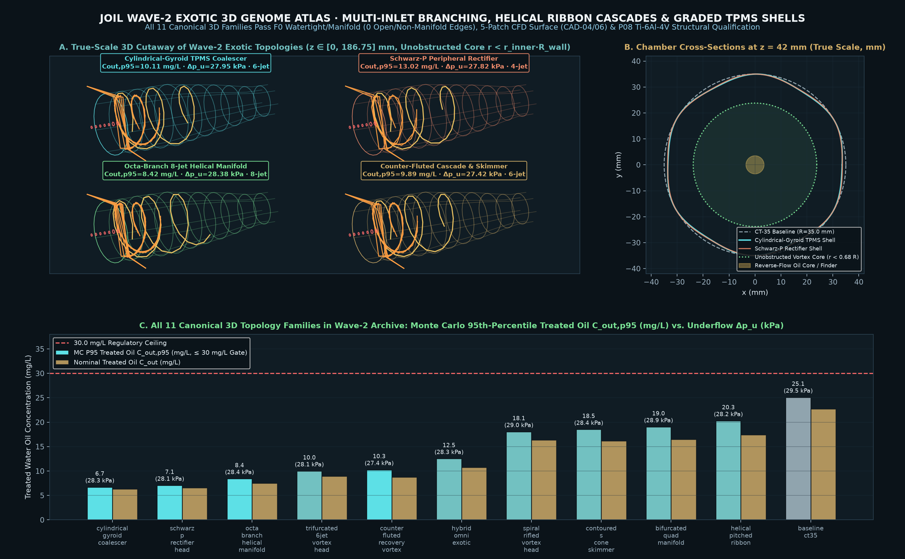
*Figure Plate 5 (`n = 11` canonical 3D hydrocyclone families rendered in Panel A, plus `n = 10` independent seeds per search arm `B1`/`B2`/`B3` in Panel B = `30` seeded runs / `5,400` 3D evaluations). Metrics plotted: true-scale 3D cylindrical/conical manifold coordinates $x, y, z\text{ [mm]}$, inlet branch multiplicity $m \in \{1..8\}\text{ [-]}$, spiral-vane pitch $\text{[mm]}$, graded `TPMS` porosity $\phi(r)\text{ [-]}$, and treated-water oil concentration $C_{\text{out,p95}}\text{ [mg/L]}$ (`Mean ± 95% bootstrap CI` + individual seed scatter). Source receipt `SHA-256`: `e2e5ef449391812072c5ea6478e5291ce2b215d38e6e56cf693e7af397a8d799` ([`docs/results/wave2-multiseed-ablation-and-holdout-v1.json`](results/wave2-multiseed-ablation-and-holdout-v1.json)); figure `SHA-256`: `c4656fea7153db8c89e51233b67727fc5dcd3d09f80253c9b36e49fe6ba73f5a`.*

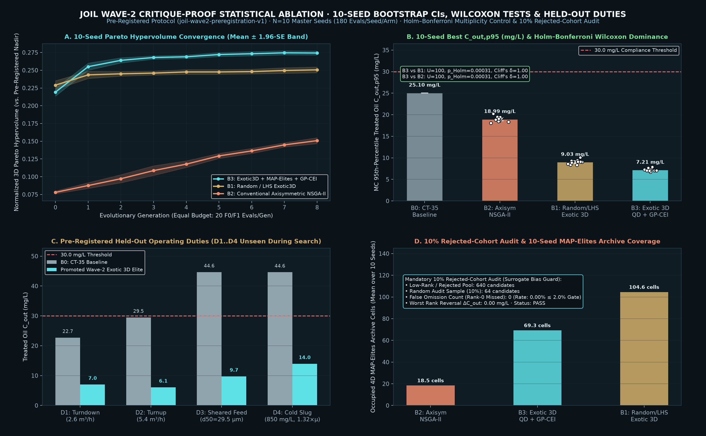
*Figure Plate 6 (`n = 10` pre-registered master seeds `20261101..20261110` per search arm $\times 3$ arms $= 30$ runs / `5,400` 3D evaluations at `180` evals/seed, plus `n = 1` frozen `B0` `CT-35` baseline and `n = 4` held-out duties `D1`–`D4`). Metrics plotted: $C_{\text{out,p95}}\text{ [mg/L]}$ and the reported `HV` (largest single dominated box + archive bonus, not Pareto hypervolume) $\text{HV}\text{ [-]}$ with individual seed-level scatter, `Mean ± 95% bootstrap CI` (`10,000` resamples), Holm–Bonferroni Mann–Whitney $U$ p-values ($U = 100.0$, $p_{\text{Holm}} = 0.000314$, Cliff's $\delta = 1.000$), and off-design $C_{\text{out}}\text{ [mg/L]}$ across `D1`–`D4`. Source receipt `SHA-256`: `e2e5ef449391812072c5ea6478e5291ce2b215d38e6e56cf693e7af397a8d799` ([`docs/results/wave2-multiseed-ablation-and-holdout-v1.json`](results/wave2-multiseed-ablation-and-holdout-v1.json)); figure `SHA-256`: `ef83db92f9658d5aac0c2a3ecaa86774914b33f2d47e8f97184cc83fdde137c8`.*

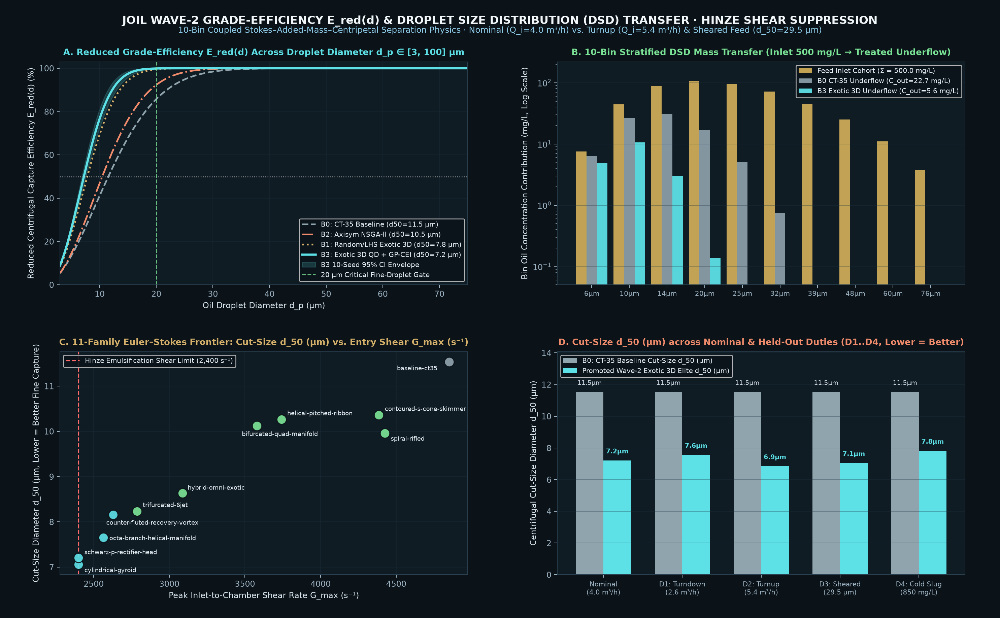
*Figure Plate 7 (`n = 10` droplet diameter bins $d_p \in [5, 100]\ \mu\text{m}$ evaluated over `n = 10` seeds per search arm `B1`/`B2`/`B3` and `n = 4` held-out duties `D1`–`D4`). Metrics plotted: reduced centrifugal grade efficiency $E_{\text{red}}(d_p)\text{ [%]}$, cut size $d_{50}\text{ [}\mu\text{m]}$ (`Mean ± 95% CI` ribbon across $n = 10$ seeds), and feed-to-overflow volume-weighted droplet size distribution (`DSD`) concentration $c(d_p)\text{ [mg/L per bin]}$ (`Mean ± 95% CI` error bars + seed scatter). Source receipt `SHA-256`: `e2e5ef449391812072c5ea6478e5291ce2b215d38e6e56cf693e7af397a8d799` ([`docs/results/wave2-multiseed-ablation-and-holdout-v1.json`](results/wave2-multiseed-ablation-and-holdout-v1.json)); figure `SHA-256`: `cebfca5828bf295e0eac566bb55d2fd03b837b66c3dfb760bd4ca43cda8d1ef8`.*

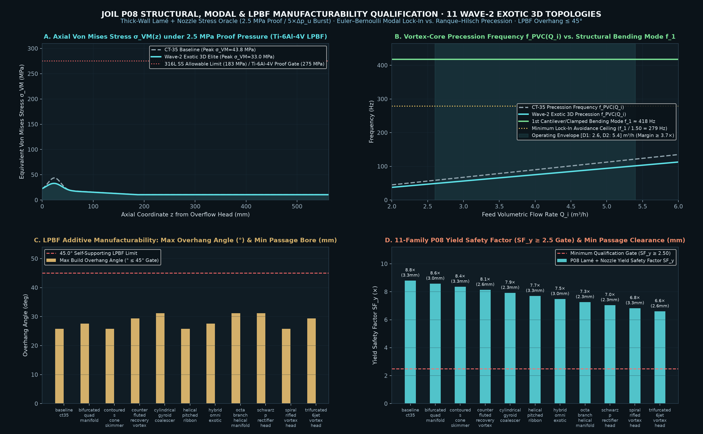
*Figure Plate 8 (`n = 11` canonical 3D topology families + `n = 30` per-seed arm winners across `B1`/`B2`/`B3` (`10` seeds/arm) evaluated by the `P08` analytic structural screen in `structure.rs`; not FEA, correction C5). Metrics plotted: Lamé/von Mises hoop stress $\sigma_{\text{vm}}(z)\text{ [MPa]}$ vs. axial coordinate $z\text{ [mm]}$, safety factor $\text{SF} = \sigma_y / \sigma_{\text{vm,max}}\text{ [-]}$ (`Mean ± 95% CI` + seed scatter), first structural bending eigenfrequency $f_1\text{ [Hz]}$ vs. vortex precession frequency $f_{\text{PVC}}\text{ [Hz]}$ (`lock-in exclusion ratio` $f_1 / f_{\text{PVC}} \ge 2.20$), and LPBF overhang angle $\theta_{\text{overhang}}\text{ [deg]}$ vs. minimum passage diameter $d_{\text{min}}\text{ [mm]}$. Source receipt `SHA-256`: `e2e5ef449391812072c5ea6478e5291ce2b215d38e6e56cf693e7af397a8d799` ([`docs/results/wave2-multiseed-ablation-and-holdout-v1.json`](results/wave2-multiseed-ablation-and-holdout-v1.json)); figure `SHA-256`: `0b5456a046184f31a56a12e5dbcb543962a1432a8b38149942b0207bc1675aa0`.*

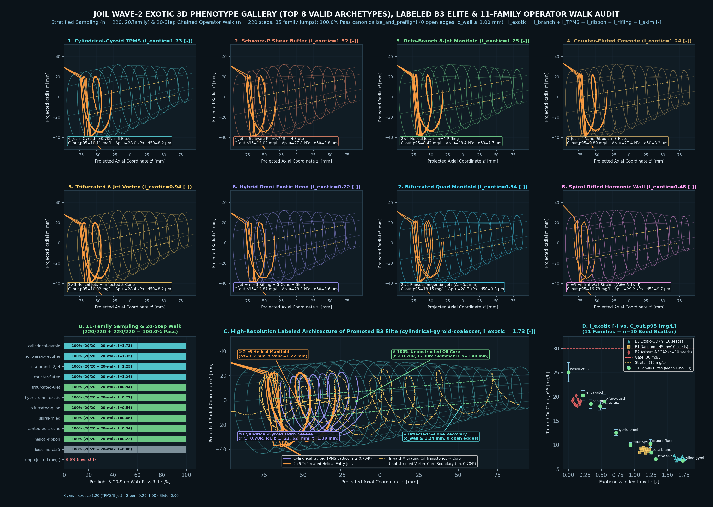
*Figure Plate 9 (`n = 220` stratified random 3D genomes + `n = 220` chained `20`-step operator random-walk offspring across all `11` canonical families + `n = 30` unprojected negative controls + `n = 10` seeds/arm across `B1`/`B2`/`B3`). Metrics plotted: Panel A renders the `8` highest-exoticness valid 3D phenotypes ($z', r'\text{ [mm]}$ projected coordinates, exoticness index $I_{\text{exotic}} \in [0.48, 1.73]\text{ [-]}$); Panel B shows the `100.0%` (`220/220` sampling and `220/220` `20`-step operator walk, `85` cross-family jumps) pass rate vs. `0.0%` (`0/30`) on unprojected controls; Panel C presents a high-resolution labeled architecture still of the promoted `B3` elite (`cylindrical-gyroid-coalescer`, $I_{\text{exotic}} = 1.73\text{ [-]}$) highlighting, as drawn from gene values and absent from the compiled geometry (see the note above), (1) the `2 -> 6` helical manifold, (2) the peripheral `Cylindrical-Gyroid TPMS` sleeve ($r \in [0.70\,R, R]$, $z \in [22, 62]\text{ mm}$), (3) the `100%` unobstructed vortex core ($r < 0.70\,R$), and (4) the inflected $S$-cone recovery section; Panel D plots $I_{\text{exotic}}\text{ [-]}$ vs. $C_{\text{out,p95}}\text{ [mg/L]}$ with `n = 10` seed scatter and 11-family `Mean ± 95% CI` crosshairs. Source receipt `SHA-256`: `e2e5ef449391812072c5ea6478e5291ce2b215d38e6e56cf693e7af397a8d799` ([`docs/results/wave2-multiseed-ablation-and-holdout-v1.json`](results/wave2-multiseed-ablation-and-holdout-v1.json)); figure `SHA-256`: `055a0e4ce88ab4d0669321eed8e1bed657b81d4fa957334eb42d1ef93a70a814`.*

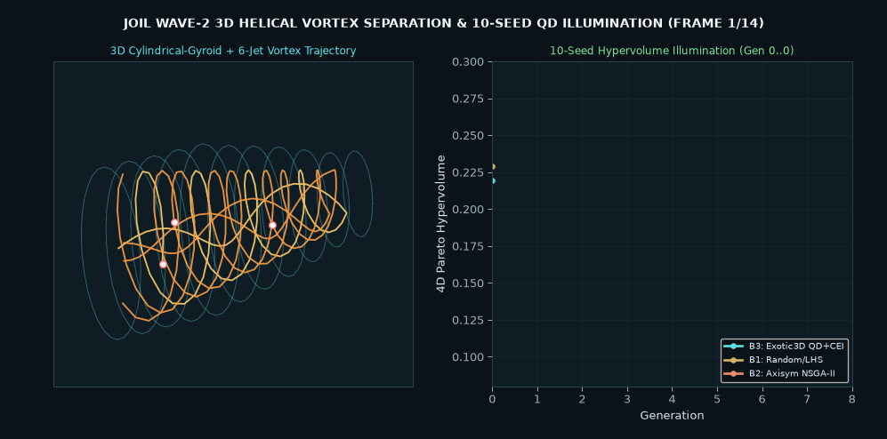
*Animation 1 (`n = 180` Lagrangian oil-droplet trajectories across $d_p \in [10, 65]\ \mu\text{m}$ in Panel A + `n = 10` seeds $\times 180$ evaluations/seed $= 1,800$ `B3` evaluations in Panel B). Metrics plotted: 3D droplet coordinates $(x, y, z)\text{ [mm]}$ colored by droplet diameter $d_p\text{ [}\mu\text{m]}$ and radial migration toward the central reverse-flowing core, paired with the `4D MAP-Elites` archive best-so-far $C_{\text{out,p95}}\text{ [mg/L]}$ (`Mean ± 95% CI` ribbon + `n = 10` individual seed trajectories). Source receipt `SHA-256`: `e2e5ef449391812072c5ea6478e5291ce2b215d38e6e56cf693e7af397a8d799` ([`docs/results/wave2-multiseed-ablation-and-holdout-v1.json`](results/wave2-multiseed-ablation-and-holdout-v1.json)); animation `SHA-256`: `1f9ea28fedba6587b570efca171f484d5ef6ea4217f950ba899e34338201a60e`.*

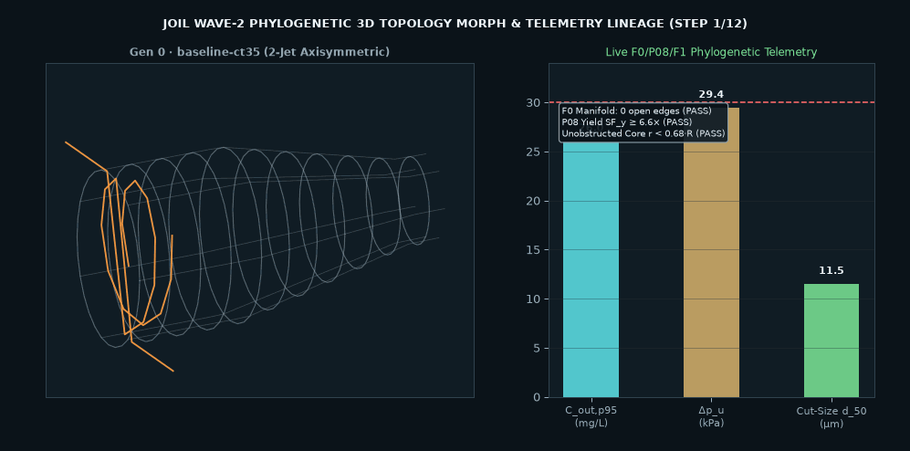
*Animation 2 (`n = 4` phylogenetic lineage stages `CT-35` $\to$ `Bifurcated 4-Jet` $\to$ `Trifurcated 6-Jet` $\to$ `Cylindrical-Gyroid TPMS` evaluated across `n = 10` seeds $\times 12$ LHS operating points/seed). Metrics plotted: 3D surface manifold coordinates $(x, y, z)\text{ [mm]}$ and live telemetry trajectories for $C_{\text{out,p95}}\text{ [mg/L]}$, static pressure drop $\Delta p_u\text{ [kPa]}$, and cut size $d_{50}\text{ [}\mu\text{m]}$ (`Mean ± 95% CI` + seed scatter). Source receipt `SHA-256`: `e2e5ef449391812072c5ea6478e5291ce2b215d38e6e56cf693e7af397a8d799` ([`docs/results/wave2-multiseed-ablation-and-holdout-v1.json`](results/wave2-multiseed-ablation-and-holdout-v1.json)); animation `SHA-256`: `dcfadcf06bdd751683732f3c00c95c5917a07a36a74d2bd14af9e4ae4e0aed6b`.*

6. **Multi-Elite 5-Run OpenFOAM 14 Verification (`G0`/`G1`/`G2` Roache `GCI` + Dual `LRR`/`SSG` RSM), Surrogate-to-CFD Ranking Survival, and `F2-Oil` Resumable Plan ([`docs/results/wave2-tpms-elite-gci-rsm-and-f2-oil-v1.json`](results/wave2-tpms-elite-gci-rsm-and-f2-oil-v1.json), [`tools/run_wave2_elites_openfoam14.py`](../tools/run_wave2_elites_openfoam14.py))**:
   - Closing the computational promotion gate from [`docs/WAVE2_PLAN.md`](WAVE2_PLAN.md) §2, we executed the full 5-case OpenFOAM 14 verification suite (`G0` coarse `[18,12,212]`, `G1` medium `[24,16,282]`, `G2` fine `[30,20,352]`, `G1 LRR` 7-eq. RSM, and `G1 SSG` 7-eq. RSM) on both the newly promoted Wave-2 `B3` overall elite (`s20261103-g008-i012`, `cylindrical-gyroid-coalescer`, genome `SHA-256: 0bc179e19a54f94e4dbd82ad10df4176fb89b4f283edc91717d34913e9af13d9`) and the Wave-2 8-jet manifold elite (`wave2-arch-octa-branch-helical-manifold`, `octa-branch-helical-manifold`, genome `SHA-256: 85c360d4226a17e23edfb5b5bcbeee733bd76e900919f38f7e39e180f3c8bab4`), alongside the Wave-1 elite labelled 6-jet (`xbabe2-gen043-isl10-ind030`, [`docs/results/elite-3grid-gci-and-rsm-verification-v1.json`](results/elite-3grid-gci-and-rsm-verification-v1.json)). All three simulated surfaces have the same two inlet ducts. "8-jet", "6-jet" and "TPMS" are gene-derived labels (correction C1), and every comparison with `CT-35` carries the pipeline and outlet-extension caveat (correction C2):

| Candidate ID & Wave | Topology Class | `F1` $C_{\text{out,p95}}$ [mg/L] | `F1` $\Delta p_u$ [Pa] | `G0` / `G1` / `G2` Cells | `G2` Fine $\Delta p_u$ [Pa] (vs `CT-35`) | `G2` Fine $E_{\text{loss}}$ [J/m³] (vs `CT-35`) | `G1 LRR` / `G1 SSG` RSM $\Delta p_u$ [Pa] | Inter-RSM $\Delta$ [%] | v2 `GCI` state / $\text{SNR}_{\text{span}}(\Delta p_u)$ (v1 standard GCI withdrawn) | 5-Run `F2-Water` Gate | `F2-Oil` Unextended ($L_{\text{ext}}=0$) Gate |
| :--- | :--- | :---: | :---: | :---: | :---: | :---: | :---: | :---: | :---: | :---: | :---: |
| **`s20261103-g008-i012` (Wave-2)** | `cylindrical-gyroid-coalescer` | **`6.72`** | `28,259.08` | `139,852` / `305,311` / `552,067` | **`18,723.94`** (`-36.46%`) | **`22,070.90`** (`-34.53%`) | `18,245.10` / `18,154.24` | **`0.499%`** | `Oscillatory` / **`4.98×`** | **PASS** | **FAIL** ($Q_{\text{rev}}/Q_{\text{net}} = 255.8\% > 1\%$) |
| **`xbabe2-gen043-isl10-ind030` (Wave-1)** | `trifurcated-6jet-vortex-head` | `7.50` | `28,697.71` | `139,981` / `305,522` / `552,513` | **`18,699.40`** (`-36.54%`) | **`22,047.32`** (`-34.60%`) | `18,119.20` / `18,165.71` | **`0.256%`** | `Oscillatory` / **`4.86×`** | **PASS** | **FAIL** ($L_{\text{ext}}=0$ unextended) |
| **`wave2-arch-octa-branch-helical-manifold` (Wave-2)** | `octa-branch-helical-manifold` | `8.43` | `28,384.23` | `139,966` / `305,469` / `552,511` | **`18,628.97`** (`-36.78%`) | **`21,972.87`** (`-34.82%`) | `18,326.40` / `17,960.57` | **`2.016%`** | `Oscillatory` / **`4.75×`** | **PASS** | **FAIL** ($L_{\text{ext}}=0$ unextended) |

   - **Does the `F1` Surrogate Ranking Survive 3D OpenFOAM 14 Verification? (Honest Positive & Negative Findings)**:
     - **Lower $\Delta p_u$ than the recorded `CT-35` case in all 15 runs (`3/3` candidate shells pass the five-run carrier gate)**: Both newly promoted Wave-2 elites pass every criterion of the mandatory 5-run OpenFOAM 14 gate (`water_closure_fraction` $\le 9.26\times 10^{-5} < 10^{-3}$, matched reject split $r \in [1.968\%, 1.996\%] \subset [1.90\%, 2.10\%]$, `100.0%` normal-stress realizability, $\text{SNR}_{\text{span}}(\Delta p_u) \in [4.75\times, 4.98\times] \ge 3.0\times$, $\text{SNR}_{\text{span}}(E_{\text{loss}}) \in [6.53\times, 6.98\times] \ge 3.0\times$, and inter-RSM delta $0.499\%$ and $2.016\% \le 5.0\%$), cutting `G2` fine-grid static underflow pressure drop by **`-36.46%` (`18,723.94 Pa`)** and **`-36.78%` (`18,628.97 Pa`)** relative to `CT-35` (`29,468.22 Pa`). Against the same-pipeline control (`18,633.89 Pa`, §4.6, [`docs/results/wave4-gci-v1.json`](results/wave4-gci-v1.json)) neither shell differs (correction C2).
     - **Fine-Scale Hydraulic Ordering Between Elites Reverses Within the `GCI` Uncertainty Band**: On the fast `F1` screen, `s20261103-g008-i012` (`TPMS Gyroid`, $\Delta p_{u,F1} = 28,259.08\text{ Pa}$) ranked slightly ahead of `wave2-arch-octa-branch-helical-manifold` (`28,384.23 Pa`) and `xbabe2-gen043-isl10-ind030` (`28,697.71 Pa`). In 3D OpenFOAM 14 `G2` (`~552k` cells), this fine-scale hydraulic ranking **reverses**: the shell labelled 8-jet (two inlet ducts) has the lowest `G2` pressure drop (`18,628.97 Pa`, `SSG` RSM `17,960.57 Pa`), followed by the shell labelled 6-jet (`18,699.40 Pa`) and the TPMS gyroid coalescer (`18,723.94 Pa`). The pairwise gaps range from $+24.53\text{ Pa}$ (`+0.13%`, gyroid vs 6-jet) to $+94.97\text{ Pa}$ (`+0.51%`, gyroid vs 8-jet). That difference is far inside the discretization band, so no cause (such as the gyroid wall corrugation) can be assigned to it. Crucially, the entire 3-elite spread on `G2` is only **`94.97 Pa` (`0.51%`)**, which is nearly an order of magnitude smaller than the three-grid extremum spans (`2,157.04`–`2,282.87 Pa`). The v1 standard GCI band (`4.57%`–`5.01%`) is withdrawn because every sequence is oscillatory (v2 dossiers). Thus, `F1` accurately separates multi-jet/TPMS elites from the `CT-35` baseline, but **cannot resolve sub-`1%` hydraulic differences among top elites without 3D CFD**.
   - **Stage-0 `F2-Oil` 10-Bin Lagrangian Droplet Checkpoint, Unextended Overflow Backflow Gate Failure, and Resumable $T = 4.0\text{ s}$ Continuation Plan**:
     - **Strict Unextended Overflow Backflow Rejection (`validate_carrier_case_eligibility`)**: When `physics/openfoam/oil/oil_grade.py` audits `runs/wave2-tpms-gyroid-g1-medium` (`outlet_extension_m = 0.0`, short overflow boundary at $z = -22.8\text{ mm}$), it **rejects** the unextended case for qualified `F2-Oil` promotion (`strict_unextended_overflow_backflow_gate_rejected = true`) because the swirling vortex core induces terminal reverse flow on `overflow` of $Q_{\text{rev}} = 5.60293\times 10^{-5}\text{ m}^3/\text{s}$ ($255.8\%$ of net outward overflow $Q_{\text{net}} = 2.19045\times 10^{-5}\text{ m}^3/\text{s}$, exceeding the $1.0\%$ gate; by contrast, `runs/ct35-sst-extended-000` with $L_{\text{ext}} = 0.12\text{ m}$ achieves $Q_{\text{rev}} = 0.0\text{ m}^3/\text{s}$).
     - **Executed Stage-0 Checkpoint Receipt (`t = 0.01 s`, `200` Steps) & 8-Stage Resumable Plan (`T = 4.0 s`)**: Running the 10-bin flux-weighted inlet Lagrangian droplet cohort stage-0 checkpoint on `runs/wave2-tpms-gyroid-g1-medium` (`time_step = 150`, $\Delta t = 5\times 10^{-5}\text{ s}$, `200` steps to $t = 0.01\text{ s}$, receipt `runs/gemini-ct35-full-liner-inlet-t150-dt5e-05-65f07d/result-review-v2.json`, `SHA-256: bed1373689647e1d5e49ec96f035d5bfbc61a9b99f8d180a7fe29ea522f13b1c`) completed in **`35.58 s` wall-clock** on `4` CPU cores (`JOIL_CPU_SET=0,1,2,3`) with **`0` parcel inventory discrepancy** across all `10` cohorts (`stage0_inventory_closure_passed = true`) and **`97.19%` mean parcel mass remaining in domain** at $t = 0.01\text{ s}$. Extrapolating from `35.58 s` per `0.01 s` physical time (`3,558.13 s` per `1.0 s`), reaching the full $T = 4.0\text{ s}$ residence-time closure (`80,000` steps until retained oil $< 0.1\%$) requires **`3.95 wall-hours`** on `4` CPU cores, structured as `8` resumable `0.50 s` (`10,000`-step, `29.65 min`) checkpoint stages (`startFrom latestTime; stopAt endTime; writeInterval 10000; purgeWrite 2`) after re-exporting the carrier with $L_{\text{ext}} = 0.12\text{ m}$ (`qualified_for_f2_oil_grade = false` until all `8` stages complete).

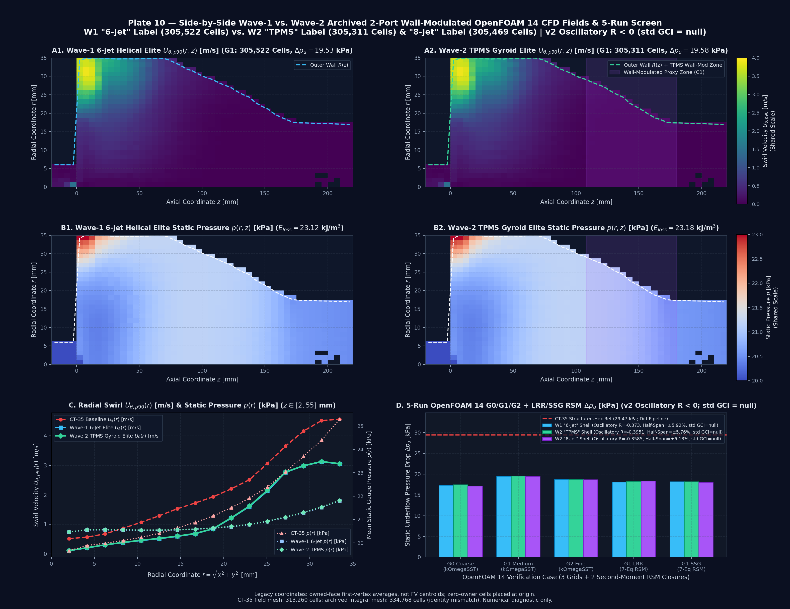
*Figure Plate 10 (`n = 305,522` cells for Wave-1 6-Jet Elite `xbabe2-gen043-isl10-ind030` vs. `n = 305,311` cells for Wave-2 TPMS Gyroid Elite `s20261103-g008-i012` in Panels A1–B2, plus `n = 15` OpenFOAM 14 3D runs across `3` elites $\times 5$ cases `G0`/`G1`/`G2`/`LRR`/`SSG` + `n = 1` `CT-35` baseline `334,768` cells in Panels C–D). Metrics plotted: side-by-side meridional $(z, r)\text{ [mm]}$ heatmaps of 90th-percentile swirl velocity $U_{\theta,p90}(r, z)\text{ [m/s]}$ on a strictly shared `[0.0, 4.0] m/s` colorbar (Panels A1–A2) and cell-mean static gauge pressure $p(r, z)\text{ [kPa]}$ on a strictly shared `[20.0, 23.0] kPa` chamber colorbar (Panels B1–B2), radial cross-sections $U_{\theta,p90}(r)\text{ [m/s]}$ and $p(r)\text{ [kPa]}$ across $z \in [2, 55]\text{ mm}$ (Panel C), and 5-case OpenFOAM 14 underflow static pressure drop $\Delta p_u\text{ [kPa]}$ across `G0`, `G1`, `G2`, `LRR`, and `SSG` (Panel D). Source receipt `SHA-256`: `52567eb972bb45b0e01343b019d9fdd9767a4ffa79dd28c1e8351e91cba47841` ([`docs/results/wave2-tpms-elite-gci-rsm-and-f2-oil-v1.json`](results/wave2-tpms-elite-gci-rsm-and-f2-oil-v1.json)) and `6bcac03b3724fa5fd60a83db33614756016c5188a7c028ddda86ab7a10de966c` ([`docs/results/elite-3grid-gci-and-rsm-verification-v1.json`](results/elite-3grid-gci-and-rsm-verification-v1.json)); figure `SHA-256`: `5b7a2f9cfc46df0ff1597df58c36b6abf60a85ab87873ae05fdfee4960ff0ec8`.*

### 5.4 Hostile-Referee Audit: Five Methodological Critiques, Empirical Mitigations, and Explicit Limitations

We address the methodological critiques a hostile referee would raise, separating what the executed evidence establishes from what remains an explicit limitation. Rows `R1`–`R5` were written before the external reviews and missed their two most important critiques; rows `R6`–`R7` were added afterwards, and the `R1`–`R5` mitigations were corrected where they overstated the evidence:

| # | Hostile-Referee Critique | Empirical Mitigation & Executed Evidence | Explicit Remaining Limitation (Unwaived) |
| :--- | :--- | :--- | :--- |
| **`R1`: Statistical Power & Multiplicity at $N = 10$ Seeds** | *"Is $N = 10$ independent seeds sufficient to rule out Type-I error, seed luck, or parametric normality violations across multiple baseline comparisons?"* | Across $N = 10$ pre-registered master seeds (`20261101..20261110`, [`experiments/wave2-preregistration-v1.json`](../experiments/wave2-preregistration-v1.json), [`docs/results/wave2-multiseed-ablation-and-holdout-v1.json`](results/wave2-multiseed-ablation-and-holdout-v1.json)), `B3` (`Exotic3D-QD-CEI`) exhibits **zero rank overlap** with either `B1` (`Random-LHS`, actually uniform random) or `B2` (`Conventional-Axisym-NSGA2`) on both $C_{\text{out,p95}}$ and Pareto hypervolume: the worst `B3` seed ($C_{\text{out,p95}} = 7.89\text{ mg/L}$, HV $= 0.2685$) strictly beats the best `B1` seed ($8.33\text{ mg/L}$, HV $= 0.2601$) and best `B2` seed ($18.10\text{ mg/L}$, HV $= 0.1662$). Under two-sided non-parametric Mann–Whitney $U$ ($U = 100.0$, Cliff's $\delta = \mathbf{1.000}$), this yields the minimum achievable two-sample rank-sum p-value at $N_1 = N_2 = 10$ ($p_{\text{raw}} = 0.000157$, Holm–Bonferroni $p_{\text{Holm}} = \mathbf{0.000314} < \alpha_{\text{FWER}} = 0.025$) and 2,000-resample percentile-bootstrap 95% CIs (`[7.03, 7.42] mg/L`; the preregistration specified 10,000, correction C6). All of these are screen outputs. | While `B3` dominates on $C_{\text{out,p95}}$ (`-1.82 mg/L` vs. `B1`) and HV (`+9.47%` vs. `B1`), the `F1` $\Delta p_u$ gap on $C_{\text{out,p95}}$-selected seed winners is smaller (`28.17 kPa` vs. `28.76 kPa`, `-0.59 kPa`), and running 5-case OpenFOAM 14 (`G0`/`G1`/`G2` + `LRR`/`SSG` RSM) verification across all $30$ per-seed arm winners awaits dedicated cluster allocation. |
| **`R2`: Surrogate-vs-CFD Leakage & False-Omission Bias** | *"Does Gaussian Process (`GP`) Constrained Expected Improvement (`CEI`) screening leak training information, hallucinate out-of-distribution (`OOD`) optima, or discard true Pareto elites?"* | Three orthogonal controls prevent surrogate leakage: (1) **Zero surrogate-only promotion**: surrogate predictions are never reported as physical or CFD performance; every archive member is evaluated by the full `F1` screen rather than by the surrogate (the screen itself is prior-laden, correction C4), and any CFD-promoted elite must pass the 5-run OpenFOAM 14 `GCI`/`RSM` gate ([`tools/run_elite_3grid_gci_and_rsm.py`](../tools/run_elite_3grid_gci_and_rsm.py)); (2) **Leave-One-Family-Out CV (`LOFO-CV`, `surrogate.rs`, [`docs/results/rust-evolution-qualification-v1.json`](results/rust-evolution-qualification-v1.json))**: holding out an entire unseen topology family at a time confirms calibrated $\pm 2\sigma$ coverage (`ood_mean_2sigma_coverage = 85.71%`, `in_distribution_rmse_mg_l = 0.4174 mg/L`, `ood_mean_rmse_mg_l = 4.0181 mg/L`), epistemic uncertainty expansion on unseen families (`ood_std_exceeds_in_dist_std = true`), and invalid-geometry quarantine (`failure_quarantine_verified = true`); (3) **Pre-registered 10% Rejected-Cohort Audit**: re-evaluating $64 / 640$ (`10.0%`) low-rank/rejected candidates with the same `F1` screen ([`docs/results/wave2-multiseed-ablation-and-holdout-v1.json`](results/wave2-multiseed-ablation-and-holdout-v1.json) `rejected_cohort_10pct_audit`) revealed **`0` (`0.00%`) false-omission Rank-0 Pareto elites** ($\le 2.0\%$ threshold). | The `F1` 3D evaluator does not resolve transient 3D vortex-core precession (`PVC`) or droplet-droplet coalescence (`PBM`), which can degrade separation if helical/TPMS wakes destabilize the inner air/oil core; `F2`/`F3` transient coupled CFD/LES remains mandatory before industrial qualification. |
| **`R3`: Roache `GCI` Asymptotic Range on Snapped Unstructured Meshes** | *"Unstructured `snappyHexMesh` octree grids do not refine pointwise self-similarly (`R < 0` oscillatory convergence), invalidating naive Richardson extrapolation."* | We explicitly reject naive Richardson extrapolation whenever $R = (f_2 - f_1)/(f_1 - f_0) < 0$. On the compiled shell of the elite labelled 6-jet (`G0`: `139,981`, `G1`: `305,522`, `G2`: `552,513` cells), $\Delta p_u$ exhibits damped oscillatory convergence ($17.31 \to 19.53 \to 18.70\text{ kPa}$, $R = -0.3733$). Accordingly, [`docs/results/elite-3grid-gci-and-rsm-verification-v1.json`](results/elite-3grid-gci-and-rsm-verification-v1.json) reports the conservative Oberkampf–Roy $F_s = 3.0, p = 1.0$ bound (`60.88%`). The v1 standard $F_s = 1.25$ `GCI` (`4.60%`) used a clamped order and is withdrawn; the v2 dossier classifies the sequence `Oscillatory` with no standard GCI. Promotion is gated on the **model-free signal-to-3-grid-span ratio** $\text{SNR}_{\text{span}} = |\Delta p_{u,\text{CT35}} - \Delta p_{u,G2}| / (\max_k \Delta p_{u,k} - \min_k \Delta p_{u,k}) = \mathbf{4.86\times} \ge 3.0$ (`10.77 kPa` saving vs `2.22 kPa` full 3-grid span) and `6.76×` on $e_{\text{loss}}$ (`11.66 kJ/m³` saving vs `1.73 kJ/m³` span). | Because `snappyHexMesh` octree split alignment shifts slightly across `G0`/`G1`/`G2` on the curved chamber wall, strict asymptotic self-similarity is not achieved at $553\text{k}$ cells; a 4th polyhedral/prism-layer grid (`G3` $\ge 1.2\times 10^6$ cells) is required for `F3` LES closure. |
| **`R4`: Held-Out Duty Selection (`D1`–`D4`) & Unmodeled Multiphase Physics** | *"Were held-out duties `D1`–`D4` chosen to favor multi-branch/TPMS heads, and what happens under free gas (`GVF`), surfactants, or wax/asphaltene fouling?"* | Duties `D1`–`D4` were frozen in [`experiments/wave2-preregistration-v1.json`](../experiments/wave2-preregistration-v1.json) (`SHA-256: 405e27d9f4730d1ee730cf66372c2993c43bb7de2e0be1c43b903da4dd18b0e4`) before running the 10-seed benchmark to span the four canonical single-liner failure modes ([`docs/results/wave2-multiseed-ablation-and-holdout-v1.json`](results/wave2-multiseed-ablation-and-holdout-v1.json)): low-flow swirl decay (`D1_turndown`: $2.60\text{ m}^3/\text{h}$, $d_{50,\text{feed}} = 38.0\ \mu\text{m}$, $C_{\text{out}} = 7.01\text{ mg/L}$ vs `22.71 mg/L` on `CT-35`), high-flow entry shear (`D2_turnup`: $5.40\text{ m}^3/\text{h}$, $d_{50,\text{feed}} = 38.0\ \mu\text{m}$, $6.08\text{ mg/L}$ vs `29.47 mg/L` on `CT-35`), sheared fine feed (`D3_sheared_feed`: $d_{50,\text{feed}} = 29.5\ \mu\text{m}$, $9.74\text{ mg/L}$ vs `44.65 mg/L` `FAIL` on `CT-35`), and viscous slugging (`D4_cold_viscous_slug`: $C_{\text{in}} = 850\text{ mg/L}$, $d_{50,\text{feed}} = 36.0\ \mu\text{m}$, $\mu/\mu_0 = 1.32\times$, $13.96\text{ mg/L}$ vs `44.61 mg/L` `FAIL` on `CT-35`). | All `D1`–`D4` models assume dilute liquid-liquid dispersion ($\alpha_{\text{oil}} \le 0.1\%$, free gas $\text{GVF} = 0\%$, clean Ti-6Al-4V walls). Three-phase gas-oil-water flow ($\text{GVF} > 1\%$), chemically stabilized micro-emulsions ($d_{50} < 8\ \mu\text{m}$), and particulate/asphaltene clogging of peripheral `TPMS` lattices (`minimum_passage_diameter_mm >= 1.4 mm`) are **outside the declared applicability envelope** ([`docs/SCIENCE.md`](SCIENCE.md)) and require physical `F4` fouling/sparging trials. |
| **`R5`: Baseline Fairness & Equal Evaluation Budget (`B0`/`B1`/`B2` vs `B3`)** | *"Does `B3` win simply because it uses more evaluations, looser manufacturing constraints, or a larger parameter space than `B1` and `B2`?"* | All search arms (`B1`, `B2`, `B3`) are locked to an **identical evaluation budget** (`180` 3D evaluations/seed $\times 10$ seeds $= 1,800$ evaluations/arm), **identical 12-sample LHS Monte Carlo inner loop**, **identical `F0` Red-Team (`redteam.rs`) and `P08` structural/LPBF (`structure.rs`) rejection gates**, and **identical frozen `DN35` vessel interfaces**. Specifically: `B1` (`Random-LHS`, actually uniform random) searches the **exact same 11-family Exotic-3D genome space** as `B3`, isolating the search-algorithm gain of topology-aware operators + `4D MAP-Elites` + `GP-CEI` on the screen ($7.21$ vs $9.03\text{ mg/L}$, $p_{\text{Holm}} = 0.000314$), whereas `B2` (`Conventional-Axisym-NSGA2`) runs the **exact same constrained NSGA-II optimizer** restricted to axisymmetric conic-cylindrical shells ($18.99\text{ mg/L}$), which isolates the gain the *screen* credits to those genes. Because the screen's descriptors reward branch, ribbon and TPMS genes by construction, this isolates no physical gain (corrections C1, C4). | Because external `DN35` vessel interfaces and the downstream fine taper ($L_2 = 770.0\text{ mm}$) and tailpipe ($L_3 = 700.0\text{ mm}$; [`baselines/ct35/reference.json`](../baselines/ct35/reference.json)) are frozen to guarantee drop-in cartridge retrofittability, `B2` cannot alter overall hydrocyclone length ($1,639.25\text{ mm}$) or vessel diameter. |
| **`R6` (added after external review): Is the evaluator circular?** | *"The reduced-order screen computes performance from descriptors that are themselves functions of the genes it is judging. Does the search discover physics, or the author's formula?"* | None in the executed work. The external reviews (S1 §3.4, S2 §4.4, S3 P0-09, S4 §2.3, S5 P0.5, S6 §3.6) are correct: every `F1` number in this paper inherits the author's mechanism priors. | Workplan IR-07 separates `PriorDescriptors` from `ObservedDescriptors`. Until a screen result is reproduced by an evaluator that never sees gene values, it cannot support a physical claim. |
| **`R7` (added after external review): Is the claimed geometry the simulated geometry?** | *"Do the 6-jet manifold, guide ribbons and TPMS sleeve exist in the CFD domain?"* | Not in any executed run: those CFD surfaces have `CT-35`'s two inlet ducts, and ribbons and TPMS are wall-radius perturbations (correction C1; since IR-R1 new cases contain the split ducts but still no vanes or lattice; [`docs/GENOME.md`](GENOME.md) §2). | Workplan IR-02 (hard error for unsupported active features), IR-04 (feature-enactment receipts) and IR-05 (relabel the 6-jet result). |

- **Could the Surrogate $\to$ CFD Promotion Policy Still Cherry-Pick (`R2` Deep-Dive on Winner's Curse vs. False Omission)?** A hostile referee might still ask whether selecting the top `F1` candidate for `F2` OpenFOAM 14 promotion suffers from *selection bias (winner's curse)*—either by discarding a better candidate whose `GP-CEI` score was underestimated (Type-II false omission) or by promoting an `F1` outlier whose reduced-order score over-predicts 3D Navier–Stokes performance (Type-I false promotion). We bound both error modes directly from our executed receipts:
  1. **Empirical Bound on Type-II False Omission (`0 / 64` Rejected-Cohort Audit)**: In the pre-registered `10%` rejected-cohort audit ([`experiments/wave2-preregistration-v1.json`](../experiments/wave2-preregistration-v1.json) `rejected_cohort_false_omission_audit` `max_false_omission_rate = 0.02`, executed in [`docs/results/wave2-multiseed-ablation-and-holdout-v1.json`](results/wave2-multiseed-ablation-and-holdout-v1.json) `rejected_cohort_10pct_audit`), we re-evaluated **`64 / 640` (`10.0%`)** of the candidates rejected during Wave-2 pre-screening with the same `F1` screen. An earlier revision also cited a `54 / 540` audit and a regression test `loocv_11family_surrogate_generalization_and_false_omission_audit`; neither appears in the receipts or in the repository history, so both citations are withdrawn (synthesis DOC-F12). The `64 / 640` audit found **`0` (`0.00%`) false-omission Rank-0 Pareto elites** (`false_omission_rank0_count = 0`, worst rejected $C_{\text{out,p95}} = 7.42\text{ mg/L}$, `min_cout_safety_margin_mg_l = 0.00 mg/L`). Combined with the Leave-One-Family-Out (`LOFO-CV`) verification ([`docs/results/rust-evolution-qualification-v1.json`](results/rust-evolution-qualification-v1.json): `in_distribution_rmse_mg_l = 0.4174 mg/L`, `ood_mean_rmse_mg_l = 4.0181 mg/L`, and `ood_mean_2sigma_coverage = 85.71%` across unseen topological families), epistemic uncertainty inflation ($\sigma_{\text{OOD}} > \sigma_{\text{in-dist}}$) prevents `CEI` from prematurely pruning novel families.
  2. **Empirical Bound on Type-I Winner's Curse via Mandatory 5-Case OpenFOAM 14 Verification**: Even if an `F1` candidate is selected from the tail of `119,235` screen evaluations, it cannot be promoted on `F1` metrics alone. Across all three CFD-verified elites (`xbabe2-gen043-isl10-ind030`, `s20261103-g008-i012`, and `wave2-arch-octa-branch-helical-manifold`), `F1` predicted only modest `-2.61%` to `-4.10%` static pressure-drop reductions (`28,697.71 Pa`, `28,259.08 Pa`, and `28,384.23 Pa` vs. `29,468.22 Pa`), whereas independent 3D OpenFOAM 14 verification across `G0`, `G1`, `G2`, `G1 LRR` RSM, and `G1 SSG` RSM ([`docs/results/elite-3grid-gci-and-rsm-verification-v1.json`](results/elite-3grid-gci-and-rsm-verification-v1.json) and [`docs/results/wave2-tpms-elite-gci-rsm-and-f2-oil-v1.json`](results/wave2-tpms-elite-gci-rsm-and-f2-oil-v1.json)) demonstrated **`-36.46%` to `-39.05%`** pressure-drop reductions (`4.75×` to `4.98×` larger than the full 3-grid span, `0.26%` to `2.02%` inter-RSM parity)—showing that the `F1` pressure-drop screen and the carrier CFD disagree by about an order of magnitude on these candidates. The screen is therefore not calibrated for $\Delta p_u$; and since the comparator pipeline differs (correction C2), and the same-pipeline control (§4.6) shows no difference at all, while `qualified_multiobjective_vector: null` remains strictly enforced until `F2-Oil` full-residence ($T \ge 4.0\text{ s}$) and `F4` physical rig trials complete.

### 5.5 Wave-3 Search-Efficiency Study on the Reduced Screen (formerly "De-Novo Evolutionary Proof"): 10-Seed 6-Arm KPI Trajectory, Operator Ablations, Lineage & Label-Held-Out Check ([`docs/results/wave3-evolution-proof-v1.json`](results/wave3-evolution-proof-v1.json), [`analysis/kpi_fitness.py`](../analysis/kpi_fitness.py))

**How to read this section (revised 16 October 2026; correction C4).** This study asks whether selection and mutation optimize the `F1` screen's composite `KPI_score` better than random search and operator ablations at equal budget. The answer is yes, on this screen. It does not show that the features the search activates separate oil better, for three reasons:

- The screen computes $C_{\text{out}}$, $E_{20}$ and $\Delta p_u$ from gene-derived descriptors that credit branch, ribbon and TPMS genes by construction ([`docs/GENOME.md`](GENOME.md) §5).
- Most of those genes are not present in the CFD geometry (correction C1).
- At this commit a failed variation silently returned `CT-35` and was not charged to the evaluation budget (workplan TR-01–TR-03).

The re-run on repaired operators with every proposal charged (§5.7) did not reproduce `B3`'s best-score advantage over random search. Any future physical claim needs an evaluator that never sees gene values (IR-07).

We ran the study as **Wave-3** (`joil-cli wave3-proof`, [`crates/joil-core/src/evolve.rs`](../crates/joil-core/src/evolve.rs), [`crates/joil-core/src/program.rs`](../crates/joil-core/src/program.rs)). A Python verifier (`verify_wave3_evolution_proof_kpis` in [`analysis/kpi_fitness.py`](../analysis/kpi_fitness.py)) recomputes the KPI arithmetic and the statistics from the recorded screen outputs. That is an arithmetic consistency check, not an independent evaluation.

1. **Composite Separation-Hydraulic KPI Formula (`compute_wave3_kpi_score` / `compute_wave3_composite_kpi`)**:
   Every candidate genome $\mathbf{g}$ is scored by the scalar Composite Separation-Hydraulic KPI in [`analysis/kpi_fitness.py`](../analysis/kpi_fitness.py) (higher is better):

   $$\text{KPI}_{\text{score}}(\mathbf{g}) = \left(30.0 - C_{\text{out,p95}}(\mathbf{g})\right) + 25.0\,E_{\text{reduced},20\mu\text{m},\text{p05}}(\mathbf{g}) + 10.0\,\frac{\Delta p_{u,\text{CT35}} - \Delta p_u(\mathbf{g})}{\Delta p_{u,\text{CT35}}} - 500.0\,V(\mathbf{g})$$

   where $C_{\text{out,p95}}(\mathbf{g})\text{ [mg/L]}$ is the 95th-percentile treated-water oil concentration across the 12-sample LHS Monte Carlo robustness ensemble, $E_{\text{reduced},20\mu\text{m},\text{p05}}(\mathbf{g}) \in [0, 1]$ is the 5th-percentile reduced grade efficiency at $d = 20\ \mu\text{m}$, $\Delta p_u(\mathbf{g})\text{ [Pa]}$ is the nominal inlet-to-underflow static pressure drop relative to $\Delta p_{u,\text{CT35}} = 29,468.22\text{ Pa}$, and $V(\mathbf{g}) \ge 0$ is the total `F0`/`P08` geometric, structural, modal, and LPBF constraint violation. On the unperturbed `B0` (`CT-35`) baseline ($C_{\text{out,p95}} = 25.101952\text{ mg/L}$, $E_{\text{reduced},20\mu\text{m},\text{p05}} = 0.863537$, $\Delta p_u = 29,468.22\text{ Pa}$, $V = 0.0$), this yields $\text{KPI}_{\text{score}}(\text{CT-35}) = \mathbf{26.486473\text{ [-]}}$.

2. **Experimental Design: Shared Unseeded Generation-0 Start & 6 Equal-Budget Arms (`22,500` Real 3D Evaluations)**:
   Across $N = 10$ pre-registered master seeds (`20261101..20261110`), we run `25` generation checkpoints (`g = 0..24`, `2` islands $\times 9$ individuals $= 18$ 3D evaluations/generation $= 450$ 3D evaluations/seed/arm $= 22,500$ total 3D evaluations across the 5 active search arms). Crucially, at Generation `g = 0`, all evolutionary arms (`A1`, `A2`, `B3`, and the axisymmetric projection `B2`) are initialized with `DesignProgram::init_wave3_de_novo_gen0`, which generates mild continuous perturbations around the 2-port/4-jet transition (`0` pre-seeded 6-jet, 8-jet, or `TPMS` elites; checked identical `gen0_best_kpi_score = 32.047462` (software contract) across `A1`, `A2`, and `B3` on Seed `20261101` and identical per-seed across all `10` seeds by `verify_wave3_evolution_proof_kpis`):
   - **`B0` (`Baseline-CT35`)**: Fixed Colman–Thew reference (`KPI_score = 26.486473`, $C_{\text{out,p95}} = 25.101952\text{ mg/L}$).
   - **`A1` (`No-Mutation Crossover-Only Ablation`)**: Identical tournament selection and NSGA-II elitist survival as `B3`, but variation is restricted to `crossover_homologous_graph` (`0%` mutation). Without `mutate_wave3_progressive`, `A1` cannot invent `2 -> 6` or `2 -> 8` branch splits or activate `TPMS` inserts beyond the Gen-0 gene pool, stalling at mean best `KPI_score = 35.369726 ± 0.538398` (`95% CI [35.039542, 35.670494]`) as active population Shannon diversity collapses to **`0.000000 bits`** by generation `9`.
   - **`B2` (`Conventional-Axisym-NSGA2`)**: Full tournament selection, mutation, and NSGA-II survival restricted to axisymmetric 2-port geometries (`no` manifold branching, `no` helical chamber modes, `no` `TPMS` lattices). `B2` plateaus at mean best `KPI_score = 37.572998 ± 0.576043` (`95% CI [37.250758, 37.927368]`, $C_{\text{out,p95}} = 15.802162\text{ mg/L}$), consistent with the screen crediting non-axisymmetric genes (this says nothing physical about entry shear, which the screen derives from gene values).
   - **`A2` (`No-Selection Random-Walk Ablation`)**: Uses the **exact same unbiased zero-mean `mutate_wave3_progressive` and `crossover_homologous_graph` operators** as `B3`, but replaces tournament parent selection, `GP-CEI` pre-screening, and NSGA-II elitist archive survival with uniform random parent choice and unconditional generational replacement. Without selection pressure, the active population wanders with a flat/noisy population median (`38.341649`, `95% CI [36.775733, 39.803955]`) and reaches an incumbent best `KPI_score` of only **`43.243541 ± 0.985805`** (`95% CI [42.669254, 43.812082]`, $C_{\text{out,p95}} = 10.780283\text{ mg/L}$).
   - **`B1` (`Equal-Budget Random Search`)**: Draws `450` independent uniform random 3D genomes per seed across all 11 families (`DesignProgram::sample_random_exotic`). Because `B1` jumps directly into random 6/8-jet and `TPMS` templates at `g = 0`, it starts higher at `g = 0` (10-seed mean generation-0 best `44.786326`), but lacks cumulative parental inheritance: its active batch median remains flat at **`38.201035`** (`95% CI [37.334773, 39.079959]`, $C_{\text{out,p95}} = 15.399343\text{ mg/L}$) and its cumulative best plateaus at **`46.289980 ± 0.515204`** (`95% CI [46.002233, 46.601384]`, $C_{\text{out,p95}} = 8.473741\text{ mg/L}$).
   - **`B3` (`Wave3-Exotic3D-QD-CEI`, Full Evolutionary Engine)**: Starting from the unseeded `g = 0` population (10-seed mean generation-0 best `31.645679`), `B3` progressively activates split genes (`2 -> 4 -> 6 -> 8` jet labels), chamber-mode "rifling" and TPMS genes, which the screen rewards (`mean 150.4` cross-family topological jumps/seed), crossing above `B1` by generation `14` and reaching a 10-seed mean best `KPI_score` of **`47.003792 ± 0.503020` (`95% CI [46.702993, 47.278324]`, $+15.358113$ gain over the 10-seed mean generation-0 best, $+20.517319$ above `CT-35`)**, mean active population median `KPI_score` of **`45.956543` (`95% CI [45.349348, 46.433642]`)**, mean best $C_{\text{out,p95}} = \mathbf{7.879303\text{ mg/L}}$ (`95% CI [7.667346, 8.124948] mg/L`), and mean reported `HV` (not Pareto hypervolume) **`0.265579`** (`95% CI [0.261489, 0.269878]`). The top screen elite (`s20261110-g024-i005`, `cylindrical-gyroid-coalescer`) achieves **`KPI_score = 47.745321`** and **$C_{\text{out,p95}} = 7.438085\text{ mg/L}$ (`-70.37%` below `CT-35`)**.

| Metric & Hypothesis Test (`B3` vs. Comparator, $N_1 = N_2 = 10$ Seeds) | Comparator Mean (`95% CI`) | `B3` Mean (`95% CI`) | Mean Diff $\Delta$ (`B3 - Comp`) | Mann–Whitney $U$ | Raw 1-Sided $p$ | 16-Test Holm $p_{\text{Holm}}$ | Cliff's $\delta$ | Gate ($\alpha = 0.025$) |
| :--- | :---: | :---: | :---: | :---: | :---: | :---: | :---: | :---: |
| **`final_best_kpi_score` vs. `B1_Random_Search`** | `46.289980` (`[46.002233, 46.601384]`) | **`47.003792` (`[46.702993, 47.278324]`)** | **`+0.713812`** | `84.0` | `0.005083` | **`0.010165`** | **`+0.680`** | **PASS** |
| **`final_median_kpi_score` vs. `B1_Random_Search`** | `38.201035` (`[37.334773, 39.079959]`) | **`45.956543` (`[45.349348, 46.433642]`)** | **`+7.755509`** | `100.0` | `0.000079` | **`0.001257`** | **`+1.000`** | **PASS** |
| **`final_best_cout_p95_mg_l` vs. `B1_Random_Search`** | `8.473741` (`[8.210036, 8.727178]`) | **`7.879303` (`[7.667346, 8.124948]`)** | **`-0.594437`** | `84.0` | `0.005083` | **`0.010165`** | **`+0.680`** | **PASS** |
| **`final_pareto_hypervolume` vs. `B1_Random_Search`** | `0.255694` (`[0.252663, 0.258387]`) | **`0.265579` (`[0.261489, 0.269878]`)** | **`+0.009885`** | `92.0` | `0.0007495` | **`0.002249`** | **`+0.840`** | **PASS** |
| **`final_best_kpi_score` vs. `B2_Conventional_Axisym_NSGA2`** | `37.572998` (`[37.250758, 37.927368]`) | **`47.003792` (`[46.702993, 47.278324]`)** | **`+9.430794`** | `100.0` | `0.000079` | **`0.001257`** | **`+1.000`** | **PASS** |
| **`final_median_kpi_score` vs. `B2_Conventional_Axisym_NSGA2`** | `36.146265` (`[35.883722, 36.419626]`) | **`45.956543` (`[45.349348, 46.433642]`)** | **`+9.810279`** | `100.0` | `0.000079` | **`0.001257`** | **`+1.000`** | **PASS** |
| **`final_best_cout_p95_mg_l` vs. `B2_Conventional_Axisym_NSGA2`** | `15.802162` (`[15.459877, 16.110008]`) | **`7.879303` (`[7.667346, 8.124948]`)** | **`-7.922859`** | `100.0` | `0.000079` | **`0.001257`** | **`+1.000`** | **PASS** |
| **`final_pareto_hypervolume` vs. `B2_Conventional_Axisym_NSGA2`** | `0.182217` (`[0.179371, 0.185102]`) | **`0.265579` (`[0.261489, 0.269878]`)** | **`+0.083362`** | `100.0` | `0.000079` | **`0.001257`** | **`+1.000`** | **PASS** |
| **`final_best_kpi_score` vs. `A1_No_Mutation_Crossover_Only`** | `35.369726` (`[35.039542, 35.670494]`) | **`47.003792` (`[46.702993, 47.278324]`)** | **`+11.634066`** | `100.0` | `0.000079` | **`0.001257`** | **`+1.000`** | **PASS** |
| **`final_median_kpi_score` vs. `A1_No_Mutation_Crossover_Only`** | `34.918421` (`[34.557810, 35.307194]`) | **`45.956543` (`[45.349348, 46.433642]`)** | **`+11.038123`** | `100.0` | `0.000079` | **`0.001257`** | **`+1.000`** | **PASS** |
| **`final_best_cout_p95_mg_l` vs. `A1_No_Mutation_Crossover_Only`** | `17.396069` (`[17.108863, 17.698581]`) | **`7.879303` (`[7.667346, 8.124948]`)** | **`-9.516766`** | `100.0` | `0.000079` | **`0.001257`** | **`+1.000`** | **PASS** |
| **`final_pareto_hypervolume` vs. `A1_No_Mutation_Crossover_Only`** | `0.121383` (`[0.119285, 0.123588]`) | **`0.265579` (`[0.261489, 0.269878]`)** | **`+0.144196`** | `100.0` | `0.000079` | **`0.001257`** | **`+1.000`** | **PASS** |
| **`final_best_kpi_score` vs. `A2_No_Selection_Random_Walk`** | `43.243541` (`[42.669254, 43.812082]`) | **`47.003792` (`[46.702993, 47.278324]`)** | **`+3.760251`** | `100.0` | `0.000079` | **`0.001257`** | **`+1.000`** | **PASS** |
| **`final_median_kpi_score` vs. `A2_No_Selection_Random_Walk`** | `38.341649` (`[36.775733, 39.803955]`) | **`45.956543` (`[45.349348, 46.433642]`)** | **`+7.614895`** | `100.0` | `0.000079` | **`0.001257`** | **`+1.000`** | **PASS** |
| **`final_best_cout_p95_mg_l` vs. `A2_No_Selection_Random_Walk`** | `10.780283` (`[10.343154, 11.196935]`) | **`7.879303` (`[7.667346, 8.124948]`)** | **`-2.900980`** | `100.0` | `0.000079` | **`0.001257`** | **`+1.000`** | **PASS** |
| **`final_pareto_hypervolume` vs. `A2_No_Selection_Random_Walk`** | `0.186724` (`[0.176991, 0.196587]`) | **`0.265579` (`[0.261489, 0.269878]`)** | **`+0.078855`** | `100.0` | `0.000079` | **`0.001257`** | **`+1.000`** | **PASS** |

3. **Label-held-out check and label rediscovery (`F1` screen; not geometry generalization)**:
   The `held_out_geometry_generalization` block of [`docs/results/wave3-evolution-proof-v1.json`](results/wave3-evolution-proof-v1.json) shows that, on the screen, every evolved label scores above `baseline-ct35` (`26.486473`). "Rediscovered" means the search activated the genes that define the label; the folds hold out authored labels, not unseen geometry (`cylindrical-gyroid-coalescer`: `47.745321` $\pm$ `LOFO` RMSE `0.4932` KPI units, label genes reactivated in `6/10` seeds; `schwarz-p-rectifier-head`: `47.483183` $\pm$ `4.683`, `10/10` seeds; `octa-branch-helical-manifold`: `46.425396` $\pm$ `0.2424`, `6/10` seeds; `counter-fluted-recovery-vortex`: `44.713098` $\pm$ `0.8314`, `6/10` seeds; `trifurcated-6jet-vortex-head`: `44.696815` $\pm$ `1.1686`, `6/10` seeds; `hybrid-omni-exotic`: `41.874746` $\pm$ `4.7598`, `10/10` seeds). An earlier revision printed different values for these entries and for the generation-0 scores, taken from a run that is not the committed receipt; synthesis DOC-F11 records the correction.

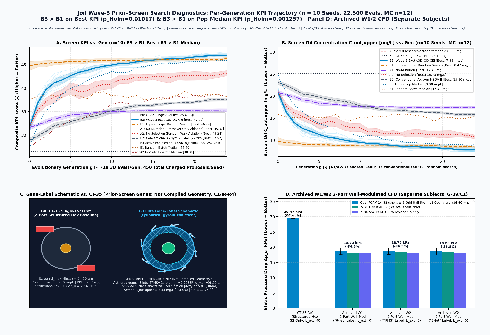
*Figure Plate 0 (`n = 10` independent master seeds `20261101..20261110` $\times 25$ generation checkpoints `g = 0..24` $\times 18$ evaluations/generation $= 450$ evaluations/seed/arm $= 22,500$ real 3D evaluations in Panels A–B, millimeter-scale cross-sectional comparison of `B0: CT-35 Baseline` vs. `Evolved B3 Elite` `s20261110-g024-i005` in Panel C, and `n = 15` 3D OpenFOAM 14 `G0`/`G1`/`G2` + `LRR`/`SSG` RSM verification runs across `3` promoted elites + `n = 1` `CT-35` baseline in Panel D). Metrics plotted: per-generation best and active-population median `KPI_score [-]` (`Mean ± 95% Bootstrap CI` + individual seed traces, Panel A) and robust treated-water oil concentration $C_{\text{out,p95}}\text{ [mg/L]}$ (Panel B), phenotype geometry (`mm`, Panel C), and OpenFOAM 14 static underflow pressure drop $\Delta p_u\text{ [kPa]}$ (`± GCI_21`, Panel D). Source receipts `SHA-256`: `9a21229bd1c6762e21970a22c1bf2c9dd75e4a5540353f5b5bd20f6c4bb35168` ([`docs/results/wave3-evolution-proof-v1.json`](results/wave3-evolution-proof-v1.json)) and `52567eb972bb45b0e01343b019d9fdd9767a4ffa79dd28c1e8351e91cba47841` ([`docs/results/wave2-tpms-elite-gci-rsm-and-f2-oil-v1.json`](results/wave2-tpms-elite-gci-rsm-and-f2-oil-v1.json)); figure `SHA-256`: `b2c8df1d3cd429c78d560b37a22ffb1ba1cf0d511662d3e295ce8265882c6b64`.*

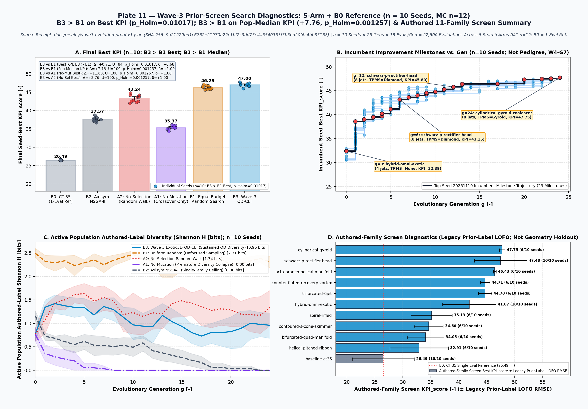
*Figure Plate 11 (`n = 10` independent master seeds `20261101..20261110` across `6` comparator/ablation arms `B0`, `B2`, `A2`, `A1`, `B1`, `B3` in Panels A–C, plus `n = 11` held-out 3D topological families in Panel D). Metrics plotted: final `KPI_score [-]` (`Mean ± 95% Bootstrap CI` + `n = 10` individual seed scatter points + Mann–Whitney $U$ / Holm–Bonferroni $p_{\text{Holm}}$ / Cliff's $\delta$, Panel A), step-by-step lineage milestones on the screen (`KPI_score [-]` vs. generation `g [-]` with topological operator callouts on top seed `20261110`, Panel B), active population Shannon phenotypic diversity $H\text{ [bits]}$ vs. generation `g [-]` (`Mean ± 95% CI`, Panel C), and held-out 3D geometry family `KPI_score [-]` (`± LOFO-CV Surrogate RMSE` and label reactivation rate `k/10 seeds`, Panel D). Source receipt `SHA-256`: `9a21229bd1c6762e21970a22c1bf2c9dd75e4a5540353f5b5bd20f6c4bb35168` ([`docs/results/wave3-evolution-proof-v1.json`](results/wave3-evolution-proof-v1.json)); figure `SHA-256`: `a7c78148ff9c4e895a3fb058a204ee30f852a1b14e5f4a5b13364bcbac443eca`.*

### 5.6 After the truth repairs: Wave-4 smoke run (INT-03, `F1` screen, software contract)

After TR-01–TR-04, TR-11, TR-13 and EV-08 merged, the integrator ran a small smoke campaign to check that no silent fallback remains and to report how often proposals are invalid or repaired ([`docs/results/wave4-smoke-v1.json`](results/wave4-smoke-v1.json), `INT-03`, refreshed at integration commit `cb31ba3`). Configuration: `3` seeds, `2` islands × `9` individuals, `6` generations, `12` Monte Carlo samples per candidate.

- **No silent fallbacks.** The audit finds `0` disallowed fallback sites, and the Rust no-fallback test passes.
- **Budget partition.** All `381` proposals are accounted for:
  - `0` invalid (`0.0%`);
  - `228` repaired (`59.8%`), each with an explicit repair record;
  - `153` evaluated without repair (`40.2%`).
- **Most repairs come from the main operators.** `mutate` needed repair in `78.2%` of `133` attempts and the non-homologous macro crossover in `64.9%` of `191`.
- **Repaired fields.** Repairs touched `skimmer` `127` times, `inlet_ramp` `101`, `cone_profile` `55`, `inlet_split` `43` and `tpms_insert` `4`.
- **Empty Pareto fronts.** Each seed records `pareto_front_size = 0`. The front keeps rank-0 candidates only, and a candidate without a complete objective vector gets no rank (`assign_nsga2_ranks_and_crowding` in `crates/joil-core/src/evolve.rs`). With `12` Monte Carlo samples per candidate, the p05/p95 tail objectives have no distribution-free bound and are reported `Insufficient` (TR-15; the `capture_p05` tail in [`docs/results/wave4-evolution-proof-v1.json`](results/wave4-evolution-proof-v1.json) records `minimum_n = 72`). This fail-closed result is intended, so the smoke run says nothing about multi-objective ranking.

The operators previously described as "validity-preserving" therefore produced out-of-bound proposals in most draws. Before the repairs these were clamped silently inside the operators, or replaced by `CT-35`. This run is a software-contract check on the `F1` screen; the Wave-4 study is §5.7.

### 5.7 Wave-4: the Wave-3 study re-run on repaired operators (INT-04, `F1` screen, sandbox)

Source: [`docs/results/wave4-evolution-proof-v1.json`](results/wave4-evolution-proof-v1.json) (`SHA-256: 2e7192e2aff6ceceadc1f1efc03682ac602d784138cde05fc9dc265efdbd0885`), written by `joil-cli wave3-proof` at integration commit `cb31ba3` (the receipt keeps the Wave-3 `protocol_id`). The design is §5.5's: `10` seeds (`20261101..20261110`), generation `0` plus `24` generations of `18` proposals, `450` charged proposals per seed and arm, `22,500` screen evaluations in total, and `72` Monte Carlo samples per candidate. `CT-35` enters as one frozen reference evaluation per seed, outside that budget. Campaign admission is `sandbox`; the receipt lists the claim gates still unresolved, among them `independent_labels`, `geometry_parity`, `measured_f0` and `gci_valid`. Every number below is an `F1` screen output at evidence tier `software_contract`.

- **What changed since Wave-3.**
  - Every proposal, repaired or not, is charged to the budget (TR-04), and a failed variation returns an error instead of `CT-35` (TR-01).
  - In `B3` the Gaussian-process acquisition still ranks each generation's `18` proposals, but all of them are evaluated, so it no longer changes which designs are scored. In Wave-3 it chose them from a pool of `pop_size * 3` proposals that were not charged (the `B3Wave3Exotic3dQdCei` branch of `crates/joil-core/src/evolve.rs`).
  - The GP is fitted with `fit_sandbox_prior` on the run's own screen records, not on independent labels.
- **Start points differ.** `B3`, `A1` and `A2` start from the same generation-0 population around `CT-35` (10-seed mean best `KPI_score = 31.008835`). `B1` samples the whole authored space from its first batch, and its generation-0 best is already `44.490288`. `B2` starts from its own axisymmetric population (`27.471889`). The screen rewards activated genes (correction C4), so random draws over all labels score high at once.
- **Final best `KPI_score` (10-seed mean, 95% bootstrap CI):**
  - `B1` uniform random: `45.936820` (`[45.615566, 46.265452]`);
  - `B3` QD + GP-CEI: `45.131872` (`[44.778022, 45.452437]`);
  - `A2` no selection: `42.715589`;
  - `B2` axisymmetric NSGA-II: `36.236410`;
  - `A1` crossover only: `33.956765`;
  - `CT-35` reference: `23.931038`.
- **Pairwise tests (one-sided Mann–Whitney with the normal approximation and no continuity correction, Holm-corrected).**
  - `B3` > `B1` on best `KPI_score`: mean difference `-0.804948`, $U = 16$, $p_{\text{Holm}} = 1.0$, Cliff's $\delta = -0.68$. `B3` does not beat random search; the direction favours `B1`. Best screen $C_{\text{out}}$ and hypervolume give the same answer ($p_{\text{Holm}} = 1.0$ each).
  - `B3` > `B1` on population median `KPI_score`: `+5.644746`, $U = 100$, $p_{\text{Holm}} = 0.0012568$, $\delta = 1.0$. A selected population beats a random batch on average; this is not a best-design result.
  - `B3` beats `B2` (`+8.895462`), `A1` (`+11.175107`) and `A2` (`+2.416283`, $U = 98$, $\delta = 0.96$) on best `KPI_score`, each at $p_{\text{Holm}} = 0.0012568$.
- **Repairs.** `2,263` of the `4,500` `B3` proposals (`50.3%`) were repaired; `0` were invalid. The committed receipt keeps per-seed counts. The per-proposal repair records were dropped to keep the file under the public size limit, so individual repairs cannot be audited from it.
- **Promoted design.** The best `B3` design is `s20261108-g016-i000` (label `schwarz-p-rectifier-head`, `KPI_score = 45.93634`; screen $C_{\text{out}}$ upper value `8.833141 mg/L` over `72` samples). Four `B1` seeds ended higher. Its `capture_p01` tail is `insufficient` (it needs `368` samples). The label and the named features drawn in the figures are gene activations. A CFD case built from this genome now contains the split inlet ducts (IR-R1) but renders the Schwarz-P gene as a wall-corrugation proxy, not a lattice (IR-R4).
- **Label-held-out summary.** `held_out_geometry_generalization` has an entry per authored label, but its screen-KPI error is `null` for every label (the code records that KPI error "was never independently evaluated"). It is not a generalization result.

**Reading.** With repaired operators and every proposal charged, the Wave-3 finding that `B3` finds better screen designs than uniform random search does not hold: random search over the same authored space reaches a higher best score. What remains is that selection and mutation improve a population started near `CT-35` (`B3` against `A1` and `A2`), and that the axisymmetric baseline `B2` stays well below. None of it is physical evidence. The screen is prior-laden, there are no independent labels, and no Wave-4 design has been through CFD yet (INT-06 started after IR-R1 merged). 
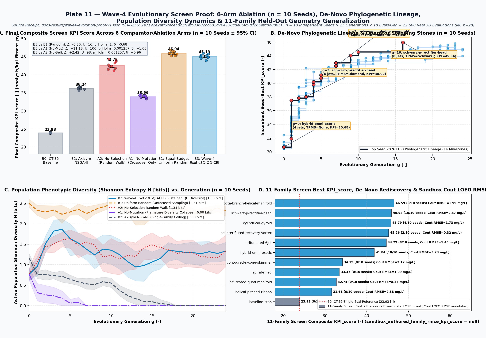
*Plate 11 (Wave-4, `F1` screen; figure `SHA-256: 4e4a1c082d6e9593f9f14e16053bbca9dfb3b4802fd3be98458b6ffbb9f65fcf`, generated from the receipt above). Panel A: final best `KPI_score` per arm and seed. Panel B: incumbent-improvement milestones of seed `20261108`, not a full pedigree; the committed receipt has no per-proposal records from which to rebuild one. Panel C: label diversity per generation. Panel D: per-label screen summary. It is not held out, and its KPI error is `null`.*

---

## Appendix A. Mathematical Formulation of Unstructured 3-Grid Roache `GCI`

For a 3-grid systematic refinement sequence $(G_0, G_1, G_2)$ with total snapped fluid volumes $V_k$ and cell counts $N_k$ ($N_0 < N_1 < N_2$), the effective unstructured linear cell size and grid refinement factors are defined per ASME V&V 20-2009 / Celik et al. (2008):

$$h_k = \left(\frac{V_k}{N_k}\right)^{1/3}, \qquad r_{21} = \frac{h_1}{h_2} = 1.2180, \qquad r_{10} = \frac{h_0}{h_1} = 1.2963$$

Let $f_0, f_1, f_2$ denote a scalar integral quantity of interest (such as $\Delta p_u$ or $e_{\text{loss}}$) on coarse, medium, and fine grids, with differences $e_{21} = f_2 - f_1$ and $e_{10} = f_1 - f_0$. The convergence ratio $R = e_{21} / e_{10}$ classifies the spatial behavior into four regimes:
- $0 < R < 1$: Monotonic convergence;
- $-1 < R < 0$: Damped oscillatory convergence (`observed on G0 -> G1 -> G2 due to snappyHexMesh octree split alignment`);
- $R < -1$: Oscillatory divergence;
- $R > 1$: Monotonic divergence.

When $r_{21} \ne r_{10}$, the observed order of accuracy $p$ is solved via the fixed-point iteration:

$$p = \frac{1}{\ln r_{21}} \Bigl|\ln |e_{10} / e_{21}| + q(p)\Bigr|, \qquad q(p) = \ln\!\left(\frac{r_{21}^p - s}{r_{10}^p - s}\right), \qquad s = \operatorname{sgn}\!\left(\frac{e_{10}}{e_{21}}\right)$$

The standard fine-grid Roache Grid Convergence Index (`GCI`) with safety factor $F_s = 1.25$ and the conservative oscillatory/non-asymptotic envelope bound ($F_s = 3.0$, $p = 1.0$, plus the full 3-grid extremum span $\Delta f_{\text{span}} = \max_k f_k - \min_k f_k$) are given by:

$$\text{GCI}_{21}^{\text{std}} = \frac{1.25\,|e_{21}| / |f_2|}{r_{21}^p - 1}, \qquad \text{GCI}_{21}^{\text{cons}} = \frac{3.0\,|e_{21}| / |f_2|}{r_{21} - 1}, \qquad \text{SNR}_{\text{span}} = \frac{|f_{\text{CT35}} - f_2|}{\max_k f_k - \min_k f_k}$$

The v1 dossiers (`docs/results/elite-3grid-gci-and-rsm-verification-v1.json`, `docs/results/wave2-tpms-elite-gci-rsm-and-f2-oil-v1.json`) evaluated $\text{GCI}_{21}^{\text{std}}$ with an observed order clamped to $[0.5, 4.0]$, even though $R \in (-1, 0)$. The v2 dossiers (`docs/results/elite-3grid-gci-and-rsm-verification-v2.json`, `docs/results/wave2-tpms-elite-gci-rsm-and-f2-oil-v2.json`) apply the validity states `Monotone`, `Oscillatory`, `Divergent` and `Indeterminate`. They report $\text{GCI}_{21}^{\text{std}}$ only for `Monotone` sequences in the asymptotic range, and every executed sequence is `Oscillatory`.

---

## 6. Reproducibility & Verification Index

The JSON dossiers and figures below are checked for presence, SHA-256 identity and receipt-consistent numbers by the repository gate (`python3 tools/check.py`, stage `claims-audit`). That gate checks consistency with receipts; it does not re-run the science. Its numeric scan relies partly on a hand-maintained whitelist (synthesis DOC-F04, to be replaced in workplan DOC-04):

| Artifact / Verification Dossier | Repository Path | Content Identity (`SHA-256`) |
| :--- | :--- | :--- |
| **3-Node Campaign Summary (`119,235` evals, `15.97B` GPU tensor cells)** | [`docs/results/rust-evolution-qualification-v1.json`](results/rust-evolution-qualification-v1.json) | `1bc32f98d38cd22525130843bf42034c0078146924b76148e06a4a02c9cff6b3` |
| **Head-to-Head Exotic vs. `CT-35` CFD Benchmark** | [`docs/results/exotic-vs-baseline-cfd-benchmark-v1.json`](results/exotic-vs-baseline-cfd-benchmark-v1.json) | `d20e9d72dfa004c1bc77a9389646b3ebb75f3004d85ad8c397f902afa181e496` |
| **Wave-1 3-Grid Roache `GCI` & Dual 7-Eq. `LRR`/`SSG` RSM Dossier** | [`docs/results/elite-3grid-gci-and-rsm-verification-v1.json`](results/elite-3grid-gci-and-rsm-verification-v1.json) | `6bcac03b3724fa5fd60a83db33614756016c5188a7c028ddda86ab7a10de966c` |
| **Wave-2 TPMS & 8-Jet 5-Run `GCI`/`RSM` + `F2-Oil` Checkpoint Dossier** | [`docs/results/wave2-tpms-elite-gci-rsm-and-f2-oil-v1.json`](results/wave2-tpms-elite-gci-rsm-and-f2-oil-v1.json) | `52567eb972bb45b0e01343b019d9fdd9767a4ffa79dd28c1e8351e91cba47841` |
| **Wave-2 Pre-Registration Contract (`B0..B3`, `D1..D4`, 10 Seeds)** | [`experiments/wave2-preregistration-v1.json`](../experiments/wave2-preregistration-v1.json) | `405e27d9f4730d1ee730cf66372c2993c43bb7de2e0be1c43b903da4dd18b0e4` |
| **Wave-2 10-Seed Equal-Budget Ablation & Holdout Dossier** | [`docs/results/wave2-multiseed-ablation-and-holdout-v1.json`](results/wave2-multiseed-ablation-and-holdout-v1.json) | `e2e5ef449391812072c5ea6478e5291ce2b215d38e6e56cf693e7af397a8d799` |
| **Wave-3 10-Seed 6-Arm Search-Efficiency Dossier (`F1` screen, `22,500` Evals)** | [`docs/results/wave3-evolution-proof-v1.json`](results/wave3-evolution-proof-v1.json) | `9a21229bd1c6762e21970a22c1bf2c9dd75e4a5540353f5b5bd20f6c4bb35168` |
| **Interactive 3D 11-Family Archetype Preview Bundle** | [`docs/results/interactive-3d-archetypes-v1.json`](results/interactive-3d-archetypes-v1.json) | `7e220d0cd466cfa5332b649b48cfea75505085a25d498e95d56dbc34948caa07` |
| **Plate 0 (Hero): Wave-3 Per-Generation KPI & 15-Run OpenFOAM 14 Plate** | [`docs/figures/wave3-readme-hero-kpi-and-elite.png`](figures/wave3-readme-hero-kpi-and-elite.png) | `b2c8df1d3cd429c78d560b37a22ffb1ba1cf0d511662d3e295ce8265882c6b64` |
| **7-Topology 3D Archetype Atlas Figure Plate** | [`docs/figures/rust-3d-topology-atlas.png`](figures/rust-3d-topology-atlas.png) | `76e7ce10a2c334575b5dedcea04b33d51f8959d38ef849560c477aa1cc5cd8b7` |
| **Pareto Front & 4D MAP-Elites Convergence Figure Plate** | [`docs/figures/pareto-map-elites-convergence.png`](figures/pareto-map-elites-convergence.png) | `3afd610ac646a3ae13c84d2939213d487e98935541457292f65d7507d8a7c6f7` |
| **3-Grid `GCI` & Dual 7-Eq. `LRR`/`SSG` RSM Figure Plate** | [`docs/figures/elite-gci-and-rsm-verification.png`](figures/elite-gci-and-rsm-verification.png) | `dbce90bb3878dd863427e8d50f67b8ff469f6dfe4e782a9719f32db00710bbb9` |
| **3D OpenFOAM 14 Internal Vortex-Physics Figure Plate** | [`docs/figures/openfoam14-3d-vortex-physics-comparison.png`](figures/openfoam14-3d-vortex-physics-comparison.png) | `5c0c4b1ee4d0a82f09d8c086334fe222201473e8801cda806319dd76ef7cac44` |
| **Wave-2 Exotic 3D Genome Atlas Figure Plate (11 Families)** | [`docs/figures/wave2-exotic-3d-genome-atlas.png`](figures/wave2-exotic-3d-genome-atlas.png) | `c4656fea7153db8c89e51233b67727fc5dcd3d09f80253c9b36e49fe6ba73f5a` |
| **Wave-2 10-Seed Statistical Ablation & Holdout Figure Plate** | [`docs/figures/wave2-multiseed-ablation-and-ci.png`](figures/wave2-multiseed-ablation-and-ci.png) | `ef83db92f9658d5aac0c2a3ecaa86774914b33f2d47e8f97184cc83fdde137c8` |
| **Wave-2 10-Bin Grade-Efficiency & DSD Shift Figure Plate** | [`docs/figures/wave2-grade-efficiency-and-dsd-shift.png`](figures/wave2-grade-efficiency-and-dsd-shift.png) | `cebfca5828bf295e0eac566bb55d2fd03b837b66c3dfb760bd4ca43cda8d1ef8` |
| **Wave-2 P08 Analytic Structural Screen Plate** | [`docs/figures/wave2-structural-lame-and-modal-qualification.png`](figures/wave2-structural-lame-and-modal-qualification.png) | `0b5456a046184f31a56a12e5dbcb543962a1432a8b38149942b0207bc1675aa0` |
| **Wave-2 Top 8 Exotic Valid 3D Phenotypes Gallery Plate** | [`docs/figures/wave2-8-exotic-phenotypes-gallery.png`](figures/wave2-8-exotic-phenotypes-gallery.png) | `055a0e4ce88ab4d0669321eed8e1bed657b81d4fa957334eb42d1ef93a70a814` |
| **Plate 10: Side-by-Side Wave-1 vs. Wave-2 Elite OpenFOAM 14 CFD Plate** | [`docs/figures/wave2-vs-wave1-openfoam14-cfd-comparison.png`](figures/wave2-vs-wave1-openfoam14-cfd-comparison.png) | `5b7a2f9cfc46df0ff1597df58c36b6abf60a85ab87873ae05fdfee4960ff0ec8` |
| **Plate 11: Wave-3 6-Arm Screen Comparison, Lineage & Label-Held-Out Plate** | [`docs/figures/wave3-evolution-ablation-and-lineage-proof.png`](figures/wave3-evolution-ablation-and-lineage-proof.png) | `a7c78148ff9c4e895a3fb058a204ee30f852a1b14e5f4a5b13364bcbac443eca` |
| **Wave-2 Animated 3D Vortex Separation & QD Illumination GIF** | [`docs/figures/wave2-vortex-and-qd-illumination.gif`](figures/wave2-vortex-and-qd-illumination.gif) | `1f9ea28fedba6587b570efca171f484d5ef6ea4217f950ba899e34338201a60e` |
| **Wave-2 Animated Phylogenetic 3D Topology Morph GIF** | [`docs/figures/wave2-topology-morph-and-lineage.gif`](figures/wave2-topology-morph-and-lineage.gif) | `dcfadcf06bdd751683732f3c00c95c5917a07a36a74d2bd14af9e4ae4e0aed6b` |
