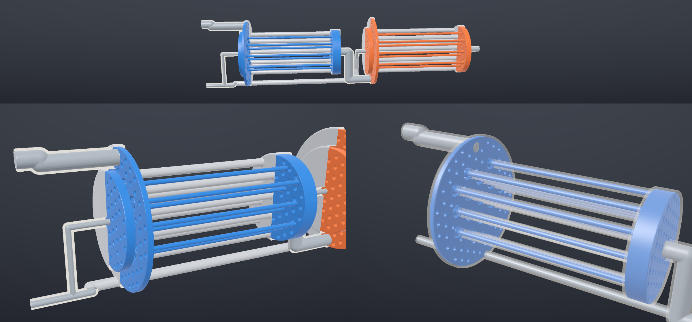
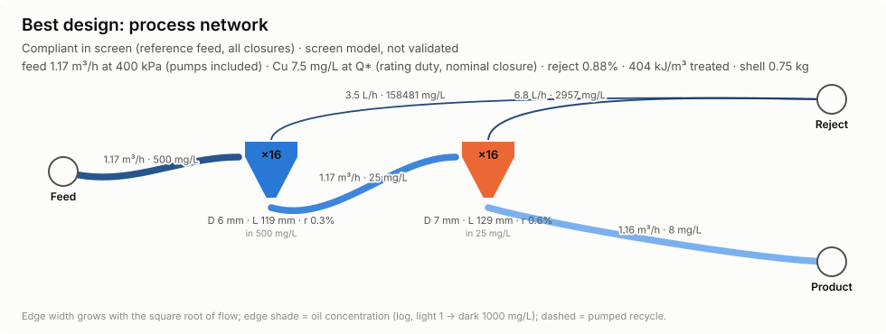
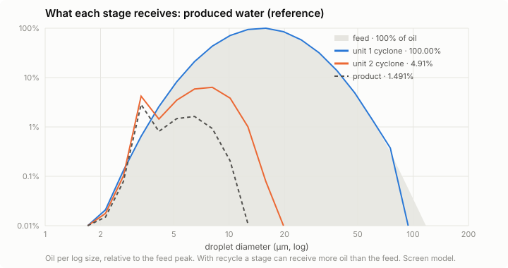
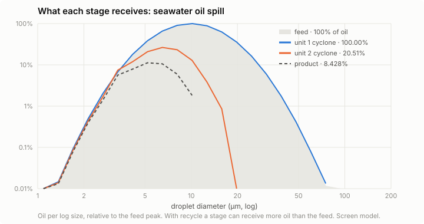
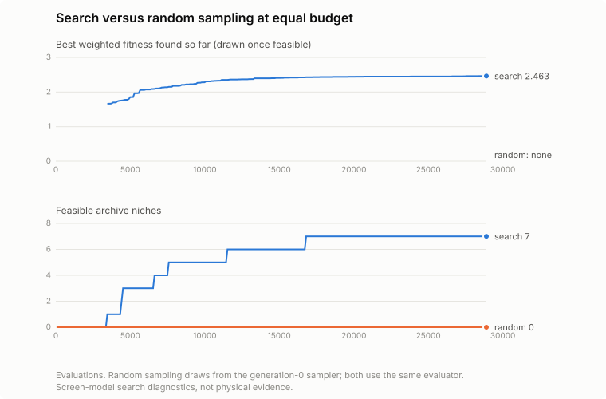
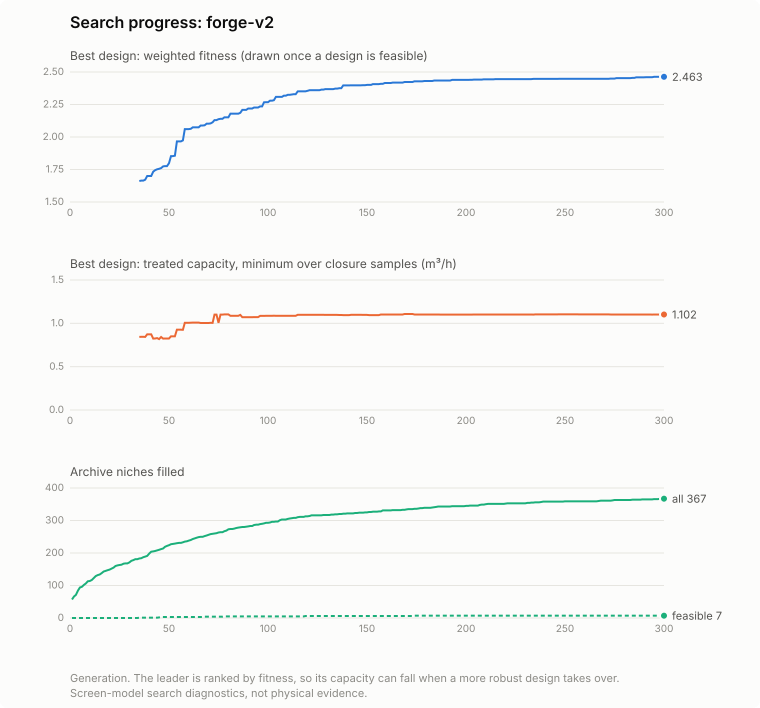
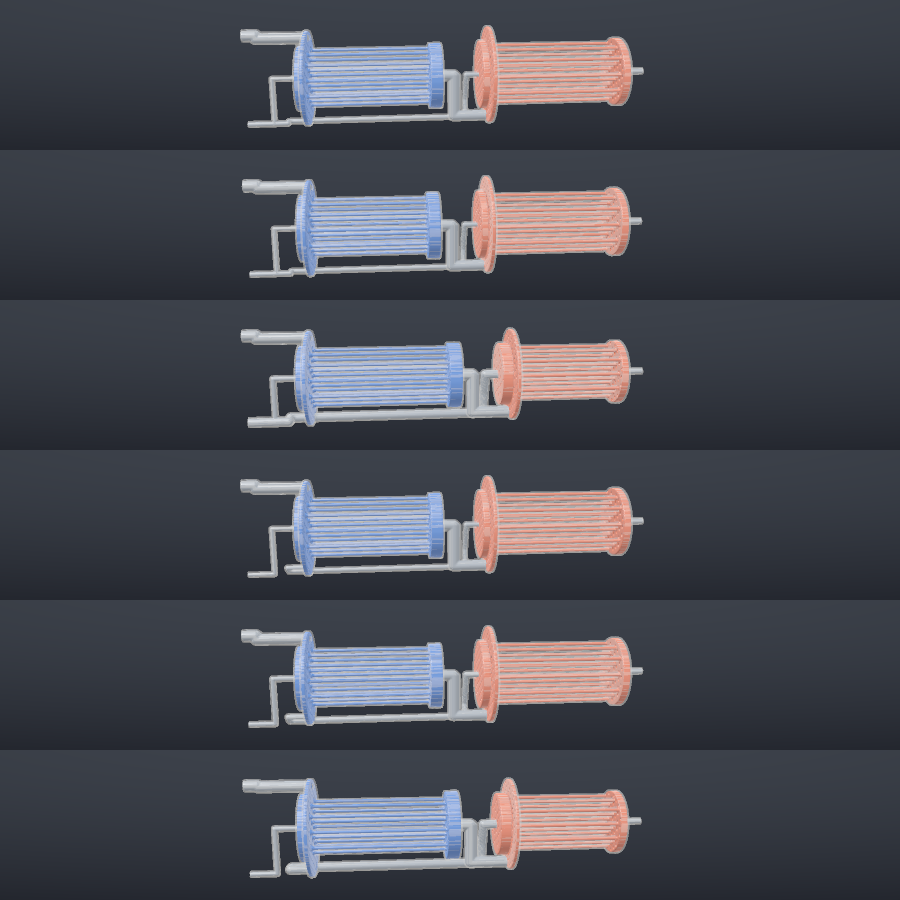
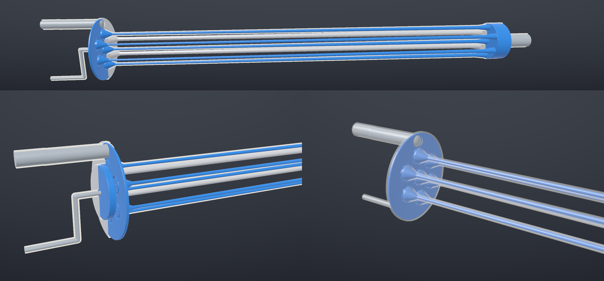

# The forge lane

One small, end-to-end pipeline for evolving printable, multi-stage deoiling cartridges,
scored first on how much oil they remove, in produced water and in seawater:

```text
genome (process network) ──develop──▶ hardware plant + cartridge layout ──judges──▶ score
        ▲                                         │                                   │
        └──────── mutate / crossover / archive ◀──┴──── CAD (STL, GLB) · renders ◀────┘
```

Two crates, one command:

| Crate | Role |
|---|---|
| `crates/joil-forge-judges` | Genome-blind physics: swirl decay, drop migration and diffusion, breakup, coalescer beds, network flows, pressures, pumps and recycle, capacity search. See [SCIENCE.md](SCIENCE.md). |
| `crates/joil-forge` | Genome, development and layout, scoring, island evolution with a diversity archive, checkpoints, CAD, renders, HTML report, and the `joil-forge` CLI. |

It depends on nothing else in the workspace. Every physical number it prints is a
reduced-order screen result (`unvalidated_reduced_order_screen`); the claim rules in
[`docs/SCIENCE.md`](../SCIENCE.md) apply in full.

## Run it

```bash
# evolve (writes only under runs/)
cargo run --release --locked -p joil-forge -- evolve \
    --campaign campaigns/forge-v2.json --run runs/forge/demo --generations 300 --threads 4

# stop at any time (Ctrl-C); continue exactly where it stopped
cargo run --release --locked -p joil-forge -- evolve --run runs/forge/demo --resume --generations 600

# start a NEW run from the best designs of an earlier one (pick up from the last best)
cargo run --release --locked -p joil-forge -- evolve \
    --campaign campaigns/forge-v2.json --seed-from runs/forge/demo --run runs/forge/next --generations 300

# changed the campaign but want to keep going? fork the lineage explicitly
cargo run --release --locked -p joil-forge -- evolve --run runs/forge/demo --resume --fork \
    --campaign my-campaign.json --generations 800

# dashboard, CAD and figures of a run
cargo run --release --locked -p joil-forge -- report --run runs/forge/demo
```

`just forge-evolve`, `just forge-resume`, `just forge-from-best`, `just forge-report` and
`just forge-test` wrap the same commands. Other subcommands: `eval` (score one genome at
report resolution), `baseline` (CT-35 same-model control), `cad` (meshes and audit),
`render` (PNG plate and SVG diagrams), `seeds` (archetype genomes), `best` (print the
best genome of a run), `campaign` (print the default campaign to edit) and `control`
(equal-budget random search: the generation-0 sampler and the same evaluator, for
comparing a run against plain sampling).

### What a run directory holds

| File | Purpose |
|---|---|
| `forge-campaign.json`, `manifest.json` | the exact campaign (a readable copy; the checkpoint carries its own) and the identity it is bound to (campaign digest, model and forge versions, fork parent, seed source) |
| `checkpoint.json` (+ `.prev`) | the complete state after the last finished generation, written atomically |
| `history.jsonl` | one line per generation |
| `best/genome.json`, `best/individual.json` | updated whenever the best design changes |
| `report/` | `index.html` (interactive 3D viewer, network, charts, what each stage receives, archive gallery), `best-plate.png`, `best-pfd.svg`, `best-grade.svg`, `best-stage-dsd-*.svg`, `evolution.svg`, `zoo.png`, `best/` with `fluid.stl`, `part.stl`, `cartridge.glb`, `cad-audit.json` (mesh and print audit), and `receipt.json` with figure digests |

**Restart semantics.** `--resume` reloads the checkpoint (populations, archive, RNG
states, innovation counter, history) and continues bit-for-bit: a run of 4 generations
equals a run of 2 plus a resume to 4, and results do not depend on the thread count
(both are tests). JSON floats round-trip exactly. A changed campaign or model version is
refused unless `--fork` is given. A fork records the parent manifest, preserves its exact
checkpoint and history under `lineage/<parent-manifest-sha256>/`, and recomputes every
population, archive and best-design score before saving or selecting new parents. Its
new trajectory starts empty; generation, genomes, innovation counter and RNG streams
continue from the parent. Re-evaluations count toward the evaluation total. Forge
`1.1.1` requires a fork for older scoring versions. `--seed-from` takes
a run directory, a checkpoint, or a genome / list of genomes and starts a new lineage
from its archive elites, best design and island leaders.

Failed duty or closure evaluations keep an unknown outlet and their original error;
they cannot produce a feasible objective. Numerical failure remains explicit. The
rating duty is checked again at the actual common rated flow. Campaign inputs must
have finite, valid weights, dimensions, properties, limits and terminal settings.
Historical demo receipts retain their original code identity and results; these
software repairs add no physical validation.

## The genome: a process network, not a parameter vector

A genome is a list of **unit genes** with stable innovation identities and one **route**
per outlet port:

| Unit | Genes | Outlets |
|---|---|---|
| Cyclone | swirl-chamber diameter, chamber length, 1–6 free wall segments (length, end radius), jets 1–8, inlet area and aspect, involute entry, orifice ratio, split, **cells 1–19** (identical parallel cells) | overflow, underflow |
| Coalescer | bed diameter and length, porosity, strut size (≥ 1 mm), cells | bed exit |
| Splitter | fraction | two branches |

A route names its destination by identity (another unit, product or reject), a channel
diameter, and whether a **pump** boosts it. Series stages, numbered-up cells, parallel
branches, reject scavengers whose underflow returns upstream, pumped recycles, coalescer
pre-treatment and free-form walls with throats, bulges or several cones are all ordinary
values of this one type. No family labels are stored; descriptors are measured from the
developed hardware.

**Variation.** Structural operators insert a series stage, number cells up or down
(keeping the total chamber cross-section), add a reject scavenger, branch through a
splitter, add a pumped recycle, insert a coalescer, delete a unit (bypassing it), rewire a
port, duplicate a unit, edit the wall profile or toggle a pump. Parametric mutation
perturbs genes in log space with occasional large jumps, and a rare transposon replaces a
unit's body. Crossover aligns units by innovation identity (NEAT-style), takes matched
units from either parent with optional gene blending, and inherits unmatched ones from
the fitter parent. Nothing ever falls back to a baseline.

**Canonical form.** Normalisation clamps every gene to its bound, repairs broken
references (overflow to reject, everything else to product), drops units the feed cannot
reach, keeps walls inside the model's applicability envelope by lengthening steep
segments, rounds continuous genes (1e-4, or 1e-6 for small ratios) and is idempotent. The
canonical SHA-256 of a genome is the digest of its normalised JSON.

**Seeding.** The default campaign is de novo: random networks only. `"seeding":
"archetypes"` adds the agent-written comparison designs from `joil-forge seeds`
(CT-35, a series pair, mini-cells, a scavenger with recycle, coalescer-first).

## Development and layout: printable by construction

Development turns a genome into the judges' plant and into a part that fits a printer:
by default a Ø100 mm footprint and a **400 mm build height**, 1.5 mm Ti-6Al-4V walls,
printed standing on its head (feed and reject face on the plate). All of these are
campaign settings; set them to the machine.

* **Bays follow the flow.** Overflow streams leave a cyclone upward and every other
  stream leaves downward, so a unit fed by an overflow sits above its source and a unit
  fed by an underflow below it.
* **Series stages fold.** Development also tries a folded layout: consecutive bays merge
  and stages stand side by side whenever their footprints fit, with streams turning back
  up through vertical lanes. It keeps whichever layout has fewer violations, then the
  shorter one. The genome never chooses; a chain is short when its stages are slim.
* **Multi-cell units are real manifolds.** Cells sit on a hexagonal cluster inside three
  plenum chambers: an overflow chamber above the roofs, an inlet chamber at jet height
  around the cell columns, and an underflow chamber below the exits.
* **Channels are routed.** Each channel drops into a routing gap, runs on its own level,
  and crosses bays on a vertical lane that avoids every vortex chamber, jet and bed.
  Lanes may pass through plenum chambers inside their own wall. Blocked runs detour through
  a waypoint; anything still blocked is a clearance violation.
* **Gates, all graded** so search can climb back inside them: build height, footprint
  packing, lane and channel clearance, printable passages (3 mm channels, 1 mm machined
  orifices, 1 mm struts), a **3 mm minimum swirl bore** (powder removal, sand), cells at
  most **30 swirl-chamber diameters** long (CT-35, behind the model's CFD anchor, is about
  23), and the wall-angle envelope.

The 400 mm limit is what removed the extreme tails of the first campaign, whose leader
was a 796 mm part with 600 mm tails of 3–6 mm bore. A probe at 400 mm with cells of at
least 8 mm found nothing compliant in 200 generations; allowing cells down to 5 mm (the
bore limit still applies) let it find compliant designs within about 35, so the genome's
diameter bound is 5–72 mm.

## Scoring: separation first

1. Geometry and print gates, pump policy, reject budget (2 %), recycle amplification (≤ 8×).
2. **Duties.** The campaign lists duties, each with its own water, oil and feed. Default:
   produced water (the repository reference: 998 kg/m³ water, 850 kg/m³ oil, 500 mg/L,
   median 15 µm) and a **seawater oil spill** (seawater at 15 °C, 1025.89 kg/m³ and
   1.220 mPa·s; a 900 kg/m³ medium crude at 1000 mg/L, median 10 µm). The first duty rates
   the design.
3. **Rating.** Treated capacity `Q*(1 − r)` at the 400 kPa budget (feed pressure plus pump
   shaft work per feed volume) and the 30 mg/L limit on the rating duty, for every
   Latin-hypercube closure sample and again at the finer report resolution. **Feasible**
   means compliant in all of them; capacity is the minimum, and the rated flow follows
   from it.
4. **Separation.** Every duty runs at the rated flow under every closure sample; its
   worst outlet `C_out,d` counts.
5. Weighted objective for feasible designs:

```text
fitness = 1.0 · mean_d ln(C_in,d / max(C_out,d, 1 mg/L))      oil removal, all duties
        + 0.5 · ln(Q_treated / 1 m³/h)                         throughput
        − 0.25 · ln(E / 100 kJ/m³) − 0.15 · ln(m_shell / 1 kg) − 0.02 · units
```

Oil removal leads. Below 1 mg/L, about the bottom of routine oil-in-water measurement,
further removal earns nothing. `E` is the energy per treated m³ (pumps included) and
`m_shell` the printed titanium mass estimate. Infeasible designs rank by their graded
violation, so search has a gradient toward feasibility. `joil-forge campaign` prints
every weight, limit, duty and print rule.

**No bonus for series.** Nothing in the objective mentions stages, and nobody seeds a
chain. The judges compose stages on the drop population each one actually receives:
after a first stage the oil is scarcer and finer, so a second stage that differs from the
first can still remove a lot, or almost nothing. Whether that pays its pressure is for
the physics to say; the report's "what each stage receives" chart shows the evidence.

## Evolution

Island populations breed offspring from tournament parents or, with probability 0.3,
from archive elites; crossover with probability 0.3; structural mutation with probability
0.45. Survivors are the best of parents and offspring, unique by canonical hash, with at
most a third of an island from one behaviour niche. Islands exchange their best designs
in a ring. The **MAP-Elites archive** keys niches on measured hardware: cyclone cells
(1, 2–3, 4–7, 8–15, 16+), series depth, recycles, auxiliary units and **stage taper**
(later cyclone stages alike, smaller or larger than the first). It keeps the best design
of every niche, which lets unfamiliar topologies, including chains of unlike stages,
survive long enough to improve. The archive shapes diversity only; it never adds to
fitness. Evaluation is parallel and pure, and offspring are bred sequentially from
per-island streams.

## CAD and visuals

* **Signed distance model.** Chambers are solids of revolution, jets oriented boxes,
  plenums and beds capped cylinders, channels capsule sweeps, splitters spheres. Channels
  that pass through a plenum are carved out with a wall. The printed part is the shell
  `0 < d ≤ wall`, cut open at the ports. Coalescer beds carry a gyroid lattice when the
  voxel resolves the struts.
* **Meshing.** Streaming marching tetrahedra (Kuhn decomposition) on one sample grid for
  both the fluid domain and the part. Vertices are welded by grid edge and triangle
  winding is decided combinatorially from the tetrahedron orientation, so slivers cannot
  flip. Every mesh is audited: closed, consistently oriented, components, Euler
  characteristic, genus per component, volume, area. The fluid domain's genus is a
  measured topology (loops through shared plenums and recycles), not a gene label. The
  default voxel puts two samples across the wall and the smallest passage (0.5–1 mm), and
  the audit warns when a wall or passage spans fewer than two voxels; at coarser voxels a
  1.5 mm wall can open pinholes and a 1 mm jet can pinch shut.
* **Printable by construction.** Horizontal channel runs wider than the 8 mm bridge limit
  get a 45° teardrop roof, and every plenum keeps solid support posts (Ø3 mm) on a
  hexagonal lattice at the bridge pitch, placed only where they stay clear of jets,
  orifices, channels and cells. The print audit counts downward-facing internal surface
  within 40° of horizontal and, by probing the field just below each face, how much of it
  lies farther than half the bridge from any support. A single connected fluid domain
  also means no sealed pocket traps powder.
* **Formats.** `fluid.stl` and `part.stl` in millimetres in the design frame (z downstream),
  `cartridge.glb` in metres, Y up, with a translucent titanium part and the fluid coloured
  by unit.
* **Figures.** A dependency-free software rasteriser draws the engineering plate (full
  cutaway strip, head cutaway, x-ray), PNG-encoded in-house; SVG process-flow diagrams,
  grade-efficiency curves, the drop sizes each stage receives on each duty, and evolution
  panels follow a validated colour-blind-safe
  categorical palette and adapt to dark mode; the HTML report embeds a WebGL2 viewer.

## Demo run

The numbers and figures below are recorded in
[`results/forge-v2-demo-receipt.json`](results/forge-v2-demo-receipt.json), with SHA-256
digests of every figure. They are screen-model search outputs at report resolution.

One run of the default campaign (`campaigns/forge-v2.json`), de novo (random networks
only, no archetypes): two islands of 48 for 300 generations, three closure samples plus
the nominal closure, 28 896 evaluations, about 12 minutes on two cores. It ran as 150
generations, a stop and `--resume` to 300. Reproduce it with `just forge-evolve`,
`just forge-control` and `joil-forge report --run runs/forge/demo --control
runs/forge/control.json`.



*The leader: two stages in series, found without any seeding. Sixteen 6.0 mm cells, each
with a single involute jet and a 3.1 mm bore, feed sixteen 6.8 mm cells. Each stage is a
hexagonal bundle in its own three plenums; the plenum ceilings carry 322 support posts.
The part is 399 mm tall, inside the 400 mm build height, and prints at about 0.91 kg.*

| | Produced water (reference) | Seawater oil spill |
|---|---|---|
| Inlet | 500 mg/L | 1000 mg/L |
| Outlet, worst closure at the rated flow | 12.8 mg/L | 151 mg/L |
| Removed | 97.4 % | 84.9 % |

Treated capacity is 1.10 m³/h at 400 kPa. The weighted fitness is 2.48 at report
resolution and 2.46 at search resolution.

**Series emerged on its own.** Six of the seven feasible niches in the final archive are
two-stage chains (with and without a pumped recycle, and with every stage taper). At
search resolution the one feasible single stage discharges 34 mg/L of produced water and
275 mg/L in the spill duty, against the chain's 13 and 152 mg/L. Among the chains, second stages within
15 % of the first stage's diameter scored best (2.46), larger second stages next (2.43),
smaller ones last (2.25); pumped recycles cost more than they returned.



**What each stage receives.** After the first stage, the produced-water oil reaching the
second stage is 4.9 % of the feed oil, almost all of it below 20 µm; the product carries
1.5 %. In the spill duty the second stage receives 20.5 % and passes on 8.4 %. A second
stage still removes more than half of what reaches it in both duties, which is why the
chain pays for its pressure here.





**Search against sampling.** `joil-forge control` spent the same 28 896 evaluations on
genomes from the generation-0 sampler with the same evaluator and found no feasible
design. The search found its first after about 3 500 evaluations (generation 35) and
ended with 7 feasible niches. One seed of each.







**CAD and print audit.** Meshed at 0.51 mm, the fluid domain and the printed part are each
one closed, consistently oriented component; one fluid component also means no sealed
pocket can trap powder. Of 22 684 mm² of downward-facing internal surface, about 244 mm²
(1 %) lies farther than half the 8 mm bridge from a support, mostly next to overflow
orifices where posts must keep clear. Both horizontal runs wider than 8 mm have teardrop
roofs.

**Same-model CT-35 control.** Under this screen the CT-35 liner alone reaches about
120 mg/L at its pressure-limited flow and has no compliant tested flow at the 30 mg/L
limit; built in the forge layout it is about 1.7 m tall and does not fit the build height. A gain over CT-35 is undefined and
none is claimed.

## First campaign (v1): why these constraints exist

The first campaign (receipt
[`results/forge-v1-demo-receipt.json`](results/forge-v1-demo-receipt.json), figures in
[`figures/v1/`](figures/v1/)) rated designs on capacity alone, allowed an 1800 mm part and
had no print rules. Over 300 generations a two-stage series design led for about 175
generations, then a single stage of seven 14.8 mm cells with 600 mm tails of 3–6 mm bore
took over (2.58 m³/h at 10.8 mg/L, a 796 mm part). Re-scoring that leader with shorter
tails showed the last third of the length bought almost nothing, while the model's trust
in such slender cells, the powder removal from their bores and the build height were all
doubtful. That is why the objective now leads with oil removal and the part must fit a
printer. Random sampling on that campaign, with the same budget, found 2 compliant
designs against the search's 9 feasible niches.



## Simplification

The forge does not replace the evidence kernel, the CFD lane or the qualification gates.
It replaces the role the legacy `F1` screen played in search: a fixed macro genome with
gene-derived descriptor priors, on which the repository's own Wave-4 study found that
evolution did not beat uniform random search. Here the
genome is open-ended, descriptors are measured, the physics is derived from conservation
laws with declared closures, and the whole loop (search, CAD, print audit, figures,
restart) is about twelve thousand lines in two crates. Wiring forge elites into the evidence kernel and the
OpenFOAM lane is the next integration step; retiring the legacy screen is a separate
decision for the owners.

## Limits

Everything in [SCIENCE.md §11](SCIENCE.md#11-what-is-not-modelled), plus: the spill oil
and drop sizes are authored assumptions, not site data; routing is a heuristic and can
fail on dense layouts; the plenum, post and jet geometry is a design convention, not an
optimised manifold, and the physics does not see the posts; the print audit is a
geometric screen, not a build simulation, and says nothing about distortion, residual
stress or surface finish; masses are shell estimates without mounting features. No forge
geometry has been meshed for CFD, printed or tested. The demo and its random-search
control are one seed each; a multi-seed comparison is the next measurement before any
claim about average search performance.
