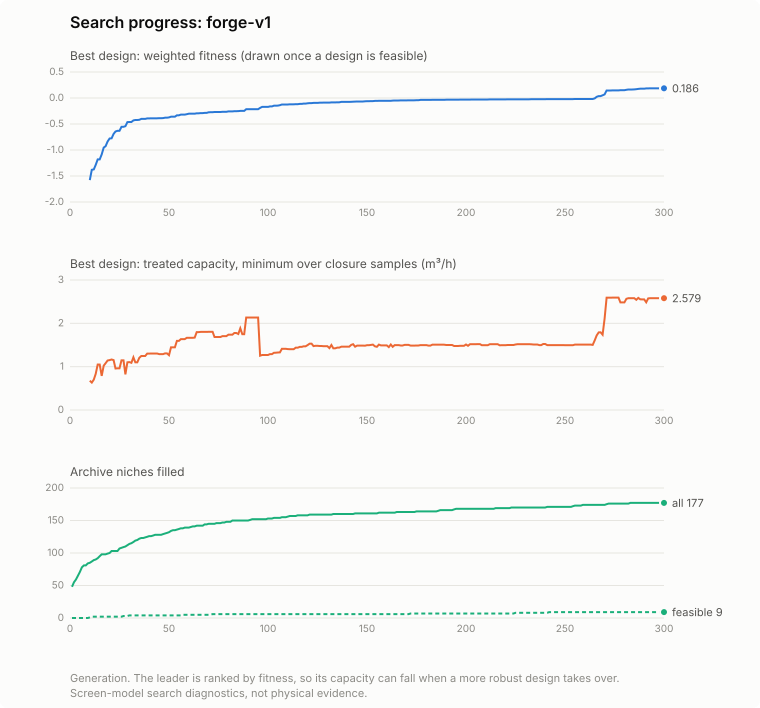
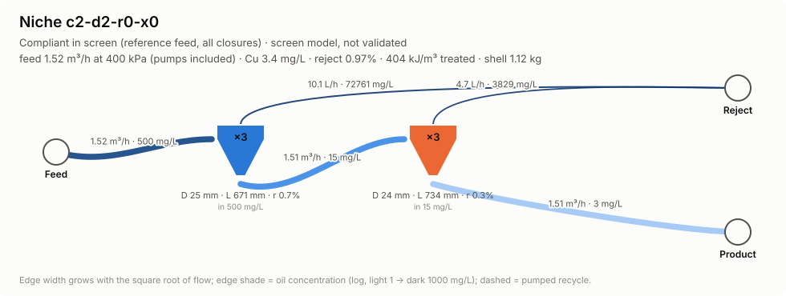
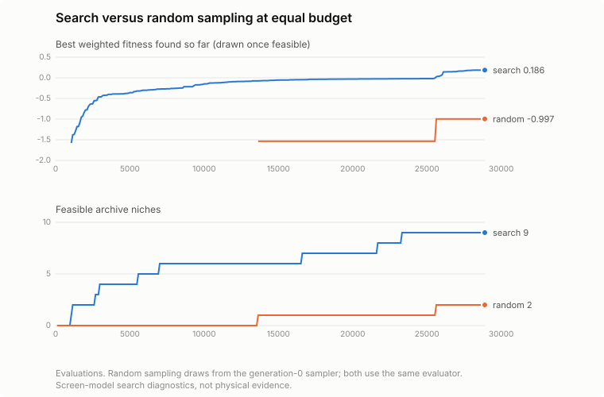
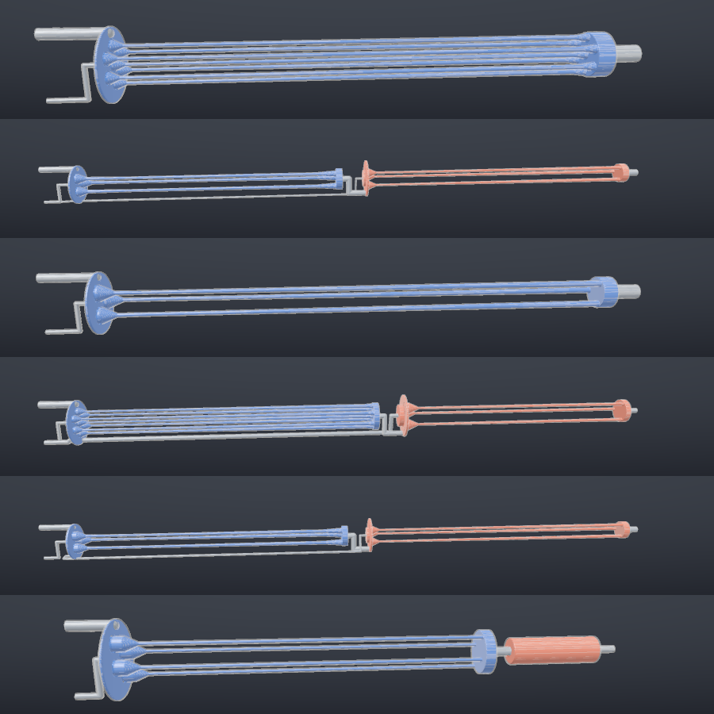

# The forge lane

One small, end-to-end pipeline for evolving multi-stage deoiling cartridges:

```text
genome (process network) ──develop──▶ hardware plant + cartridge layout ──judges──▶ score
        ▲                                         │                                   │
        └──────── mutate / crossover / archive ◀──┴──── CAD (STL, GLB) · renders ◀────┘
```

Two crates, one command:

| Crate | Role |
|---|---|
| `crates/joil-forge-judges` | Genome-blind physics: swirl decay, drop migration and diffusion, breakup, coalescer beds, network flows, pressures, pumps and recycle, capacity search. See [SCIENCE.md](SCIENCE.md). |
| `crates/joil-forge` | Genome, development and layout, scoring, island evolution with a diversity archive, checkpoints, CAD, renders, HTML report, and the `joil-forge` CLI. |

It depends on nothing else in the workspace. Every physical number it prints is a
reduced-order screen result (`unvalidated_reduced_order_screen`); the claim rules in
[`docs/SCIENCE.md`](../SCIENCE.md) apply in full.

## Run it

```bash
# evolve (writes only under runs/)
cargo run --release --locked -p joil-forge -- evolve \
    --campaign campaigns/forge-v1.json --run runs/forge/demo --generations 300 --threads 4

# stop at any time (Ctrl-C); continue exactly where it stopped
cargo run --release --locked -p joil-forge -- evolve --run runs/forge/demo --resume --generations 600

# start a NEW run from the best designs of an earlier one (pick up from the last best)
cargo run --release --locked -p joil-forge -- evolve \
    --campaign campaigns/forge-v1.json --seed-from runs/forge/demo --run runs/forge/next --generations 300

# changed the campaign but want to keep going? fork the lineage explicitly
cargo run --release --locked -p joil-forge -- evolve --run runs/forge/demo --resume --fork \
    --campaign my-campaign.json --generations 800

# dashboard, CAD and figures of a run
cargo run --release --locked -p joil-forge -- report --run runs/forge/demo
```

`just forge-evolve`, `just forge-resume`, `just forge-from-best`, `just forge-report` and
`just forge-test` wrap the same commands. Other subcommands: `eval` (score one genome at
report resolution), `baseline` (CT-35 same-model control), `cad` (meshes and audit),
`render` (PNG plate and SVG diagrams), `seeds` (archetype genomes), `best` (print the
best genome of a run), `campaign` (print the default campaign to edit) and `control`
(equal-budget random search: the generation-0 sampler and the same evaluator, for
comparing a run against plain sampling).

### What a run directory holds

| File | Purpose |
|---|---|
| `forge-campaign.json`, `manifest.json` | the exact campaign (a readable copy; the checkpoint carries its own) and the identity it is bound to (campaign digest, model and forge versions, fork parent, seed source) |
| `checkpoint.json` (+ `.prev`) | the complete state after the last finished generation, written atomically |
| `history.jsonl` | one line per generation |
| `best/genome.json`, `best/individual.json` | updated whenever the best design changes |
| `report/` | `index.html` (interactive 3D viewer, network, charts, archive gallery), `best-plate.png`, `best-pfd.svg`, `best-grade.svg`, `evolution.svg`, `zoo.png`, `best/` with `fluid.stl`, `part.stl`, `cartridge.glb`, `cad-audit.json`, and `receipt.json` with figure digests |

**Restart semantics.** `--resume` reloads the checkpoint (populations, archive, RNG
states, innovation counter, history) and continues bit-for-bit: a run of 4 generations
equals a run of 2 plus a resume to 4, and results do not depend on the thread count
(both are tests). JSON floats round-trip exactly. A changed campaign or model version is
refused unless `--fork` is given, which records the parent manifest. `--seed-from` takes
a run directory, a checkpoint, or a genome / list of genomes and starts a new lineage
from its archive elites, best design and island leaders.

## The genome: a process network, not a parameter vector

A genome is a list of **unit genes** with stable innovation identities and one **route**
per outlet port:

| Unit | Genes | Outlets |
|---|---|---|
| Cyclone | swirl-chamber diameter, chamber length, 1–6 free wall segments (length, end radius), jets 1–8, inlet area and aspect, involute entry, orifice ratio, split, **cells 1–19** (identical parallel cells) | overflow, underflow |
| Coalescer | bed diameter and length, porosity, strut size (≥ 1 mm), cells | bed exit |
| Splitter | fraction | two branches |

A route names its destination by identity (another unit, product or reject), a channel
diameter, and whether a **pump** boosts it. Series stages, numbered-up cells, parallel
branches, reject scavengers whose underflow returns upstream, pumped recycles, coalescer
pre-treatment and free-form walls with throats, bulges or several cones are all ordinary
values of this one type. No family labels are stored; descriptors are measured from the
developed hardware.

**Variation.** Structural operators insert a series stage, number cells up or down
(keeping the total chamber cross-section), add a reject scavenger, branch through a
splitter, add a pumped recycle, insert a coalescer, delete a unit (bypassing it), rewire a
port, duplicate a unit, edit the wall profile or toggle a pump. Parametric mutation
perturbs genes in log space with occasional large jumps, and a rare transposon replaces a
unit's body. Crossover aligns units by innovation identity (NEAT-style), takes matched
units from either parent with optional gene blending, and inherits unmatched ones from
the fitter parent. Nothing ever falls back to a baseline.

**Canonical form.** Normalisation clamps every gene to its bound, repairs broken
references (overflow to reject, everything else to product), drops units the feed cannot
reach, keeps walls inside the model's applicability envelope by lengthening steep
segments, rounds continuous genes (1e-4, or 1e-6 for small ratios) and is idempotent. The
canonical SHA-256 of a genome is the digest of its normalised JSON.

**Seeding.** The default campaign is de novo: random networks only. `"seeding":
"archetypes"` adds the agent-written comparison designs from `joil-forge seeds`
(CT-35, a series pair, mini-cells, a scavenger with recycle, coalescer-first).

## Development and layout

Development turns a genome into the judges' plant and into a cartridge inside the
declared full-cartridge scope (Ø100 mm × 1800 mm, 1.5 mm Ti-6Al-4V walls). This scope
is separate from the frozen CT-35 head-retrofit interfaces, as
[PROCESS_NETWORKS.md](../design/PROCESS_NETWORKS.md) requires for multistage work.

* **Bays follow the flow.** Overflow streams leave a cyclone upward and every other
  stream leaves downward, so a unit fed by an overflow is stacked above its source and a
  unit fed by an underflow below it. Units in one bay sit side by side.
* **Multi-cell units are real manifolds.** Cells sit on a hexagonal cluster inside three
  plenum chambers: an overflow chamber above the roofs, an inlet chamber at jet height
  around the cell columns, and an underflow chamber below the exits.
* **Channels are routed.** Each channel drops into a routing gap, runs on its own level,
  and crosses bays on a vertical lane that avoids every vortex chamber, jet and bed.
  Lanes may pass through plenum chambers inside their own wall. Blocked runs detour through
  a waypoint; anything still blocked is a clearance violation.
* **Gates.** Bay packing, cartridge length, lane and channel clearance, printable passages
  (3 mm channels, 1 mm machined orifices, 1 mm struts) and the applicability envelope.
  Violations are graded, so search can climb out of them.

## Scoring

1. Geometry gates, pump policy, reject budget (2 %), recycle amplification (≤ 8×).
2. Treated capacity `Q*(1 − r)` at the 400 kPa pressure budget (feed pressure plus pump
   shaft work per feed volume) and the 30 mg/L limit, for the nominal closure.
3. If compliant, the same for every Latin-hypercube closure sample and once more at the
   finer report resolution. **Feasible** means compliant in all of them; capacity is the
   minimum.
4. Off-design feed margin: every campaign scenario (default: the same feed with an 8 µm
   oil-volume median, as after upstream shear) runs once at the rated flow `Q*`. The
   margin `m = min(1, limit / C_out)` over scenarios is 1 when they all still comply.
5. Weighted objective for feasible designs:

```text
fitness = 1.0·ln(Q_treated / 1 m³/h) + 1.0·ln(m) − 0.25·ln(E / 100 kJ/m³)
          − 0.15·ln(m_shell / 1 kg) − 0.02·units
```

The first two terms are the log of an effective capacity: a design that misses the
fine-feed limit by a factor of two keeps half its capacity credit. Both are continuous, so
nothing is gained by sitting exactly on the limit. `E` is the energy per treated m³
(pumps included) and `m_shell` the printed titanium mass estimate. Infeasible designs
rank by their graded violation, so search has a gradient toward feasibility. Weights,
limits, feed, scenarios, envelope and closure sample count live in the campaign file
(`joil-forge campaign` prints the defaults).

**The duty decides the architecture.** With an easy feed the cheapest way to more
capacity is a larger or numbered-up single stage. Series stages, scavengers and recycles
only earn their pressure when the separation is hard, so the default duty includes the
fine-feed scenario. In the demo below a two-stage design leads for most of the run before
a numbered-up single stage overtakes it; a heavier margin weight or a finer scenario
favours staging. Change the duty and the answer changes, which is why it lives in the
campaign and not in the code.

## Evolution

Island populations breed offspring from tournament parents or, with probability 0.3,
from archive elites; crossover with probability 0.3; structural mutation with probability
0.45. Survivors are the best of parents and offspring, unique by canonical hash, with at
most a third of an island from one behaviour niche. Islands exchange their best designs
in a ring. The **MAP-Elites archive** keys niches on measured hardware: cyclone cells
(1, 2–3, 4–7, 8–15, 16+), series depth, recycles and auxiliary units. It keeps the best
design of every niche, which is what lets unfamiliar topologies survive long enough to
improve. Evaluation is parallel and pure, and offspring are bred sequentially from
per-island streams.

## CAD and visuals

* **Signed distance model.** Chambers are solids of revolution, jets oriented boxes,
  plenums and beds capped cylinders, channels capsule sweeps, splitters spheres. Channels
  that pass through a plenum are carved out with a wall. The printed part is the shell
  `0 < d ≤ wall`, cut open at the ports. Coalescer beds carry a gyroid lattice when the
  voxel resolves the struts.
* **Meshing.** Streaming marching tetrahedra (Kuhn decomposition) on one sample grid for
  both the fluid domain and the part. Vertices are welded by grid edge and triangle
  winding is decided combinatorially from the tetrahedron orientation, so slivers cannot
  flip. Every mesh is audited: closed, consistently oriented, components, Euler
  characteristic, genus per component, volume, area. The fluid domain's genus is a
  measured topology (loops through shared plenums and recycles), not a gene label. The
  default voxel puts two samples across the wall and the smallest passage (0.5–1 mm), and
  the audit warns when a wall or passage spans fewer than two voxels; at coarser voxels a
  1.5 mm wall can open pinholes and a 1 mm jet can pinch shut.
* **Formats.** `fluid.stl` and `part.stl` in millimetres in the design frame (z downstream),
  `cartridge.glb` in metres, Y up, with a translucent titanium part and the fluid coloured
  by unit.
* **Figures.** A dependency-free software rasteriser draws the engineering plate (full
  cutaway strip, head cutaway, x-ray), PNG-encoded in-house; SVG process-flow diagrams,
  grade-efficiency curves and evolution panels follow a validated colour-blind-safe
  categorical palette and adapt to dark mode; the HTML report embeds a WebGL2 viewer.

## Demo run

The numbers and figures below are recorded in
[`docs/forge/results/forge-v1-demo-receipt.json`](results/forge-v1-demo-receipt.json),
with SHA-256 digests of every figure. They are screen-model search outputs.

One run of the default campaign (`campaigns/forge-v1.json`), de novo (random networks
only, no archetypes): two islands of 48 for 300 generations, three closure samples plus
the nominal closure, 28 896 evaluations, about 10 minutes on two cores.
It ran as 150 generations, a stop, and `--resume` to 300. Reproduce it with
`just forge-evolve`, `just forge-control` and
`joil-forge report --run runs/forge/demo --control runs/forge/control.json`.


*The leader after 300 generations: seven parallel 14.8 mm cells on a hexagonal cluster,
eight jets each, sharing an inlet chamber, an overflow chamber and an underflow chamber.
Each cell contracts to a 3.1 mm throat within 1.5 chamber diameters, holds 3–4 mm for
10 diameters, widens over a 30-diameter tail to 6.2 mm and flares to 10.6 mm at the exit.
Printed shell 0.85 kg; part length 796 mm.*

| Leader | Generations | Treated capacity | `C_out` at `Q*` | Fine-feed margin |
|---|---|---|---|---|
| first feasible design | 10 | 0.68 m³/h | 13.4 mg/L | – |
| two stages in series, 3 cells feeding 3 cells | 96–270 | about 1.5 m³/h | about 3 mg/L | about 1 |
| one stage, 7 cells with long flared tails | 271–300 | 2.58 m³/h | 10.8 mg/L | 0.64 |

All three rows are compliant at the reference feed under every closure sample and at the
finer report resolution (search fitness 0.186, report-resolution fitness 0.184). For about
175 generations the leader was a two-stage series cartridge that cleans the fine feed with
margin to spare. It lost to a numbered-up single stage whose capacity outweighs its
fine-feed miss: 2.58 × 0.64 is more effective capacity than 1.5 × 1. A heavier robustness
weight or a finer scenario reverses that ranking. One wall segment of the leader sits at
its upper length bound (30 diameters), so that bound is active.



The archive ends with 177 occupied niches, 9 of them feasible: single stages with 2–3,
4–7 and 8–15 cells, two-stage series with and without a pumped recycle, and cyclones with
auxiliary units. The previous two-stage leader is kept there:



**Search against sampling.** `joil-forge control` spent the same 28 896 evaluations on
genomes from the generation-0 sampler, scored by the same evaluator. It found its first
feasible design after about 13 600 evaluations and only 2 in total; the best is a
three-cell single stage at 0.78 m³/h (fitness −0.997). The search found its first
feasible design within about 1 000 evaluations and ended at fitness 0.186 with 9 feasible
niches. This is one seed of each, so it shows that the operators carry information on
this genome, not by how much on average.





**CAD.** The leader's fluid domain and printed part are each one closed, consistently
oriented component (meshed at 0.64 mm, two samples across the 1.28 mm jets; audit in the
receipt). The measured genus (80 for the fluid) still drifts by a few handles between
0.75 and 0.45 mm voxels, because jets of about one millimetre sit close to the voxel scale;
treat it as an observation at the stated voxel, not a design count.

**Same-model CT-35 control.** Under this screen the CT-35 liner alone reaches about
120 mg/L at its pressure-limited flow and has no compliant tested flow at the 30 mg/L
limit; built inside the forge cartridge it is also infeasible. A capacity gain over CT-35
is therefore undefined, and none is claimed.

## Simplification

The forge does not replace the evidence kernel, the CFD lane or the qualification gates.
It replaces the role the legacy `F1` screen played in search: a fixed macro genome with
gene-derived descriptor priors, on which the repository's own Wave-4 study found that
evolution did not beat uniform random search. Here the
genome is open-ended, descriptors are measured, the physics is derived from conservation
laws with declared closures, and the whole loop (search, CAD, figures, restart) is about
ten thousand lines in two crates. Wiring forge elites into the evidence kernel and the
OpenFOAM lane is the next integration step; retiring the legacy screen is a separate
decision for the owners.

## Limits

Everything in [SCIENCE.md §11](SCIENCE.md#11-what-is-not-modelled), plus: routing is a
heuristic and can fail on dense layouts; the plenum and jet geometry is a design
convention, not an optimised manifold; masses are shell estimates without supports or
mounting features; no forge geometry has been meshed for CFD, printed or tested. The demo
and its random-search control are one seed each; a multi-seed comparison is the next
measurement before any claim about average search performance.
